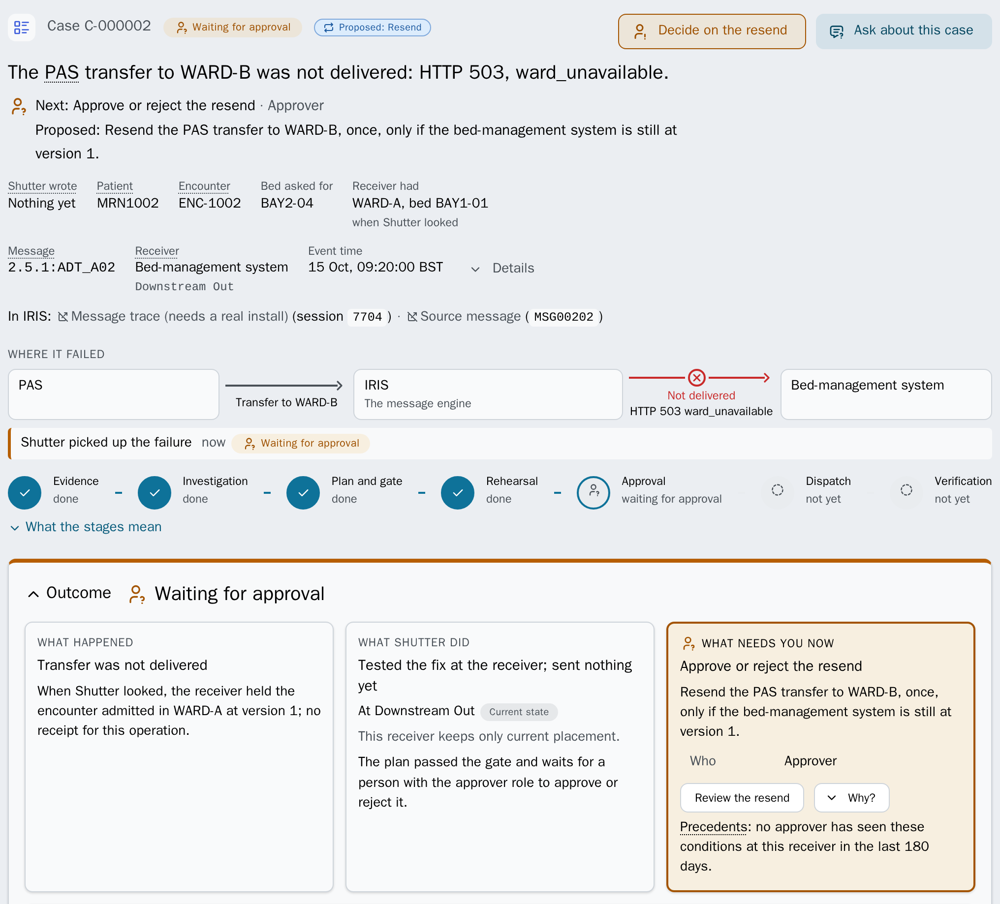

<p align="center">
  
</p>
<h1 align="center">Shutter</h1>
<p align="center"><b>IRIS AI Hub agents for failed HL7 deliveries, in an Interoperability production.</b></p>
<p align="center">The AI board proposes; the gate disposes.</p>
<p align="center">
  <a href="https://github.com/MxSalata/shutter/actions/workflows/ci.yml"></a>
  <a href="https://github.com/MxSalata/shutter/tags"></a>
  <a href="https://mxsalata.github.io/shutter/"></a>
  <a href="https://shutter.mxsalata.com"></a>
</p>
<p align="center">
  <a href="https://mxsalata.github.io/shutter/"><b>Trial</b> (no IRIS)</a> ·
  <a href="https://shutter.mxsalata.com"><b>Online demo</b> (real IRIS)</a> ·
  <a href="https://github.com/MxSalata/shutter#for-judges">For judges</a> ·
  <a href="https://github.com/MxSalata/shutter#what-has-been-measured">Results</a> ·
  <a href="https://github.com/MxSalata/shutter#where-the-agents-sit">The agents</a> ·
  <a href="https://youtu.be/ZBnAqKTfdvM">Two-minute video</a>
</p>
<p align="center"><sub>
  <a href="https://github.com/MxSalata/shutter/blob/main/docs/readme/how-shutter-works.md">How Shutter works (guide)</a> ·
  <a href="https://github.com/MxSalata/shutter/blob/main/docs/readme/integrating-at-your-trust.md">At your trust (guide)</a> ·
  <a href="https://github.com/MxSalata/shutter#try-it">Install (Docker or IPM)</a> ·
  <a href="https://github.com/MxSalata/shutter#limits-plainly">Limits</a> ·
  <a href="https://openexchange.intersystems.com/package/Shutter">Open Exchange</a> ·
  <a href="https://github.com/MxSalata/shutter/blob/main/CHANGELOG.md">What's new</a> ·
  <a href="https://github.com/MxSalata/shutter/releases/download/v1.4.5/shutter-overview.mp4">Two-minute video (MP4)</a> ·
  <a href="https://youtu.be/InZx2MYJ47k">Full demo video (13 minutes, recorded on 1.4.4)</a>
</sub></p>
<p align="center"><sub>Current release 1.4.7; the videos and measurements were recorded on the releases named beside them.</sub></p>

**When a hospital's HL7 delivery fails, the usual fix is Resend, and when two systems move a patient at the same moment, that resend can write over the bed manager's newer ward. Shutter's IRIS AI Hub agents decide how to put the failure right; a deterministic gate decides whether anything is written.**

On an ordinary day a hospital's integration engine can see hundreds of failed messages. Engineers put right what they can by hand, and the rest can go unactioned. Shutter won't fix them all, but it helps with most: in my work on interoperability with 28 NHS hospitals, most failures were of the kinds it knows. It resends the failed patient movements that pass its checks, closes those the receiver already has, and for the rest stops, writes nothing, and identifies the patient for a person to review.

A plain **Resend** can also repeat something the receiver already holds, or revive a cancelled movement.

Shutter turns a failed delivery into a case. AI Hub agents examine sealed evidence and propose a plan. A deterministic gate checks whether it may write. A person, or the site's written policy, releases it. **The agents have no write tool.**

Recovery has different contracts, with different guarantees:

- **Case recovery:** a conditional write through the receiver's API, verified in its receipt and history.
- **FHIR R4, one profile:** a version-aware Encounter update with If-Match on InterSystems IRIS for Health's FHIR server, after a person's approval, verified from the Encounter's history; there is no receiver-side dry run.
- **Outage recovery:** stored HL7 messages resent through the engine, completed in the engine and settled by the receiver's declared duplicate handling. This is not receiver-side verification.


*S8, the same failure played twice on the same evidence. The Rules only run is exempted on purpose from one gate check, `ENTRY_NOT_NAMED_WRITE`, to show what a plain resend writes: WARD-B over the bed manager's WARD-C. The board escalates and writes nothing. On a real case the whole gate runs and holds that resend, so "every check passed" in the picture means every check but the one lifted.*


### In 60 seconds

- **What the agents decide:** resend a failed HL7 delivery, close it as already delivered, or stop and escalate with nothing written. Four business operations, three specialists and a coordinator, read sealed evidence through typed tools; the coordinator submits the plan. They are `Shutter.Bridge.Operation.Agent` items (Agent Conformance, Agent Encounter, Agent Impact, Agent Coordinator), each running the `%AI.Agent` subclass named in its `AgentClass` setting.
- **What permits a write:** a deterministic gate, then a person's approval bound to the plan's digest and the case's version, or a release under the site's written policy (only for a plan Site policy built from a catalogue entry; an agent's plan always waits for a person). For a case recovered through the receiver's API, the receiver is read again just before a conditional write and its own history confirms the result; FHIR and the engine's resend have their own contracts, above. IRIS Workflow carries the approval, `%AI.Policy` authorisation holds each run to its own case and its audit logs every tool call, and Visual Trace shows every agent's lane.
- **What the test found:** release 1.4.3 reran twelve synthetic cases that had influenced fixes, three runs of each per mode: a regression test, not a new held-out evaluation. The board's mean loss was 0.167 against 4.000 for rules only, and no mode executed a wrong write: the gate stopped the bad proposals. The single investigator matched the board at 0.167 once its three disputed F08 runs were settled as right (the unchanged grader scored it 0.667), at about a quarter of the cost per run, so four agents have not shown better decisions than one; both modes ship. [The results](https://github.com/MxSalata/shutter#what-has-been-measured)
- **The whole mechanism:** [How Shutter works](https://github.com/MxSalata/shutter/blob/main/docs/readme/how-shutter-works.md), from a failed delivery to a verified recovery, with every gate check and its source; [How to integrate Shutter at your trust](https://github.com/MxSalata/shutter/blob/main/docs/readme/integrating-at-your-trust.md) for an integration team planning a pilot.
- **Why I built it:** the failures above are the ones I met in my interoperability work with 28 NHS hospitals. At one trust we checked every interface daily for failed messages, and I wrote a 30-page guide to handling them. Not every clinical system checks what it receives. When a bed transfer from I.PM failed to reach NerveCentre and clinicians corrected the history there by hand, resending the failures in order could displace several patients, because NerveCentre won't put two patients in one bed and moves the other to the waiting area. Blindly resending coding messages from NerveCentre to Careflow would overwrite a patient's coding and end-date it as of today, and on older PAS systems a resent A02 for a past spell could reopen it, leaving two active spells. That is why Shutter reads the receiver before it writes. While building Shutter I filed AI Hub bug reports [#11](https://github.com/intersystems-community/ai-hub-eap-bugreports/issues/11), [#12](https://github.com/intersystems-community/ai-hub-eap-bugreports/issues/12), [#22](https://github.com/intersystems-community/ai-hub-eap-bugreports/issues/22) and [#23](https://github.com/intersystems-community/ai-hub-eap-bugreports/issues/23).


*S8's case in IRIS's Visual Trace, from a replay: each board member has its own lane, and the recorded specialists answer in turn within milliseconds. Live, they start together and take 12 to 16 seconds each. [Trace an agent](https://github.com/MxSalata/shutter/blob/main/docs/readme/tracing.md) shows each tool call as its own step.*

## For judges

**Start here: three recorded outcomes, about five minutes, nothing to install and no key.** On each case, read what the agents contributed; on S2, the **Decision receipt** and **What was verified**; on S8, the **Message trace**, the agents' separate lanes.

**Know the mode:** the trial plays recordings in your browser; the online demo runs on real IRIS, where the `demo` account replays the recorded agents and the judges' account calls them live; your machine runs either ([Try it](https://github.com/MxSalata/shutter#try-it)).

Open the [trial](https://mxsalata.github.io/shutter/) and choose **Start with S2** in the welcome dialog. It opens **Scenarios** in Board mode, where **Try these three first** has a card for each, with its own **Run** button (the case numbers below are the trial's; on the demo, open the case the banner names):

1. **S2: recover a transfer that never arrived.** Press **Run S2**, then open the case named by the banner, C-000002 in the trial. Choose **Decide on the resend**, then **Approve the resend** in the review that opens. One conditional write, then **Delivered: verified at the receiver**.

   The two-minute video plays S2 in Site policy mode: the site's policy proposes the resend from the catalogue, with no agent, and a person approves it. In Board mode, as here, the board investigates first.

2. **S3: recognise a delivery that already arrived.** Press **Run S3**. Its case, C-000003 in the trial, reads the receiver's receipt. Only the acknowledgement was lost. Nothing is written.
3. **S8: stop an ambiguous movement.** Press **Run S8 in Board**. Two systems moved the same patient at the same recorded time. Its case, C-000008 in the trial, escalates with **0 writes**. A person must decide. Its **In IRIS:** line opens **Message trace**, the agents' steps in IRIS's Visual Trace (a screenshot in the trial). On the online demo, **Message trace** first asks for a Cloudflare Access sign-in (GitHub or an emailed code), then IRIS's read-only sign-in, `demo-trace` / `Shutter-Demo-IRIS-Portal`; the trial's screenshot needs neither.

**FHIR R4:** on the online demo (not the trial), choose **Site policy** under **Run mode**, then **Run** S35 ([what to look for](https://github.com/MxSalata/shutter/blob/main/docs/readme/fhir.md#try-it-s35)).

**Where the agents beat the catalogue:** held-out case F09, a transfer its source cancelled six minutes later. The catalogue matched a resend; on release 1.0.0 Site policy wrote it in all three runs, and the board and the single investigator escalated in all six ([fair test](https://github.com/MxSalata/shutter/blob/main/docs/readme/fair-test.md#per-case)). Since then the gate also stops that write.

**The browser trial replays recorded workflow and gate outcomes; on IRIS the gate runs on the server.** There, the same gate checks all three. The [trial](https://mxsalata.github.io/shutter/) makes no model call and sends nothing to IRIS, so it leaves out what needs a live instance: the Single investigator, receiver outages, convening the board or reinvestigating a case, free-text questions (the suggested ones are answered from recordings), and the Management Portal, where only S8's **Message trace** has a screenshot. A reload starts the recording afresh.

Then visit the [online demo](https://shutter.mxsalata.com), a fictional hospital running on real IRIS for Health with AI Hub build `2026.3.0AI.154.0`. Its bed manager is a simulated receiver with a versioned HTTP API (`Downstream.API`), reached through Shutter's `Downstream Out` operation (`Shutter.Operation.Ward`), so case recovery runs end to end. Against a plain MLLP receiver Shutter investigates and drafts an email, and in an outage resends through the engine. Its sign-ins:

| Sign-in | What you can do |
| --- | --- |
| `demo` / `shutter` | Read, open the written explanations (live answers need the judges' account), approve waiting cases, and run scenarios from their recordings (no model call, no spend); no reset |
| Judges' account, supplied by the organisers | Run scenarios with live agents or **Convene the board**, one run at a time |

The online demo is one hospital shared by every visitor. If someone else runs the same scenario, its reset of the receiver closes a case of yours still waiting from an earlier run of it; **Run** waits while another visitor's run plays. Run it again if that happens.

The demo resets on the hour to its starting state: for up to a minute it answers with errors, then everyone is signed out and the cases visitors ran are gone. Start a scenario well before the hour. Live spending is capped at 5 USD an hour and 15 USD a day. All judges sign in to the one judges' account, so they share its 2 USD an hour. When that is spent, live runs are refused until the next hour, and the `demo` account still plays the scenarios from their recordings. Shutter admits a live run only when the recorded spend, the estimates reserved for the runs in flight and the new run's own estimate fit within its caps, checking and reserving in one locked step. That bounds estimates, not the bill: a run can cost more than its estimate, and a reservation older than 20 minutes is released, so these caps are no ceiling on the provider's invoice.

**Optional comparison:** under **Run mode**, choose **Rules only**, then press **Run S8 in Rules only** on S8's card. In a recorded scenario played in Rules only, the gate deliberately lifts one check, `ENTRY_NOT_NAMED_WRITE`, which blocks a write that names no catalogue entry where the matched entry calls for no resend. S8 is built to show what that lets through: WARD-B overwrites WARD-C. Every other check still runs. The trial's recorded case, C-000021, is already approved and written. A real case gets the whole gate, which holds that resend. **Compare the two runs** on either case sets them side by side, as in the picture above. This is a demonstration of a plain resend's consequence, not evidence that AI alone prevents it.

**Recipe: from S2's claim to its proof.** In the trial, as its approver; about two minutes. After step 1 above, start at step 4.

- **Goal:** see what allowed S2's one write, and what confirmed it.
- **Steps:**
  1. Open the [trial](https://mxsalata.github.io/shutter/) and choose **Explore on my own**.
  2. Open **Cases**, press the **Waiting for approval** tile (**Show**), then open **C-000002**.
  3. Press **Decide on the resend**, then **Approve the resend**.
  4. Under **4. Gate and decision**, press **At dispatch, after the approval and a fresh read of the receiver**: the checks run again just before the write.
  5. Open **6. What was verified**: the receiver's receipt, read after the write.
  6. Open the **Audit trail** tab: each step, with its time.
- **Done when:** the outcome reads **Delivered: verified at the receiver**, **4. Gate and decision** says "Gate passed 12 of 12 applicable checks at dispatch; approved by approver", and **6. What was verified** says "Verified: Committed and current".
- **If it does not work:** a reload starts the trial afresh, with C-000002 waiting again.

**Then, to judge the complete workflow, as time allows:**

- **Watch:** the [13-minute demo video](https://youtu.be/InZx2MYJ47k) on YouTube, or [download the MP4](https://github.com/MxSalata/shutter/releases/download/v1.4.4/shutter-demo.mp4) (captioned, no sign-in): recorded live on the online demo, from an escalated case to an approved resend verified at the receiver.
- **Inspect:** on S2's case, the **Decision receipt** and **What was verified**, which quotes the receiver's receipt; then S8's **Message trace**, the agents' steps in IRIS's Visual Trace. In the trial that trace is a screenshot of S8's; on IRIS every case opens its own session.
- **The contest's workflow in code:** [CaseWorkflow](https://github.com/MxSalata/shutter/blob/main/src/Shutter/Process/CaseWorkflow.cls) runs the case; the [AI Hub agents](https://github.com/MxSalata/shutter/tree/main/src/Shutter/Agent), three specialists and a [coordinator](https://github.com/MxSalata/shutter/blob/main/src/Shutter/Agent/Coordinator.cls), read the sealed evidence; the coordinator calls [SubmitPlan](https://github.com/MxSalata/shutter/blob/main/src/Shutter/Tools/SubmitPlan.cls); the [gate](https://github.com/MxSalata/shutter/blob/main/src/Shutter/Operation/Gate.cls) checks the plan; an IRIS Workflow task takes the approval; one conditional write follows, and the [verifier](https://github.com/MxSalata/shutter/blob/main/src/Shutter/Operation/Verify.cls) reads the receiver's receipts and history.

## How it works

A **receiver** is the system the message was going to. A **receipt** is that receiver's own record of a message it holds.

### A case, from evidence to decision

1. **Seal the evidence.** One snapshot, with a digest, holds the message, receiver state, receipt and history, other operations for the encounter, and the catalogue match.
2. **Propose a plan.** The board reviews that evidence and records its reasons and any specialist it overruled.
3. **Check the plan.** The [gate](https://github.com/MxSalata/shutter/blob/main/src/Shutter/Operation/Gate.cls) checks identity, conformance, intent, ordering, state transition, effect, authorisation, rehearsal, concurrency, freshness, receiver capabilities and the catalogue. An unknown blocks a write as a failed check does.
4. **Rehearse, then bind the release.** Once the gate passes a write, the receiver dry-runs the exact action. The approval binds the plan's digest, the evidence, that dry run, the gate's policy version, the site profile's version, and the receiver's version and epoch, and it expires after an hour by default. If one of them changes, the approval is void; refreshed evidence keeps it only when nothing material changed.
5. **Recheck, write once, then verify.** After release Shutter reads the receiver again and the gate runs a second time, checking the approval and its dry run against that read. One conditional write follows, and the receiver's receipt and history settle what happened.

A **catalogue** entry describes a known failure and its safe outcome. The **site profile** is the site's written policy, including what each receiver permits and what needs a person. The shipped non-demo profile asks a person before every resend.

For an API-recovery incident, one approval binds the incident's plan. Its cases become chains per encounter, released in order, each item's own evidence, dry run and dispatch checks completed before the next proceeds.



### Two recovery contracts

| | Case recovery through the receiver's API | Outage recovery through the engine |
| --- | --- | --- |
| **What is sent** | One mapped operation, not the original HL7 message | Stored HL7 messages that never arrived, unchanged and in order |
| **What the receiver must offer** | Versioned reads, conditional writes, receipts, readable history and non-mutating dry runs | A watched receiver configured for `engine_resend`; a current-state or history-of-record receiver must also declare `ack_level: application` |
| **Release** | Approval bound to the exact plan, or release under the site's written policy | One approval bound to the offered set |
| **Completion evidence** | **Verified at the receiver:** the operation is read back in its receipt and history | **Completed in the engine:** each new header's delivery outcome. What a completed header proves at the receiver is what the site declared in `ack_level`, not something Shutter establishes |
| **Duplicates** | The receipt and history establish what the receiver holds | The receiver's declared duplicate answer closes a message as already delivered. Where duplicate refusal is not declared, the approver first checks the receiver and confirms it |
| **What is not claimed** | A guarantee beyond the receiver API's contract | Shutter reads nothing at the receiver and does not claim receiver-side verification |

A FHIR R4 receiver is a third, narrower contract: one version-aware update (`If-Match`) with no dry run and no receipt; its completion evidence is the version carrying Shutter's marker in the Encounter's history, read back by id when the receiver's answer named it ([fhir.md](https://github.com/MxSalata/shutter/blob/main/docs/readme/fhir.md)).

Outside an outage, the case of a plain MLLP receiver with no API and no FHIR entry gets investigation and a drafted email, never a resend from the case.

The [receiver contract](https://github.com/MxSalata/shutter/blob/main/docs/readme/receiver-contract.md) defines the API path. [CONTRACTS 17.8](https://github.com/MxSalata/shutter/blob/main/docs/CONTRACTS.md#178-the-send-v151-to-v154) defines the engine resend.

## Where the agents sit

The board is four business operations inside the production, not an external service attached to its logs. Each is a `Shutter.Bridge.Operation.Agent` item (Agent Conformance, Agent Encounter, Agent Impact, Agent Coordinator) running the `%AI.Agent` subclass named in its `AgentClass` setting:

| Member | Its view |
| --- | --- |
| Conformance specialist | The message |
| Encounter specialist | The encounter's history |
| Impact specialist | The effect on the receiver |
| Coordinator | The specialists' findings, combined into one plan with reasons and recorded dissent |

The specialists run in parallel. Their typed tools read the sealed evidence and search interface knowledge, and each run ends with a submit tool that returns a finding or a plan; no tool writes to a receiver. Case-scoped authorisation, a pinned list of tool names and evidence-reference checks constrain each run. Every tool call is audited in the production's **Visual Trace**.

**Four modes make the comparison explicit:**

- **Board:** three specialist findings and a coordinated plan.
- **Single investigator:** one live agent with the same evidence, tools and gate. It has no recording, so it runs live only: not in the trial or the `demo` account's replays.
- **Site policy:** recognised failures settled by written policy without a model; unresolved ones go to the board. The default for a watched production's failures.
- **Rules only:** the plain-resend baseline, subject to the whole gate, except in a recorded scenario, where one catalogue check is lifted so that S8 can show what a plain resend writes.

The board's measured advantage is **not better decisions than one agent**. In the release 1.4.3 rerun (12 cases, 36 runs in each of the two modes) the board equalled the single investigator, 0.167 each as settled with no wrong write, at about 3.8 times the cost: 0.480 against 0.127 USD a run. What the board supplies is separate review perspectives, kept dissent and reasoning a person can review. The single investigator is the economical choice.

Also included: **Ask Shutter** about the page on screen, a read-only production review, and audited read-only MCP access to cases, evidence and plans.

[Agent source](https://github.com/MxSalata/shutter/tree/main/src/Shutter/Agent) · [AI Hub integration](https://github.com/MxSalata/shutter/blob/main/docs/readme/ai-hub.md) · [Trace an agent, step by step](https://github.com/MxSalata/shutter/blob/main/docs/readme/tracing.md)

## What has been measured

Every figure below names its cases, its runs and its release. The cases are synthetic, and nothing here was measured at a hospital.

### The latest rerun: release 1.4.3, 12 cases, three runs each

On 11 November 2026 all twelve held-out cases were played again on release 1.4.3: three runs of each case in each mode, the agent modes live on `claude-opus-5-5`, on AI Hub build `2027.1.0AI.109.0` (the newer of the two supported builds; the online demo runs `2026.3.0AI.154.0`). **It is a regression rerun on cases that have influenced fixes since release 1.0.0, not a new held-out test,** and the instance was upgraded in place, not installed fresh. No later release has been rerun.

Loss runs from **0 for a right outcome to 20 for a wrong write executed**. It is not a recovery rate: in all three board runs of F08 the answer graded right and the case still ended blocked for a person, although the receiver had committed the operation.

| Mode, release 1.4.3, with the cases and runs scored | Mean loss | Wrong writes executed | USD per run |
| --- | ---: | ---: | ---: |
| Board: 12 cases, 36 runs | 0.167 | 0 | 0.480 |
| Single investigator: 12 cases, 36 runs | 0.167 as settled, 0.667 by the unchanged grader | 0 | 0.127 |
| Site policy with a live board: 10 cases, 29 runs (not F03 or F12) | 0.900 | 0 | 0.040 |
| Rules only: 12 cases, 36 runs | 4.000 | 0 | 0 |
| Always escalating, computed once per case: 12 cases, not played | 1.250 | 0 | 0 |

**No mode executed a wrong write in this rerun:** the gate stopped the ones Site policy and Rules only proposed. The board, and the single investigator as settled, graded as on release 1.0.0 and made the same 12 writes, all verified. The single investigator's 0.667 counts F08's three runs as false closures (0.500 on 1.0.0, where two runs took that path); the fair-test page gives both readings, and no blind re-grade was done this time.

### The original full comparison: release 1.0.0, 12 cases, 36 runs in each mode

Twelve synthetic held-out cases, three runs of each case in each mode, live agents on `claude-opus-5-5`, played on 6 and 8 November 2026. Cases, expected outcomes and scoring were hashed before the runs and published with them, but this was not an independently sealed evaluation. **These figures are historical:** the wrong writes in this table were executed on release 1.0.0, and the 1.4.3 rerun above executed none.

| Mode, release 1.0.0 | Mean loss | Wrong writes executed, of 36 runs | USD per run |
| --- | ---: | ---: | ---: |
| Board | 0.167 | 0 | 0.48 |
| Single investigator | 0.167 or 0.500, depending on the F08 grading described below | 0 | 0.13 |
| Site policy, tested without a model key | 3.500 | 3 | 0 |
| Rules only | 5.000 | 3 | 0 |
| Always escalating, computed once per case, not played | 1.250 | 0 | 0 |

Board and single investigator each produced 30 right and 6 defensible answers out of 36 runs. Treating defensible answers as free gives both a mean loss of 0.000. The single investigator scores 0.500, not 0.167, if two F08 runs are graded on their second plan. While their first plan, a resend, waited for approval, the receiver committed the slow original delivery; the gate voided the approval, nothing was sent, and the case closed on the receipt. The unchanged grader reads the second plan; this page and a blind re-grade read the first ([the one disagreement](https://github.com/MxSalata/shutter/blob/main/docs/readme/fair-test.md#the-one-disagreement-and-how-it-was-settled)).

Site policy's three board cases had no model key and fell back to a plain resend. Its row is not a measurement of Site policy with a live board.

**What the agents added over no model, on release 1.0.0:** both agent modes lost 0.167, against 1.250 for always escalating and 3.500 for Site policy without a key. On F04 and F09 the catalogue's match pointed the wrong way; Site policy followed it, and the agents read the entry against the evidence and escalated.

### Follow-up evidence, with its scope

| Evidence | What it establishes |
| --- | --- |
| **Release 1.3.2, F03 and F07: 2 cases, 6 runs in each agent mode** | Both cases closed correctly in every board and single-investigator run, three runs each, with F07 using the shipped `show` setting |
| **Catalogue demonstration, S1 to S10 and S13: 11 scenarios, recorded live on 25 October 2026, before release 1.0.0** | The board reached all 11 expected outcomes, live and in replay, with the catalogue's preferred outcome supplied to it |

**Sonnet 5.5 specialists with an Opus 5.5 coordinator: the same grades as the all-Opus board in all 36 runs of the twelve cases on release 1.1.1, at 0.331 USD a run against 0.527.** Both boards graded 0.667 there (0.500 with F03 settled as right), not 0.167, because the 1.1.x gate held two right plans, F03 and F07.

Separately, on release 1.0.0, an all-Sonnet 5.5 board reached the same grades as the Opus 5.5 board in all 36 runs of the full comparison, at 0.24 USD per run against 0.48; its plans differed only on F09, where both write nothing.

[All twelve on 1.4.3](https://github.com/MxSalata/shutter/blob/main/docs/readme/fair-test.md#release-143-all-12-cases-rerun) · [Full comparison on 1.0.0, scoring and every run](https://github.com/MxSalata/shutter/blob/main/docs/readme/fair-test.md) · [F03 and F07 on 1.3.2](https://github.com/MxSalata/shutter/blob/main/docs/readme/fair-test.md#release-132-f03-and-f07-live) · [What the catalogue demonstration does and does not show](https://github.com/MxSalata/shutter/blob/main/docs/readme/evaluation.md)

## Try it

### Docker: replay first, no key

You need Docker, at least **5 GB of memory** and about **25 GB of disk**. The replay edition pulls a roughly **6 GB image**, then is healthy in about **8 minutes on 8 cores**.

```sh
git clone https://github.com/MxSalata/shutter.git
cd shutter
./install.sh --replay
```

Open http://localhost:52773/shutter/index.html and choose **Not now** if offered the trial.

The installer checks Docker, Compose, memory, disk, ports and the image before changing anything. The replay edition uses public IRIS for Health Community 2026.2. It needs no AI Hub Early Access file.

### Live agents instead

Get AI Hub Community build `2027.1.0AI.109.0` from the [Early Access portal](https://evaluation.intersystems.com/Eval/early-access/AIHub). If you installed the replay edition first, [switch editions](https://github.com/MxSalata/shutter/blob/main/docs/readme/running.md) before this: `install.sh` refuses an `.env` made for the other edition. Copy `.env.example` to `.env` and set `ANTHROPIC_API_KEY` for live agents, then:

```sh
./install.sh --image-file irishealth-community-2027.1.0AI.109.0-docker.tar.gz
```

Build `2026.3.0AI.154.0` is also supported. With both images loaded, `./install.sh` chooses 109. Without a configured provider, the board replays recordings; it does not run a local model.

A replay makes no model call and executes no tool. It restores a recorded answer and tool calls, marked **replay**, then runs the gate against the plan.

### Sign-ins and first checks

| Where | Sign-in |
| --- | --- |
| Local web app | `approver` / `shutter` approves; `operator` / `shutter` runs and reads but cannot approve |
| Local [Management Portal](http://localhost:52773/csp/sys/UtilHome.csp) | `_SYSTEM` / `SYS`, namespace `SHUTTER`; use `approver` / `shutter` for the Workflow inbox |
| Online demo's read-only [Shutter in IRIS](https://shutter.mxsalata.com/csp/healthshare/shutter/Shutter.Portal.Guide.cls) | After GitHub or emailed one-time-code sign-in, `demo-trace` / `Shutter-Demo-IRIS-Portal` |

Run S2, S3 and S8 as above. Then try S2's approval as an operator, submit it from two tabs, or approve its Workflow task with an empty plan digest. The expected results are refusal, one write only, and no dispatch respectively.

[Exact steps and expected answers](https://github.com/MxSalata/shutter/blob/main/docs/readme/first-steps.md) · [Windows, Apple silicon, ports and edition switching](https://github.com/MxSalata/shutter/blob/main/docs/readme/running.md) · [Troubleshooting](https://github.com/MxSalata/shutter/blob/main/docs/readme/troubleshooting.md)

### IPM on a stock AI Hub image

With a clone at `<module>` inside the container:

```objectscript
Do $SYSTEM.OBJ.Load("<module>/src/Shutter/Setup.cls", "ck")
Write ##class(Shutter.Setup).CreateNamespace("SHUTTER")
Do $SYSTEM.OBJ.Delete("Shutter.Setup")
zn "SHUTTER"
Do $SYSTEM.OBJ.Load("<module>/vendor/ipm/zpm-0.10.10.xml", "ck")
zpm "repo -reset-defaults"
zpm "install iris-shutter"
```

`Shutter.Setup` is needed only to make the namespace, so its copy in the namespace you started from is deleted: start from a namespace that has no Shutter in it (USER on a stock instance), or the delete removes that install's setup class. `repo -reset-defaults` prints IPM's own warning about `-password`; the command passes none and the public registry needs none. The last command installs the registry's latest version, which can lag this repository; `zpm "list"` shows the version installed. For the exact clone, replace the last two lines with `zpm "load <module>"`. On plain IRIS for Health Community 2026.2, with no AI Hub, load the core instead, `zpm "load <module>/core"`, which replays recorded agent runs ([INSTALL.md](https://github.com/MxSalata/shutter/blob/main/docs/INSTALL.md)). This installs the demo, which the web app plays as above. To play scenarios from a terminal with `tests/e2e/scenario_check.py`, first clear the stock image's password-change flag, or the check cannot read the demo receiver as `_SYSTEM` and reports `downstream None None`: in `%SYS`, `Do ##class(Security.Users).UnExpireUserPasswords("*")`, on a demo instance only (the call clears the flag for every user; the Docker route does it for you). Then `python3 tests/e2e/scenario_check.py --url http://localhost:52773 --approve S2 S3 S8`.

[Installation, upgrades and uninstall](https://github.com/MxSalata/shutter/blob/main/docs/INSTALL.md)

## At your site: investigate first, enable recovery deliberately

Install in a dedicated namespace with `-Ddemo=0`, without the demo users or receivers. Map your users to the operator and approver roles, and your approvers to the Workflow role.

**Start on captured synthetic traffic in a sandbox.** Onboarding edits the watched production: it renames the site's `Ens.Alert`, adds items and maps classes. That production then depends on Shutter's database to start. The module's `Hospital` and `Downstream` packages can also collide with a site's classes; a dedicated namespace matters.

A non-demo installation starts in **shadow mode**. It investigates and records proposals but sends no rehearsal, recovery write, blind-resend preview, outage resend or escalation email until recovery is enabled. Email has one exception: `notifications.shadow_delivery: "enabled"` in the site profile lets escalation emails go out in shadow mode. Enabling recovery does not send the emails that shadow mode held back.

Before enabling it:

- **Prove the receiver contract.** Run the [receiver conformance kit](https://github.com/MxSalata/shutter/blob/main/docs/receiver-conformance.md) against a test endpoint. It reports what was demonstrated and enables nothing.
- **Test the stop.** **Stop Shutter recovery** refuses Shutter's recovery calls. An outage resend halts before its next message. It does not stop the hospital's feed, and an already admitted call may complete.
- **Arrange notification.** Outage mail and open-case reminders are opt-in. “Escalated” does not mean someone has been notified.
- **Decide the data flow.** Live agents send evidence to the configured provider, Anthropic by default. Known case identifiers become per-case tokens, demographics are dropped, and notes become flags unless free text is enabled. Identifiers appearing only in receiver or engine free text can still reach the model.
- **Keep the provider genuinely off if required.** Omitting a key on a new instance leaves no provider. A previously configured provider stays until `SELECT Shutter.Setup_ClearProvider()` removes it.

The failure census can compare watched failures with opened cases. A redacted case bundle supports audit and handoff; warehouse history can inform a person without enabling writes.

**A trust's own rules are not supported yet.** [A worked example](https://github.com/MxSalata/shutter/blob/main/docs/readme/local-rules.md) shows the proposed design of a local stop rule, which sends a trust's own pattern to a person; none of it is implemented.

[Five-step pilot](https://github.com/MxSalata/shutter/blob/main/docs/readme/first-steps.md#pilot-it-first) · [Pilot decision pack](https://github.com/MxSalata/shutter/blob/main/docs/pilot/00-decision-record.md) · [Clinical safety, hazards and data flow (a review of 1.0.0, current controls at its top)](https://github.com/MxSalata/shutter/blob/main/docs/SAFETY.md)

<a id="documents"></a>

## Documents and pathology: no agent decides, and no case resends

These failures sit outside patient movements. In both kinds no agent is convened and the case itself resends nothing: a person decides.

### Documents: MDM exceptions without a blind resend

Where document handling is switched on in both places, the receiver's site profile entry and its source's Shutter Forwarder, a failed **MDM^T01 to T11**, including **MDM^T02**, becomes a document exception at any size: the Forwarder posts the document's metadata, not the message, so the ordinary 2 MB forwarding limit is lifted. So does an **ORU^R01** with an OBX whose OBX-2 says ED or RP; a report sent as Base64 under TX or ST takes the ordinary path. Without a document profile, a failed MDM gets the ordinary case instead, with the message copied into Shutter's store, and one over 2 MB gets no case.

The case shows the document's identity, status and chain for a person to review, never its content: the document number, the parent, every PID-3 identifier, the statuses and the delivery, and what the message store holds for that document. Shutter keeps no copy of the message: an **MDM^T02's Base64 document** stays in the source's message store. A drafted email supports the handoff; a draft is not proof that anyone was notified.

<a id="pathology"></a>

### Pathology: ORU^R01 results, findings and outage recovery

**An individual failure is investigated, not resent.** Its case carries the receiver's own response, the OBX it names and findings about characters above plain ASCII. The escalation draft names the relevant fields but takes no result value, units or comment.

**An eligible outage is recovered through the engine.** At a receiver configured for `engine_resend`, Shutter lists the messages that never arrived. After one approval, **Engine Resend** sends them unchanged, one at a time, in order, stopping at the first message that does not complete. These resends are **completed in the engine**, with the duplicate-handling contract above. An unknown send result is read again from its new engine header for up to seven days, without sending again.

**What cannot safely join that set is held:** a newer message on the same or a linked order; a newer patient message that cannot be shown to concern another order; a patient merge or identity change; an unresolved case on the same order; evidence Shutter cannot read; and a message whose “never sent” cannot be established. Shadow mode and **Stop Shutter recovery** hold this path too.

**Release scope:** outage lists and findings from 1.3.0, approved engine resend from 1.4.0, settlement of late outcomes from 1.4.1.

**On the online demo (since 1.4.6):** two optional paths on the Scenarios page, P1 (a result the demo's results system refuses) and P2 (that receiver's outage, recovered under one approval), both played on a stand-in receiver inside the instance, with no agent and no model call ([scenarios.md](https://github.com/MxSalata/shutter/blob/main/docs/readme/scenarios.md#pathology-on-the-demo)).


[Document exceptions and their contract](https://github.com/MxSalata/shutter/blob/main/docs/CONTRACTS.md#112-document-exceptions) · [Outage recovery contract](https://github.com/MxSalata/shutter/blob/main/docs/CONTRACTS.md#178-the-send-v151-to-v154) · [Release history](https://github.com/MxSalata/shutter/blob/main/CHANGELOG.md)

## FHIR R4: one ward move on an existing Encounter

An optional FHIR R4 profile repairs one failed A02 as a ward-location update to an existing, in-progress Encounter, by another route than the original HL7 delivery. It sends at most one person-approved PUT per approval with the ETag the receiver returned in `If-Match`. Before closing the case it finds the version carrying its marker in the Encounter's history as the receiver returned it, reads that version back by its version id when the receiver's answer named one, checks it against the approved base, and checks that the current record has not undone the move. This profile has no receiver-side dry run, and says so on every decision. A 412 is not retried. Any further write needs fresh evidence and a new approval. A lost answer is reconciled through the receiver's history and never resent, and an incomplete or untrusted history may leave it unknown for good. Version ids and ETags are kept as the server gave them. Version ids are not treated as numbers. Verification concerns the Encounter record, not the patient's physical location or delivery to any downstream system. No agent plans a FHIR case: Rules only proposes the one update, every other mode follows the catalogue's one matching entry, and anything else goes to a person. In this release the receiver must be InterSystems IRIS for Health's own FHIR R4 server. On a demo install, the online demo included (not the trial), scenario S35 plays it against Shutter's own test FHIR server, held to the answers IRIS for Health's server gave when measured; the run against IRIS for Health's own FHIR server is in [receipt-fhir.md](https://github.com/MxSalata/shutter/blob/main/docs/readme/receipt-fhir.md).

It runs end to end in CI on an IRIS for Health 2026.2 instance against Shutter's own test FHIR server, which is held to the answers InterSystems IRIS for Health's FHIR server gave when measured (2026.2, 2026.3.0AI Build 154 and 2027.1.0AI Build 109 answered alike on the write path; the conformance file's 234 exchanges for IRIS for Health were run against Build 109). It was also run against IRIS for Health's own FHIR server (2026.2 and 2026.3.0AI Build 154, 14 November 2026); the request, the answers and the history are in [receipt-fhir.md](https://github.com/MxSalata/shutter/blob/main/docs/readme/receipt-fhir.md).

No other recovery writes over FHIR: no create, no admission or discharge, no merge, no documents, no Provenance, no `$validate` as a rehearsal. Details and limits: [fhir.md](https://github.com/MxSalata/shutter/blob/main/docs/readme/fhir.md).

## How it is tested

**Release checks and agent evaluations are different evidence.** The latest release checks below are for the 1.4.7 tag; the latest comparative agent evaluation remains the 1.4.3 rerun.

| Scope | Recorded checks |
| --- | --- |
| **Release 1.4.7** | CI on the tagged commit ([run 49](https://github.com/MxSalata/shutter/actions/runs/43624412267)): the web and browser suites and three IRIS shards, 1,276 unit tests, the scenario checks with FHIR's S35 among them, the FHIR conformance kit (244 exchanges) and the pathology check. The same IRIS job ran 13 full rounds on the tag with no failure. A fresh install on AI Hub build 154 is recorded step by step in [its receipt](https://github.com/MxSalata/shutter/blob/main/docs/readme/receipt-1.4.7.md) |
| **Release 1.4.3** | 1,083 unit tests passed on AI Hub build 154 and 1,074 on IRIS 2026.2, none failed. Role checks covered judges running but not resetting, upgraded permissions and attribution of scenario runs. Web and relevant browser suites included accessibility checks |
| **Pathology, release 1.4.0** | All 56 pathology-rig rows passed on build 154. An end-to-end check counted receiver sends under shadow mode and the recovery stop |
| **Replay CI, figures at 1.1.0** | Full installation on IRIS 2026.2, 37 receiver-contract tests, 26 scenarios end to end and approval-boundary attacks over HTTP |
| **AI Hub installs and live agents** | Separate fresh-install checks on builds 109 and 154 on release 1.0.0 (6 November 2026), and on build 154 on release 1.4.7 (14 November, no live call), recorded live runs, and live comparative tests up to the 1.4.3 rerun. CI cannot download the Early Access image, so replay CI does not replace this evidence |

The approval boundary tests stale versions, wrong digests, insufficient roles, repeated approval and a receiver changed after approval. Privacy checks inspect recordings.

[Release-specific checks](https://github.com/MxSalata/shutter/blob/main/CHANGELOG.md) · [Approval boundary](https://github.com/MxSalata/shutter/blob/main/docs/readme/first-steps.md#the-approval-boundary-attacked-over-http) · [Build 109 evidence](https://github.com/MxSalata/shutter/blob/main/docs/readme/receipt-109.md) · [Build 154 evidence](https://github.com/MxSalata/shutter/blob/main/docs/readme/receipt.md)

## Technology bonuses

Each technology has a job in the workflow.

| Technology | What it does and where to inspect it |
| --- | --- |
| **Workflow Engine** | `EnsLib.Workflow` tasks bind approvals to the plan digest: [case workflow](https://github.com/MxSalata/shutter/blob/main/src/Shutter/Process/CaseWorkflow.cls), [incident workflow](https://github.com/MxSalata/shutter/blob/main/src/Shutter/Process/IncidentWorkflow.cls) |
| **IRIS Vector Search** | Agents search interface knowledge in IRIS vector tables through `%AI.RAG.VectorStore.IRIS`: [Library.cls](https://github.com/MxSalata/shutter/blob/main/src/Shutter/Knowledge/Library.cls). Every recorded agent run searches at least once. In the trial, open S8's case (C-000008), then an agent's **Recorded tool calls**: the Coordinator's first call is `search_playbooks`, the Encounter specialist's `search_lifecycle` |
| **Embedded Python** | `zoneinfo` resolves IANA feed time zones for event ordering: [Time.cls](https://github.com/MxSalata/shutter/blob/main/src/Shutter/Util/Time.cls) |
| **Custom Adapter** | An inbound adapter walks the HL7 index for the encounter's other messages: [Adapter.cls](https://github.com/MxSalata/shutter/blob/main/src/Shutter/Index/Adapter.cls) |
| **Java PEX** | HAPI 2.6.0 provides an independent Second Parser when IRIS cannot read a message: [PEX implementation](https://github.com/MxSalata/shutter/tree/main/pex). An IPM install needs `pex/build.sh` before this item runs |
| **Docker** | Reproducible demo installation: [Compose](https://github.com/MxSalata/shutter/blob/main/docker-compose.yml), [Dockerfile](https://github.com/MxSalata/shutter/blob/main/Dockerfile) |
| **IPM** | Published package `iris-shutter`, for IRIS 2026.3 or later: [module.xml](https://github.com/MxSalata/shutter/blob/main/module.xml) |
| **Community Opportunity DPI-I-689** | Interoperability as the agent tracing tool: [idea](https://ideas.intersystems.com/ideas/DPI-I-689), [reproduce the trace](https://github.com/MxSalata/shutter/blob/main/docs/readme/tracing.md) |
| **Online demo** | A [real IRIS production](https://shutter.mxsalata.com) with a fictional hospital and a new failure every seven minutes. The browser-only trial is separate |
| **AI Hub bug reports** | [#11](https://github.com/intersystems-community/ai-hub-eap-bugreports/issues/11), [#12](https://github.com/intersystems-community/ai-hub-eap-bugreports/issues/12), [#22](https://github.com/intersystems-community/ai-hub-eap-bugreports/issues/22), [#23](https://github.com/intersystems-community/ai-hub-eap-bugreports/issues/23), [#24](https://github.com/intersystems-community/ai-hub-eap-bugreports/issues/24) |
| **Embedded Python bug reports** | [#26](https://github.com/intersystems-community/python-bugreports/issues/26), [#27](https://github.com/intersystems-community/python-bugreports/issues/27) |
| **Articles** | [Building on AI Hub](https://community.intersystems.com/post/building-shutter-iris-ai-hub-what-worked-what-was-hard-and-what-it-cost), [testing the recovery gate](https://community.intersystems.com/post/what-failed-when-i-tested-my-hl7-recovery-gate), [integrating at a site](https://community.intersystems.com/post/integrating-shutter-your-organisation-one-namespace-time) |
| **Questionnaire** | Submitted on 3 November 2026 |
| **Video** | [Demo video on YouTube](https://youtu.be/InZx2MYJ47k); the [MP4 with captions](https://github.com/MxSalata/shutter/releases/download/v1.4.4/shutter-demo.mp4) is attached to the [1.4.4 release](https://github.com/MxSalata/shutter/releases/tag/v1.4.4) |

**See the tracing idea in one case:** run S8 in Board mode, then choose **In IRIS: Message trace**. Each agent has its own lane, and its response records model, mode, tokens and tool calls; [Trace an agent](https://github.com/MxSalata/shutter/blob/main/docs/readme/tracing.md) shows each tool call as its own step. Replay is explicitly marked. In the trial this opens a screenshot; on an installed instance it opens the session's Visual Trace.

[AI Hub features, constraints and implementation experience](https://github.com/MxSalata/shutter/blob/main/docs/readme/building-on-ai-hub.md)

## Limits, plainly

- **No clinical safety case.** No standard is claimed as met and no DCB0129 manufacturer's work has been done for Shutter; DCB0160 at a deploying site is that site's. [Safety review](https://github.com/MxSalata/shutter/blob/main/docs/SAFETY.md) · [Safety case template](https://github.com/MxSalata/shutter/blob/main/docs/pilot/10-safety-case-template.md)
- **No hospital outcome study.** Coverage and operational benefit have not been measured at a hospital. Recovery evidence uses synthetic cases with demo receivers, test servers or InterSystems IRIS for Health's own FHIR server; none establishes hospital outcomes.
- **The receiver remains part of the safety boundary.** Ignoring conditional writes or returning incomplete history may escape detection. A receiver that writes during a declared dry run has already acted; Shutter can record and stop, not undo it.
- **An approval is not a substitute for feed validation.** Sites must confirm identifiers, event meanings, location fields and times before enabling recovery.
- **Model failure does not authorise a write.** Depending on the case, Shutter escalates, uses available findings or proposes a rules plan. A fallback plan requires a person even where policy would otherwise release it.
- **Large incidents need a full review.** One approval binds every chain, although the Workflow task lists only those fitting its 2,000-character message. The incident page has the full set. Complete release at 1,000 failures has not been measured.
- **Failover, mirrors and backup restoration are untested.**
- **FHIR R4 is one profile, not general FHIR handling.** One ward move on an existing, in-progress Encounter held by InterSystems IRIS for Health's FHIR R4 server, off until a site turns it on for a receiver. No create, no admission or discharge, no bed move, no merge, no documents. It has no receiver-side dry run and says so on every decision.
- **The catalogue guides the agents.** In the scenario demonstration each agent is given the matching entry and its preferred outcome, and the coordinator took it in 24 of the 25 board plans recorded between 25 October and 1 November 2026, before release 1.0.0. The original held-out evaluation tested judgement beyond these demonstrations; later reruns used cases that had influenced fixes.

[Every limit, with effect, workaround and status](https://github.com/MxSalata/shutter/blob/main/docs/readme/limits.md) · [Failure scenarios and their boundaries](https://github.com/MxSalata/shutter/blob/main/docs/edge-cases.md) · [What happens when a model fails](https://github.com/MxSalata/shutter/blob/main/docs/readme/model-fails.md)

## How Shutter was developed

I set Shutter's requirements and made its architectural and safety decisions, including the deterministic gate, approval tied to the exact plan and verification at the receiver. I tested the trial and the online demo myself, sent back the changes I wanted, and decided each release.

Shutter was built with substantial AI assistance: coding assistants wrote much of the code and documentation under my direction, and I used model-based review workflows. I take responsibility for the published project.

---

Shutter is an entry in the InterSystems Programming Contest **AI Agents in Interoperability Workflows**, [contest 49](https://openexchange.intersystems.com/contest/49).

[Open Exchange](https://openexchange.intersystems.com/package/Shutter) · [Changelog](https://github.com/MxSalata/shutter/blob/main/CHANGELOG.md) · [Releases](https://github.com/MxSalata/shutter/releases)
