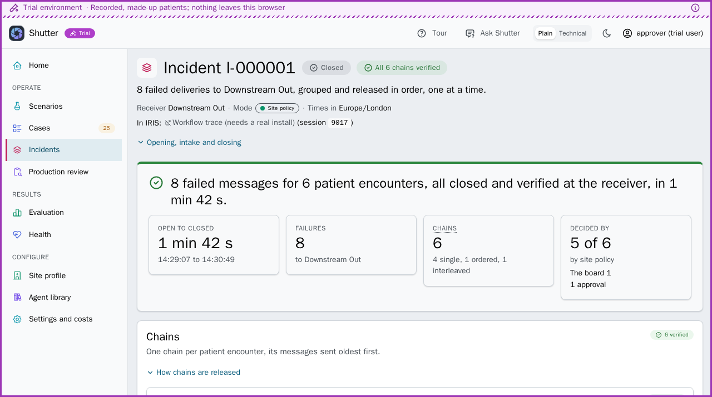
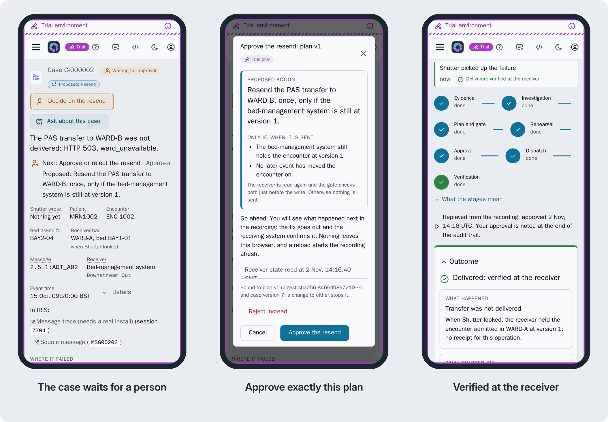

# Shutter: AI Hub agents for failed HL7 deliveries

**When a hospital's HL7 delivery fails, the usual fix is Resend, and when two systems move a patient at the same moment, that resend writes over the bed manager's ward with every check passed. Shutter's IRIS AI Hub agents decide how to put the failure right; a deterministic gate decides whether anything is written.**

On an ordinary day a hospital's integration engine can see hundreds of failed messages. Engineers put right what they can by hand, and the rest can go unactioned. Shutter won't fix them all, but it helps with most of the failed patient movements it can see: it resends the ones that pass its checks, and for the rest it stops, writes nothing, and names the patient a person needs to review.

Shutter is about delivery, not diagnosis: it resends what the failed message asked for, unchanged, or not at all, and shows why. Recovery needs a receiver with an API; a plain MLLP receiver gets the investigation and a drafted escalation, never a resend.

**What can go wrong when you resend:** a nurse moves the patient while a resend waits, the receiver refuses it as "duplicate" with nothing filed, the clocks go back, a merge has since been undone by hand. [The list](https://github.com/MxSalata/shutter/blob/main/docs/edge-cases.md) says what Shutter does about each and what it doesn't cover yet.

**For judges, in about three minutes, with nothing to install:**
1. Open the [trial](https://mxsalata.github.io/shutter/) and press **Explore on my own**.
2. In **Scenarios**, choose **Rules only**, press **Run** on S8, then open its case: "Wrote WARD-B over the bed manager's WARD-C", with every check passed.
3. Choose **Board**, run S8 again and open C-000008: escalated, **0 writes**, and the patient named for a person to review.
4. On that case, under **In IRIS:**, press **Message trace (screenshot)**. To see the real thing, [the demo's IRIS](https://shutter.mxsalata.com/csp/healthshare/shutter/Shutter.Portal.Guide.cls) is read only, after a sign-in ([details](https://github.com/MxSalata/shutter#try-it)).

[](https://github.com/MxSalata/shutter/actions/workflows/ci.yml) [](https://github.com/MxSalata/shutter/blob/main/LICENSE)

**Jump to:** [Take the agents away](https://github.com/MxSalata/shutter#take-the-agents-away) · [Try it](https://github.com/MxSalata/shutter#try-it) · [How it works](https://github.com/MxSalata/shutter#how-it-works) · [Where the agents sit](https://github.com/MxSalata/shutter#where-the-agents-sit) · [AI Hub](https://github.com/MxSalata/shutter#ai-hub-inside-shutter) · [Bonuses](https://github.com/MxSalata/shutter#technology-bonuses) · [What can go wrong when you resend](https://github.com/MxSalata/shutter#what-can-go-wrong-when-you-resend) · [Testing](https://github.com/MxSalata/shutter#how-it-is-tested) · [Limits](https://github.com/MxSalata/shutter#limits-plainly) · [Run details](https://github.com/MxSalata/shutter#run-details)

**Trial** [mxsalata.github.io/shutter](https://mxsalata.github.io/shutter/) | **Online demo** [shutter.mxsalata.com](https://shutter.mxsalata.com) | **A real IRIS, read only** [Shutter in IRIS](https://shutter.mxsalata.com/csp/healthshare/shutter/Shutter.Portal.Guide.cls) | **Video** [link at submission] | **Articles** [link at submission] | **Open Exchange** [link at submission]

*Why I built it:* my background is interoperability with 28 NHS hospitals in the UK, and real testing of an integration only happens in production, where a receiver behaves in a way nobody foresaw, a message arrives out of order, or someone fixes something by hand. Shutter is a safety net for those cases, made for a clinical setting, where a wrong write has a patient on the other end.

Instead of a **Resend** in the Message Viewer, Shutter makes each failed delivery a case: **the board**, four AI Hub agents (three specialists and a coordinator), reads its sealed evidence and proposes a plan; **the gate**, deterministic checks, decides whether the plan may write; **a person, or the site's written policy,** releases it; **one conditional write** follows, checked against the receiver's receipt and history. The AI board proposes; the gate disposes.

| Shutter decides | For example | What is written |
| --- | --- | --- |
| Resend | S2: a transfer that never arrived | One conditional write once released, verified from the receiver's history |
| Superseded | S1: a later transfer has already moved the patient | Nothing; the closure is checked against the receiver's history, or against a later message the feed sent |
| Reconcile | S3: the receiver holds the message; only its acknowledgement was lost | Nothing; the receipt is checked |
| Escalate | S8: two moves at one moment | Nothing; a person decides |
| Withheld | S15: a patient merge, for the PAS team | Nothing; no agent runs |
| An incident | S11: an outage, eight failures to one receiver | One chain per encounter, released in event order by the site's policy or an approval, each item verified, stopping at the first surprise |


**Terms:** the **receiver**, the system the failed message was going to (in the demo a bed manager); the **catalogue**, the failures Shutter knows and each one's safe outcome; **PAS**, the patient administration system; **Verified**, read in the receiver's receipt and history, never from an acknowledgement ([all the terms](https://github.com/MxSalata/shutter/blob/main/docs/readme/first-steps.md#terms)).

## Take the agents away

**Scenario S8 shows what a plain resend misses.** Two systems move one patient at the same moment. The matcher flags it as catalogue entry E7 with no model. **Rules only** mode has no agents: the message is resent unchanged unless the gate objects. On Shutter's own scenarios, with no case held out ([comparison](https://github.com/MxSalata/shutter/blob/main/docs/readme/comparison.md)):

- **The board** gets all 11 single cases it is convened for (S1 to S10 and S13) right, live and in replay.
- **Rules only** gets 4, the plain resends (S2, S4, S5 and S9).
- In six more (S1, S3, S6, S7, S10, S13) the gate blocks its resend: nothing wrong is written, but each stops for a person.
- **In S8** every check passes: Rules only writes Ward B over the bed manager's Ward C. The board sees the evidence can't say which move is current, and escalates.
- S15 and S16, a merge and a cancel the receiver can't take, are withheld by rule before either.


What do the agents add? Not the flag: the matcher had already marked S8, and in Rules only the gate doesn't stop a resend that names no entry. The board checks the entry against this case's evidence, says in words why it applies or doesn't, and keeps any dissent (in S8, the conformance specialist's resend, and why it was overruled). Each agent is given the catalogue's entry and preferred outcome, and the coordinator took it in 24 of 25 recorded plans: agents applying written policy, not answering unaided ([what that does and does not show](https://github.com/MxSalata/shutter/blob/main/docs/readme/evaluation.md)). **Site policy** mode settles 8 of those 11 from the catalogue with no agent and sends S4 and S8 to the board; S7 has no such mode.

## Try it

| Way to try it | You need | Time |
| --- | --- | --- |
| **The trial**: recorded runs; nothing leaves the browser | Nothing to install | The quick tour ([open it](https://mxsalata.github.io/shutter/?trial=tour)): 9 steps, about 4 minutes. The engineers' tour ([open it](https://mxsalata.github.io/shutter/?trial=engineer)): 6 steps, about 3 minutes |
| **The online demo**: a live hospital, a new failure every 7 minutes; any resend waits for you | The sign-ins below | The steps below |
| **The replay edition**, `./install.sh --replay`: your own instance, the board replaying its recorded live runs | Docker; no key, no Early Access file | Healthy in 2 to 8 min once the 6 GB image is pulled |
| **The AI Hub edition**, `./install.sh --image-file ...`: live agents, or their recordings without a key | Docker and the build 109 file from the Early Access portal; `ANTHROPIC_API_KEY` for live agents | Healthy in 3 to 15 min on build 109 ([receipt](https://github.com/MxSalata/shutter/blob/main/docs/readme/receipt-109.md)) |

**In a hospital's own IRIS for Health:** Shutter installs without the demo, beside or inside the productions it watches ([docs/INSTALL.md](https://github.com/MxSalata/shutter/blob/main/docs/INSTALL.md); [several namespaces](https://github.com/MxSalata/shutter/blob/main/docs/INSTALL.md#9-onboarding-several-namespaces)). Failures reach it through a forwarder, or through the production's alerts with no change to the hospital's own code. A receiver with no API still gets a case, the board's diagnosis and a drafted email, never a resend, and a production review needs nothing configured ([what each kind of receiver gets](https://github.com/MxSalata/shutter/blob/main/docs/INSTALL.md#what-shutter-does-at-your-site)). Every proof so far is against the demo receiver or a stub, so treat recovery as a demonstration until a site has tested its own receiver.

**The online demo** is my fictional hospital, with made-up patients, on AI Hub build `2026.3.0AI.154.0`. The board runs live for the judges' account, whose sign-in the organisers pass to the judges within a model budget of 15 USD a day. Its sign-ins:

- The web app: `demo` / `shutter`.
- The Management Portal's Visual Trace, read only, as `demo-trace` / `Shutter-Demo-IRIS-Portal`: open https://shutter.mxsalata.com/csp/healthshare/shutter/Shutter.Portal.Guide.cls (or "Shutter in IRIS" in the web app); it first asks you to sign in with GitHub or an emailed one-time code, then signs you in as that user.

**On your machine:** `install.sh` checks Docker, Compose, memory, disk, the ports and the image, and changes nothing until every check passes ([Windows or Apple silicon](https://github.com/MxSalata/shutter/blob/main/docs/readme/running.md#notes-on-the-install)).

```sh
git clone https://github.com/MxSalata/shutter.git && cd shutter

# The AI Hub edition (live agents), with the image file from InterSystems' Early Access portal:
./install.sh --image-file irishealth-community-2027.1.0AI.109.0-docker.tar.gz

# Or the replay edition: the public IRIS for Health image, no Early Access file, no key:
./install.sh --replay
```

```text
Shutter is ready after 3 min 21 s:
  the web app:   http://localhost:52773/shutter/index.html  (approver / shutter, or operator / shutter)
  first steps:   Scenarios, run S2 in Board mode, then approve its case (the README's "On your machine or in the trial, first")
  the portal:    http://localhost:52773/csp/sys/UtilHome.csp  (_SYSTEM / SYS, namespace SHUTTER)
```

- **Builds:** judges, please use the AI Hub Community build `2027.1.0AI.109.0`, the one the [Early Access portal](https://evaluation.intersystems.com/Eval/early-access/AIHub) offers since 2 November 2026. Shutter is also verified on `2026.3.0AI.154.0`, the contest's first ([receipt](https://github.com/MxSalata/shutter/blob/main/docs/readme/receipt.md)).
- For live agents, set `ANTHROPIC_API_KEY` in `.env` (Anthropic's API only, so with another provider's key it replays too); without a key the board replays, and the case page says so. The replay edition is the same without live agents or knowledge search. Allow Docker at least 5 GB of memory, the minimum, and about 25 GB of free disk.
- **Sign-ins on your machine:** the web app as `approver` / `shutter` (approves) or `operator` / `shutter`; the Management Portal as `_SYSTEM` / `SYS`, namespace `SHUTTER`, or as `approver` / `shutter` for the Workflow inbox.

### On your machine or in the trial, first

The gate is the same in every mode; **Single investigator** runs live only ([the modes](https://github.com/MxSalata/shutter/blob/main/docs/readme/first-steps.md#the-modes)).

1. In the trial, choose **Explore on my own** (on your machine, **Not now** if a prompt offers the trial). In **Scenarios**, run **S2** in **Board** mode. About 20 seconds later (a minute live) **Open C-000002** shows its case waiting for approval: **Decide on the resend**, **Review the plan and decide**, **Approve plan**, **Approve this plan**. One conditional write, then "Verified".
2. Run **S8** in **Rules only** and approve (in the trial it is already approved and written): WARD-B overwrites WARD-C. In **Board** it escalates, writing nothing, and the plan records the dissent.


**Try to break it,** with S2's case waiting (the first works in the trial too; the rest need your machine): as `operator`, **Approve plan** is disabled and the API answers 403; confirm the dialog in two tabs: one write, the second answering 409; approve the Workflow task with `PlanDigest` empty or wrong: the case blocks. Every click: [first-steps.md](https://github.com/MxSalata/shutter/blob/main/docs/readme/first-steps.md).

**On the online demo, first:** with the judges' account, **Convene the board** on a blocked, escalated or failed case: it investigates again, live. **Break the feed** on the banner: the bed manager goes down for a minute, eight movements fail, and in the demo's rehearsal on 3 November 2026 Shutter ended with **one incident waiting for one approval**, with no model call; on **Incidents**, **Approve release** sends them in order.



One web app for a PC and a phone, 57 screens and states tested at a phone's width. All 26 scenarios: [scenarios.md](https://github.com/MxSalata/shutter/blob/main/docs/readme/scenarios.md).



## How it works


1. **A failed delivery becomes a case.** The feed fails forward (`FailureTimeout` 0), so nothing is stuck behind it.
2. **Evidence, sealed.** One snapshot with a digest: the message, the receiver's state, history and receipt, the encounter's other operations and the catalogue match. Before a model sees it, identifiers found in the known fields become per-case tokens (`MRN-T1`; free text is matched exactly, and only that), demographics are dropped and note text becomes a flag.
3. **The board decides.** Each specialist reviews the evidence from its own view; the coordinator's one plan records every specialist it overruled and why.
4. **The gate** ([Gate.cls](https://github.com/MxSalata/shutter/blob/main/src/Shutter/Operation/Gate.cls)) **checks** identity, conformance, intent, ordering, state transition, effect, authorisation, rehearsal, concurrency, evidence freshness, the receiver's capabilities and the catalogue. An unknown blocks a write as a failed check does, but S8's two same-time moves pass every check. Merges, and cancels the receiver cannot take, are withheld before any agent runs.
5. **Release.** A person approves the exact plan, bound to its digest, the evidence, the gate's policy and the receiver's version, or the site's written profile releases the cases its catalogue settles.
6. **One conditional write, then verification.** A dry run, a fresh read, a second gate, one write at the expected version, then a check of the receiver's history.

**Sign-in stays inside IRIS:** Shutter keeps no users or passwords of its own; IRIS roles say what a person may do, and the approver of record is that user. The workflows are ObjectScript rather than BPL, by choice; every step is a production message, so the Visual Trace shows it.


## Where the agents sit

The three specialists (conformance, encounter and impact) and the coordinator are business operations in the production: the specialists run in parallel, then the coordinator writes the plan. A pass takes 24 to 47 seconds and costs 0.34 to 0.50 USD across the 25 recorded passes on `claude-opus-5-5`. No agent has a write tool: only the gate's checked, released plan is ever written. The contest's task, and the code to read first: [ai-hub.md](https://github.com/MxSalata/shutter/blob/main/docs/readme/ai-hub.md). [What one S8 agent was sent and did](https://github.com/MxSalata/shutter/blob/main/docs/readme/s8-what-the-agents-saw.md); in the trial, **Show the recording** on each member's card.


## AI Hub inside Shutter

| AI Hub feature | Where |
| --- | --- |
| `%AI.Agent`: the board, a single investigator, the production review agent, the Explain agent and the board's question mode | [Agent](https://github.com/MxSalata/shutter/tree/main/src/Shutter/Agent) |
| `%AI.Tool` with typed arguments; the answer tools refuse a setting not among the case's facts | [Tools](https://github.com/MxSalata/shutter/tree/main/src/Shutter/Tools), [Schema](https://github.com/MxSalata/shutter/tree/main/src/Shutter/Schema) |
| `%AI.Policy.Authorization` holds each run to its own case; `%AI.Policy.Audit` logs each tool call in the trace; the tool catalogue is pinned | [Policy](https://github.com/MxSalata/shutter/tree/main/src/Shutter/Bridge/Policy), [Catalogue.cls](https://github.com/MxSalata/shutter/blob/main/src/Shutter/Bridge/Catalogue.cls) |
| The provider key in the IRIS wallet; a live run only for holders of `Shutter_LiveAgents`, within the day's budget; a failure from the feed runs as `system`, under that budget alone | [Setup.cls](https://github.com/MxSalata/shutter/blob/main/src/Shutter/Setup.cls), [Dispatch.cls](https://github.com/MxSalata/shutter/blob/main/src/Shutter/API/Dispatch.cls), [Budget.cls](https://github.com/MxSalata/shutter/blob/main/src/Shutter/Util/Budget.cls) |
| Findings must cite evidence the run was given (`evidence_refs`), or the model repairs them; precedents go to the person, never to an agent | [Findings.cls](https://github.com/MxSalata/shutter/blob/main/src/Shutter/Schema/Findings.cls), [CONTRACTS.md](https://github.com/MxSalata/shutter/blob/main/docs/CONTRACTS.md#64-the-site-profile-and-the-policy-path) |
| Cases, evidence and plans as read-only MCP tools through IRIS's own MCP gateway, each call audited under the caller's IRIS user | [CONTRACTS.md](https://github.com/MxSalata/shutter/blob/main/docs/CONTRACTS.md#15-the-publisher-v135) |

**What worked, what was hard,** measured on build `2026.3.0AI.154.0`: typed tools, the two policies, FastEmbed knowledge bases and prompt caching worked well; `agent.Run()` takes three arguments (the guide shows four) and calls only `OnRunStart` and `OnRunComplete`, so a token budget is judged after the run; a fresh Config Store needs a registry rebuild; the image has no IPM; a production sends its alerts to the one item named `Ens.Alert`. On `2027.1.0AI.109.0` the three arguments and the missing IPM still hold; the rest wasn't re-run. The list, and what I would like to see: [building-on-ai-hub.md](https://github.com/MxSalata/shutter/blob/main/docs/readme/building-on-ai-hub.md); more in article 1 [link at submission].

## Technology bonuses

| Bonus | Where to see it |
| --- | --- |
| Workflow Engine | Each approval is an `EnsLib.Workflow` task for the role "Shutter Approvers", bound to the plan's digest; S2's waits in the Workflow inbox ([CaseWorkflow.cls](https://github.com/MxSalata/shutter/blob/main/src/Shutter/Process/CaseWorkflow.cls), [IncidentWorkflow.cls](https://github.com/MxSalata/shutter/blob/main/src/Shutter/Process/IncidentWorkflow.cls)). For a hospital: approvers work in the inbox IRIS already has, and an approval can never be reused for another plan |
| IRIS Vector Search | The agents' knowledge bases are IRIS vector tables (`%AI.RAG.VectorStore.IRIS`, FastEmbed `AllMiniLML6V2`, 384 dimensions), `Shutter_Knowledge.contracts` (26 chunks) to `Shutter_Knowledge.explain` (83), searched by the agents' `search_*` tools ([Library.cls](https://github.com/MxSalata/shutter/blob/main/src/Shutter/Knowledge/Library.cls); [a `VECTOR_COSINE` query on build 109](https://github.com/MxSalata/shutter/blob/main/docs/readme/running.md#the-knowledge-in-iris-vector-tables)). For a hospital: the agents look up the site's own interface contract and encounter rules, kept inside IRIS, instead of guessing |
| Embedded Python | Any IANA feed time zone, through Python's `zoneinfo` ([Time.cls](https://github.com/MxSalata/shutter/blob/main/src/Shutter/Util/Time.cls), `PyOffset`). In SHUTTER: `SELECT Shutter_Util.Time_Probe('20261015092000', 'Europe/Paris')` answers `"iso":"2026-10-15T07:20:00Z"`. For a hospital: a feed in any IANA time zone other than Europe/London (whose rules Shutter keeps in ObjectScript) is put in true event order, summer time included (except the repeated hour at a clock change when a time carries no offset, which reads with the zone's first offset), and the site profile accepts a feed time zone only when `zoneinfo` knows it ([SiteProfile.cls](https://github.com/MxSalata/shutter/blob/main/src/Shutter/Store/SiteProfile.cls)) |
| Custom Adapter | The HL7 index walk is Shutter's own inbound adapter, handing batches of message headers to the HL7 Index item ([Index/Adapter.cls](https://github.com/MxSalata/shutter/blob/main/src/Shutter/Index/Adapter.cls)). For a hospital: Shutter knows each encounter's other messages, so it can tell an old resend from the latest state |
| PEX (Java) | The Second Parser, a Java business operation (`EnsLib.PEX.BusinessOperation` with HAPI 2.6.0): when IRIS can't read a failed message, it says whether the message is sound or malformed; see S25 ([pex/](https://github.com/MxSalata/shutter/tree/main/pex)). For a hospital: whether the sender or the site's schema has to be fixed. `SELECT Shutter.Setup_Doctor()` (the Doctor, Shutter's one-query readiness report) reports `second_parser` |
| Docker | `install.sh`, or `docker compose up` ([docker-compose.yml](https://github.com/MxSalata/shutter/blob/main/docker-compose.yml), [Dockerfile](https://github.com/MxSalata/shutter/blob/main/Dockerfile)). For a hospital: a full trial on a laptop, away from the live production |
| IPM | One package for the AI Hub builds, `iris-shutter`, requiring IRIS 2026.3 or later with Interoperability, as the organisers ask: `zpm "install iris-shutter"` once it is published, or `zpm "load"` from a clone, as the image build does on 109 and 154 ([module.xml](https://github.com/MxSalata/shutter/blob/main/module.xml)); the replay edition's core alone is [core/module.xml](https://github.com/MxSalata/shutter/blob/main/core/module.xml). For a hospital: one install on its own IRIS for Health with AI Hub. Create and use a namespace called `SHUTTER` first ([the install guide, section 3.1](https://github.com/MxSalata/shutter/blob/main/docs/INSTALL.md#3-shape-a-shutter-in-its-own-namespace)): a load in `USER` runs, but the web app's "Shutter in IRIS" link answers 404 there and this page's addresses name `SHUTTER`. |
| Community Opportunity idea [DPI-I-689](https://ideas.intersystems.com/ideas/DPI-I-689) | Interoperability as the traceability tool for AI agents: below. For a hospital: an integration team audits an agent with the Visual Trace and SQL it already knows |
| AI Hub bug reports | [#11](https://github.com/intersystems-community/ai-hub-eap-bugreports/issues/11): `%AI.Agent.Run()` takes three arguments, not four; [#12](https://github.com/intersystems-community/ai-hub-eap-bugreports/issues/12): `Run()` never calls `OnIterationStart` or `OnIterationComplete` |
| Embedded Python bug reports | [#26](https://github.com/intersystems-community/python-bugreports/issues/26): signal 11 after catching an SQL error in a Python SQL function under dynamic SQL; [#27](https://github.com/intersystems-community/python-bugreports/issues/27): defaults pasted into the Python source |
| Online demo | The live hospital, [shutter.mxsalata.com](https://shutter.mxsalata.com): a new failure every 7 minutes, decided under the site's written policy; any resend waits for you; the sign-ins are under [Try it](https://github.com/MxSalata/shutter#try-it). The trial on GitHub Pages is its offline companion, recorded runs only |
| YouTube video | [link at submission] |
| Developer Community articles | [link at submission] |

**Tracing AI agents with Interoperability (DPI-I-689).** Every agent run is a message, so the production's own trace does a tracing tool's job, with no other service to run: run **S8** in **Board** mode (the replay edition is enough), and **In IRIS: Message trace** opens its session in the Visual Trace, one lane per item, each `AgentResponse` holding the model, mode, tokens and tool calls. In the SQL page (namespace `SHUTTER`), that session's tool calls:

```sql
-- One session's tool calls in order, with the board member that made each (? is the session number)
SELECT t.Seq, %EXACT(t.Name) AS Tool, t.DurationMs, t.Ok, t.Denied, %EXACT(h.TargetConfigName) AS Member
FROM Shutter_Bridge.ToolCall t JOIN Ens.MessageHeader h ON h.ID = t.RunKey
WHERE h.SessionId = ?
ORDER BY h.ID, t.Seq
```


The full walk-through: [tracing.md](https://github.com/MxSalata/shutter/blob/main/docs/readme/tracing.md); tokens and cost by board member in SQL: [running.md](https://github.com/MxSalata/shutter/blob/main/docs/readme/running.md#agent-runs-by-board-member-in-sql).

## What can go wrong when you resend

Each row is played against the demo receiver or a stub listener. **Seen in practice** marks the ones I've met at hospitals myself. **Handled**: a test shows the outcome. **Stops and flags**: nothing is written and the case says why, so a person decides, often the right answer. **Says so**: Shutter tells you and takes no action. "In CI": IRIS for Health Community 2026.2, the agents replaying recorded live runs; the gates, rules and receiver run for real. [What each row doesn't cover](https://github.com/MxSalata/shutter/blob/main/docs/edge-cases.md).

| What goes wrong | What Shutter does | Proof |
| --- | --- | --- |
| A transfer never reached the receiver | **Handled.** One conditional write once a person or the site's written policy releases it, checked against the receiver's receipt and history | S2 in CI |
| The receiver took the message, but its answer was lost | **Handled.** The case reads the receipt, finds it, and resends nothing | S3 in CI |
| *Seen in practice.* A later transfer, or a nurse's move by hand, reaches the receiver while a resend waits for approval | **Handled.** The approval is bound to the receiver's version: when it moves, that approval is void, nothing is written on it, and the case is planned afresh from what the receiver now holds. A later transfer stands | S7, S20 in CI; [boundary check](https://github.com/MxSalata/shutter/blob/main/tests/e2e/boundary_check.py) |
| *Seen in practice.* A later move overtook the failed one, but the failed move is still owed to a system that keeps history | **Handled.** Per receiver: a current-state system closes with nothing sent; a history-of-record system goes to a person with the correction steps, never a plain replay | S22 in CI |
| A transfer timed in the hour the clocks go back, on a Europe/London feed with no offset | **Stops and flags.** A time that could be either hour isn't ordered by guesswork; a person decides | S21 in CI |
| *Seen in practice.* The receiver refuses a message as "duplicate", but nothing was filed | **Handled.** That refusal closes nothing: the case reads the receipt and history, finds neither, and a person approves the resend, verified only from the receipt and history | S4 in CI; [Verify tests](https://github.com/MxSalata/shutter/blob/main/tests/unit/Shutter/Test/Verify.cls) |
| A newer message for the same visit is on its way as Shutter is about to resend | **Stops and flags.** The gate and the connector hold the resend and name the message; if it lands, the case closes with nothing written | S24 in CI |
| A failed patient merge, perhaps since undone by hand or read the wrong way round | **Stops and flags.** Never resent automatically. By default no agent runs, the PAS team gets the case, and no reverse merge is invented | S15 in CI |
| A plain MLLP receiver answers AE, the engine suspends the message and the queue moves on. *Seen in practice:* a listener that allows one connection, so a second can knock out the live feed | **Stops and flags.** A case opens through the alert intake with the evidence and the reason; nothing is resent, and Shutter opens no MLLP connection of its own | [Plain receiver check](https://github.com/MxSalata/shutter/blob/main/tests/e2e/plain_receiver_check.py) in CI |
| Two patients in one message, such as an A17 bed swap | **Stops and flags.** Not mapped, nothing sent, a person decides, no split invented | [Trigger test](https://github.com/MxSalata/shutter/blob/main/tests/unit/Shutter/Test/Triggers.cls), [gate test](https://github.com/MxSalata/shutter/blob/main/tests/unit/Shutter/Test/Gate.cls) |
| Any result or order, where a resend could put a preliminary over a final | **Stops and flags.** No result or order is ever resent: up to 2 MB it gets a case and a drafted email | [Gate test](https://github.com/MxSalata/shutter/blob/main/tests/unit/Shutter/Test/Gate.cls); [onboarding check](https://github.com/MxSalata/shutter/blob/main/tests/e2e/onboard_check.py), run by hand |
| "Completed" in the Message Viewer means less than it reads: reply checking off, or any positive code accepted | **Says so.** Onboarding states, per TCP operation, what Completed proves there; Verified is never read from an acknowledgement | [Onboarding check](https://github.com/MxSalata/shutter/blob/main/tests/e2e/onboard_check.py), run by hand on stock IRIS; [Verify tests](https://github.com/MxSalata/shutter/blob/main/tests/unit/Shutter/Test/Verify.cls) in CI |
| Two approvers, one working from an old tab, or one approval clicked twice | **Handled.** In the web app a changed plan or an older case version is refused, one approval makes one write, and a closed case takes no more; in the Workflow inbox a wrong digest blocks the case with nothing written | [Boundary check](https://github.com/MxSalata/shutter/blob/main/tests/e2e/boundary_check.py) and [inbox check](https://github.com/MxSalata/shutter/blob/main/tests/e2e/inbox_check.py) in CI |

## How it is tested

CI reports what follows on [its run at the release commit](https://github.com/MxSalata/shutter/actions/runs/42278108699): every job green, all 771 browser tests passed.

- **On a real IRIS, every push to `main` that changes code:** the full install on IRIS for Health Community 2026.2, 37 receiver contract tests, 290 unit tests (8 more on an AI Hub build only) and 26 scenarios end to end through the REST API, one through the demo hospital's production.
- **The approval boundary, attacked over HTTP:** [the codes and the check](https://github.com/MxSalata/shutter/blob/main/docs/readme/first-steps.md#the-approval-boundary-attacked-over-http).
- **Privacy, and a question that tries to act:** [evaluation.md](https://github.com/MxSalata/shutter/blob/main/docs/readme/evaluation.md#what-the-agents-see-and-a-question-that-tries-to-act). **The web app:** 1429 component and 771 browser tests, axe-core on 69 screens and states in 5 appearances.
- **The AI Hub module:** CI can't download an Early Access build, so it builds the core. The module is proven by fresh installs on builds 109 and 154, each Doctor clean ([receipt on 109](https://github.com/MxSalata/shutter/blob/main/docs/readme/receipt-109.md), [receipt on 154](https://github.com/MxSalata/shutter/blob/main/docs/readme/receipt.md)); every scenario on 109, 29 plays across three modes; the board recorded live on 154 (100 agent runs, 10.00 USD at list prices), which CI replays; and the board live on 109 on 3 November 2026 (S2, four runs, 0.42 USD).

## Limits, plainly

For a clinical safety officer: [the hazards, data flow, threats and what a site still owes](https://github.com/MxSalata/shutter/blob/main/docs/SAFETY.md).

Every limit in this list, in full, is on [one page](https://github.com/MxSalata/shutter/blob/main/docs/readme/limits.md), which links the rest.

- **How many of a hospital's failures Shutter resolves has not been measured:** the scenarios are written by us and the data is synthetic, and until a receiver is given an API, help means a case and a drafted email.
- **The receiver is a demo bed-management system built for the scenarios.** Shutter resends only to a receiver whose API the site profile describes. A plain MLLP receiver gets no resend, because an ACK says a message arrived, not what the receiver now holds; a NACK with `AlertOnError` on opens a case for a person.
- **Without an API key the agents replay recorded runs;** a case with no recording, such as your own HL7 file's, takes the rules path: the gate alone decides and a resend waits for a person.
- **When no agent can answer** (no key, the budget spent, the provider refusing), a case for the board falls back to that path, S8's included: it reads as a plain resend, and a person must still approve it. To be fixed in v1.1.0.
- **At a tier the site's policy releases, a resend writes with no approval;** that is the shipped setting for tiers 1 and 2, and the shipped site profile is a demo ([more](https://github.com/MxSalata/shutter/blob/main/docs/readme/running.md#other-limits)).
- **One visit at a time.** Shutter doesn't see the patient's other visits, merged records or linked numbers, and a withheld merge holds nothing else back.
- **Death and restriction fields aren't read,** so a message that carries or clears a death, or concerns a restricted record, isn't stopped for that reason.
- **Verified is narrow:** the receiver's receipt and history held this operation's key when read. Ward and bed aren't compared, and a closed case isn't read again. A corrected message under a committed key can close as already applied, and a receipt lookup that errors can read as no receipt. To be fixed in v1.1.0.
- **A receiver with no history** can still be written to: a move another system made outside the feed isn't seen, the resend goes over it, and verification then fails and asks a person. To be fixed in v1.1.0.
- **Times are taken as stated.** Two sources count as simultaneous only at the same recorded second, in a receiver that keeps history: a move a second earlier is ordered by event time, and the later one resent, with no person at a tier the site's policy releases. A sender's slow clock isn't noticed, and the clock-change stop applies only to Europe/London. To be fixed in v1.1.0. One time zone per site profile: senders that give no offset must share it.
- **The receiver's API is trusted.** A receiver ignoring a write's condition, a gateway's sign-in page answering for it, a partial history, or a 200 saying already committed on first delivery, isn't detected. One that declares `dry_run` and writes anyway has taken the write: an alert, no undo.
- **An incident stops at about four chains under one approval.** Measured on v1.0.0: 8 failures in 4 chains are approved and released; 10, 40, 200 and 1,000 are grouped into one incident that abandons itself: nothing written, no case lost, each closed `failed` for a person. To be fixed in v1.1.0 ([the measurements](https://github.com/MxSalata/shutter/blob/main/docs/readme/storm-at-scale.md)).
- **Onboarding edits the watched production:** it renames the site's Ens.Alert, adds two items and maps Shutter's classes, and the production then needs Shutter's database to start. Try it first in a sandbox.
- **The evaluation** is one recording per board member and case, with one model, and the catalogue was written alongside these scenarios; the injected instruction (S4) reaches the agents only as a flag, and [its text was sent once](https://github.com/MxSalata/shutter/blob/9dfd675438022cb1ae4c8a9a35ef6fc9673def27/fixtures/records/scenario-S4-coordinator-1.json), a weak test.
- **Spend:** `SHUTTER_DAILY_BUDGET_USD` stops new live runs at the day's limit, then cases take the rules path; runs in flight can finish past it, so keep a hard limit at the provider ([more](https://github.com/MxSalata/shutter/blob/main/docs/readme/running.md#more-about-running-it)). A storm of one kind convenes one board; the rest follow it, each through its own gate and approval.
- **To be fixed in v1.1.0, also:** an incident item's next version can come from the encounter as read at verification, and a chain can wait with no time limit; a closure can verify when only the feed sent the later event, leaving the receiver behind until that message's own case recovers; a failed update or discharge followed by a later transfer closes as superseded at a current-state receiver, and the patient can stay undischarged; a failed admission and discharge can resend the admission to a closed unit, and an admission with no record there can make a second record.
- **And:** orders, results and documents up to 2 MB get a case and a drafted email, larger an alert and no case; a message accepted by a transport ACK and then lost downstream raises nothing; the operation travels, not the message, so a failed A08 isn't recovered; the alert route reads only the alert's words and the session's first message, so keep approval on for it, and a forward is never retried, so a failure during downtime becomes no case; the forwarder's sign-in is trusted: at a tier that releases by policy, an invented movement could write with no approval; the visit number (PV1-19.1) must be unique at the receiver across feeds, a site that moves standard HL7 positions must not enable recovery, MSH-3.1 must name one system, and an identifier only in free text can reach the model; a write whose answer was lost is judged about 70 s later, then a person decides; `FailureTimeout` -1 at a receiver with an API can deliver the same message twice; one instance, with failover, mirrors and restores untested, no switch yet to stop all writes, and Case Workflow's pool kept at one; no local-model profile, on purpose.

## Run details

What the organisers ask each README to give; `install.sh` above does these steps for you.

```sh
docker image load -i irishealth-community-2027.1.0AI.109.0-docker.tar.gz
docker tag docker.iscinternal.com/docker-intersystems/intersystems/irishealth-community:2027.1.0AI.109.0 irishealth-community:2027.1.0AI.109.0
git clone https://github.com/MxSalata/shutter.git && cd shutter
cp .env.example .env       # SHUTTER_IMAGE names the build; ANTHROPIC_API_KEY for live agents (model claude-opus-5-5)
docker compose up -d
docker compose ps          # again until it says healthy
curl http://localhost:52773/api/shutter/health
```

- **Build 154:** use its file and the tag `irishealth-community:2026.3.0AI.154.0`, and set `SHUTTER_IMAGE` to it. If `docker image load` prints another name, tag that one.
- **Healthy:** the health report says `"ok":true` once the production runs.
- **The replay edition:** in `.env`, set `SHUTTER_IMAGE=containers.intersystems.com/intersystems/irishealth-community:2026.2`, then `docker compose up -d --build`.
- **Switching editions:** run `docker compose down -v` first (it removes the instance's data), then remove `.env` or change `SHUTTER_IMAGE` and `SHUTTER_WITH_AIHUB` in it: `install.sh` refuses an `.env` set up for the other edition.

**Open it:** the web app at http://localhost:52773/shutter/index.html and the Management Portal at http://localhost:52773/csp/sys/UtilHome.csp, with the sign-ins under [Try it](https://github.com/MxSalata/shutter#try-it) (production `Shutter.Production`; the demo hospital's is `Hospital.Production` in `HOSPITAL`). More in [docs/readme/running.md](https://github.com/MxSalata/shutter/blob/main/docs/readme/running.md) and, for a hospital's own IRIS for Health, [docs/INSTALL.md](https://github.com/MxSalata/shutter/blob/main/docs/INSTALL.md).

**Troubleshooting.** `install.sh` prints `[fix]` at each check it stops at, and gives up after 25 minutes with the log's last 30 lines; `SELECT Shutter.Setup_Doctor()` in the SQL page (namespace `SHUTTER`, as `_SYSTEM`) is the readiness report. "License limit exceeded": `docker compose restart`. The rest: [troubleshooting.md](https://github.com/MxSalata/shutter/blob/main/docs/readme/troubleshooting.md).

## About the contest

Shutter is an entry to the InterSystems Programming Contest "AI Agents in Interoperability Workflows" (Open Exchange contest 49).

- Contest page: https://openexchange.intersystems.com/contest/49
- Announcement: https://community.intersystems.com/post/intersystems-programming-contest-ai-agents-interoperability-workflows
