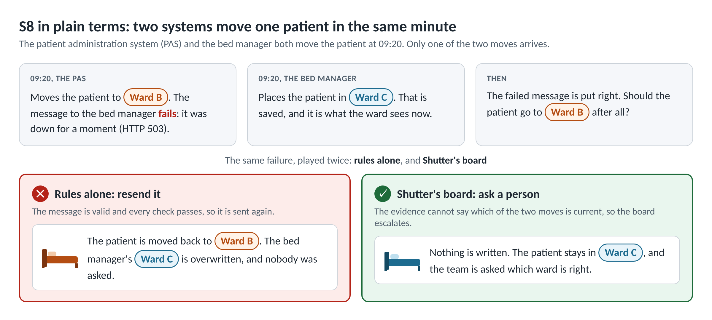
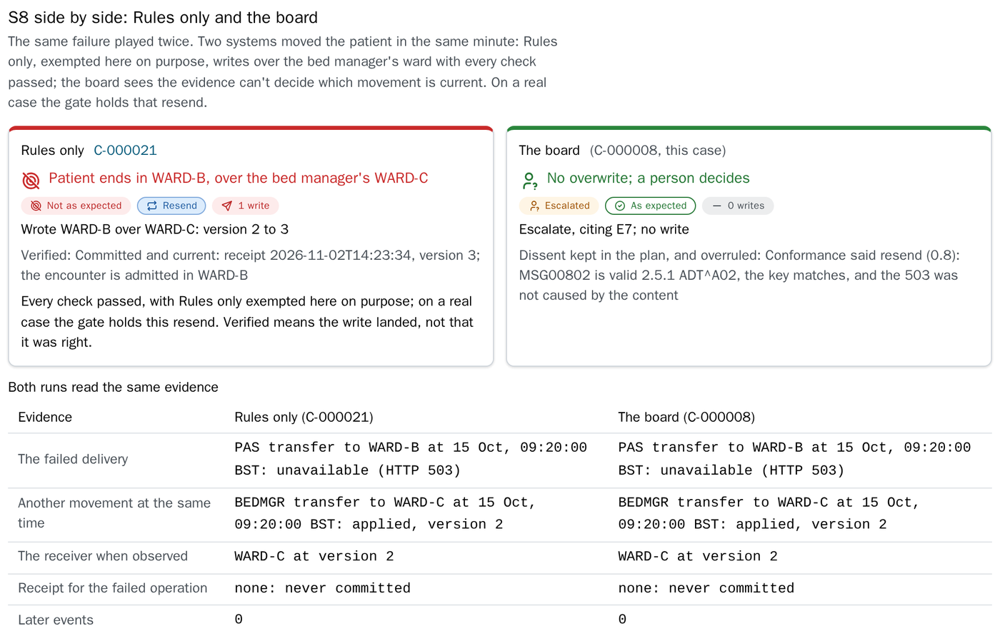
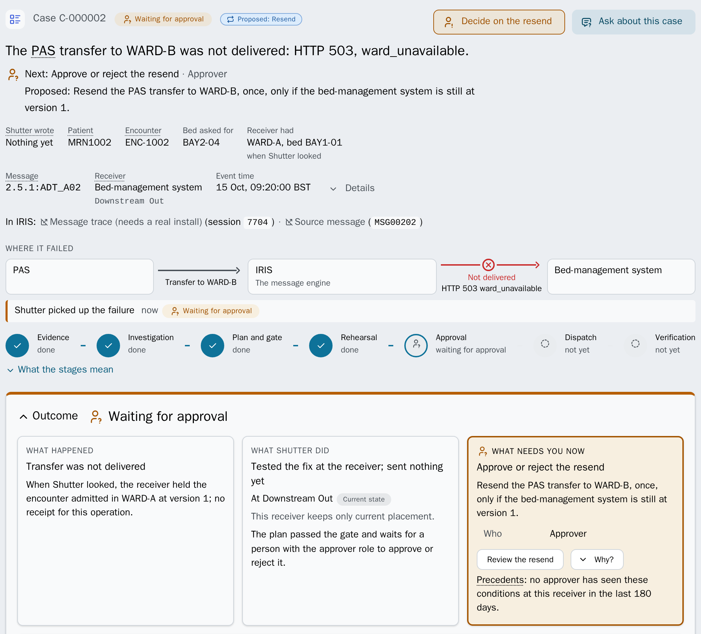
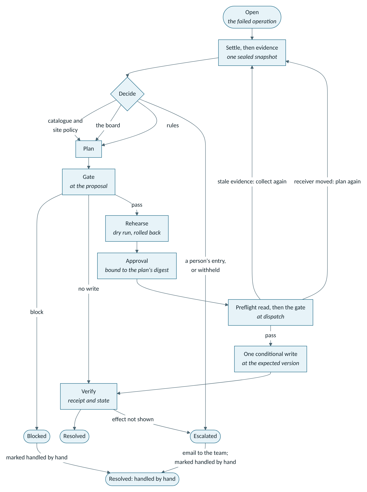
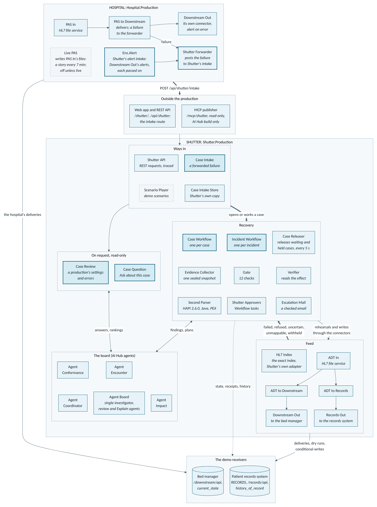
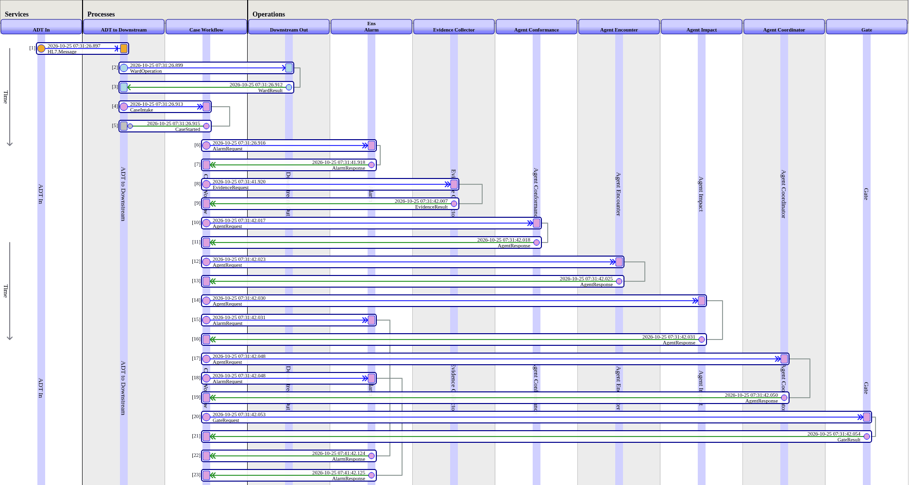
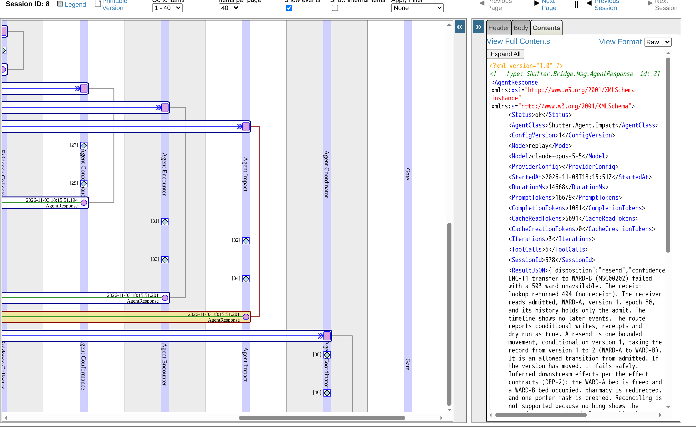

# Shutter: AI Hub agents for failed HL7 deliveries

**When a hospital's HL7 delivery fails, the usual fix is Resend, and when two systems move a patient at the same moment, that resend writes over the bed manager's ward with every check passed. Shutter's IRIS AI Hub agents decide how to put the failure right; a deterministic gate decides whether anything is written.**

On an ordinary day a hospital's integration engine can see hundreds of failed messages. Engineers put right what they can by hand, and the rest can go unactioned. Shutter won't fix them all, but it helps with most.

**For judges, recommended:** the replay edition (the board replays its recorded live runs; no key, no Early Access file). It needs Docker (5 GB memory, 25 GB disk) and a 6 GB image pull, then is healthy in 2 min 21 s on a 12-thread VM, about 8 min on 8 cores.

```sh
git clone https://github.com/MxSalata/shutter.git
cd shutter
./install.sh --replay
```

Then open http://localhost:52773/shutter/index.html as `approver` / `shutter` (**Not now** if offered the trial).

**No install, about three minutes:** open the [trial](https://mxsalata.github.io/shutter/) and choose **Explore on my own**. The steps are the same.

1. In **Scenarios**, choose **Rules only** (a plain resend, no agents), then under **Every scenario** press **Run** on S8's row (not the S8 card at the top). About 20 seconds later open its case and approve it (in the trial, C-000021, already approved and written): the case shows WARD-B written over the bed manager's WARD-C, with every check passed.
2. Choose **Board** (four AI Hub agents, replayed), press **Run** on S8's row again and open its case (C-000008 in the trial): escalated, **0 writes**, and the patient (MRN1008) handed to a person to review.
3. On that case, under **In IRIS:**, press **Message trace**: the session in the Visual Trace, as `approver` (a screenshot in the trial). Then run **S3** in **Board**: the receiver (the bed manager) already holds the message and only its answer was lost, so the case reads the receipt and writes nothing.

| Where | Sign in as | Allows |
| --- | --- | --- |
| The [trial](https://mxsalata.github.io/shutter/) | No sign-in | Everything, on recorded runs; nothing leaves the browser |
| Your machine's web app | `approver` / `shutter`, or `operator` / `shutter` | `approver` approves; `operator` runs and reads, and can't approve |
| The [online demo](https://shutter.mxsalata.com) | `demo` / `shutter` | Reads, asks, approves a case that waits; runs no scenario |

The online demo is a fictional hospital with made-up patients, on AI Hub build 154. The board runs live for the judges' account, whose sign-in the organisers pass to the judges within a model budget of 15 USD a day.

**Measured**, each row linked to its proof:

| What | Result |
| --- | --- |
| [The board on the 11 one-failure scenarios (S1 to S10, S13)](https://github.com/MxSalata/shutter/blob/main/docs/readme/comparison.md) | 11 of 11 as expected, live on build 154 and in replay |
| [Rules only (no agents), the same 11](https://github.com/MxSalata/shutter/blob/main/docs/readme/comparison.md#what-it-shows) | 4 right; 6 wrong resends stopped; S8 overwrites WARD-C |
| [12 held-out cases, sealed before any run](https://github.com/MxSalata/shutter/blob/main/docs/readme/fair-test.md); loss per case from 0 (right) to 20 (a wrong write made) | Board and single investigator (one agent): 0.167, no wrong write. Site policy and Rules only (no agents) wrote a cancelled transfer |
| [The board on release 1.1.1, the same cases](https://github.com/MxSalata/shutter/blob/main/docs/readme/fair-test.md#release-11x) | No wrong write; proposals as on 1.0.0 in 36 of 36. Loss 0.667 against 0.167, all from two gate stops on right plans: F03 (a null bed read as another bed) and F07 (another visit's discharge, held by default) |

[](https://github.com/MxSalata/shutter/actions/workflows/ci.yml) [](https://github.com/MxSalata/shutter/blob/main/LICENSE)

**Jump to:** [Take the agents away](https://github.com/MxSalata/shutter#take-the-agents-away) · [Try it](https://github.com/MxSalata/shutter#try-it) · [How it works](https://github.com/MxSalata/shutter#how-it-works) · [AI Hub](https://github.com/MxSalata/shutter#ai-hub-inside-shutter) · [Bonuses](https://github.com/MxSalata/shutter#technology-bonuses) · [Testing](https://github.com/MxSalata/shutter#how-it-is-tested) · [Limits](https://github.com/MxSalata/shutter#limits-plainly) · [Run details](https://github.com/MxSalata/shutter#run-details)


Instead of a **Resend**, each failed delivery becomes a case: **the board** of four AI Hub agents proposes a plan from its sealed evidence; **the gate**, deterministic checks, decides whether it may write; **a person, or the site's written policy,** releases it; **one conditional write** follows, checked in the receiver's history. The AI board proposes; the gate disposes.

## Take the agents away

**Scenario S8 shows what a plain resend misses.** Two systems move one patient at the same moment, and the matcher flags it as catalogue entry E7 with no model. **Rules only**, the plain-resend baseline with no agents, sends the failed operation as stated unless the gate objects: in S8 every check passes, and Ward B is written over the bed manager's Ward C. The gate stops this resend in every other mode and on any real case; Rules only in a recorded scenario is exempted on purpose, to show what a plain resend does. The board sees the evidence can't say which move is current, and escalates ([comparison](https://github.com/MxSalata/shutter/blob/main/docs/readme/comparison.md)).



What do the agents add? Not the flag: the board checks the entry against this case's evidence, says why it applies or doesn't, and keeps any dissent (in S8, the conformance specialist's resend, and why it was overruled). Each agent is given the catalogue's entry and preferred outcome, and the coordinator took it in 24 of 25 recorded plans: agents applying written policy, not answering unaided ([what that does and does not show](https://github.com/MxSalata/shutter/blob/main/docs/readme/evaluation.md)). **Site policy** (the catalogue, no agent) played 10 of the board's 11 scenarios (S7 has no such mode): 8 settled with no model call, and S4 and S8 went to the board ([on build 109](https://github.com/MxSalata/shutter/blob/main/docs/readme/receipt-109.md#every-scenario-on-build-109)). Under the shipped site profile each of its resends waits for a person.

**Twelve held-out cases,** made-up failed ADT deliveries written inside the project by an author who had not read the catalogue, against release 1.0.0's code, frozen before they were written. Cases, outcomes and scoring rule were hashed on 6 November 2026 before any run and published with the results, so the seal rests on my word. Three runs a case, live on `claude-opus-5-5`; mean loss per case, from 0 right to 20 for a wrong write executed. Both agent modes beat always escalating and wrote nothing wrong; the board did no better than the single investigator, at 3.7 times its cost. These are 1.0.0's figures; 1.1.1's are under [release 1.1.x](https://github.com/MxSalata/shutter/blob/main/docs/readme/fair-test.md#release-11x).

| Mode | Mean loss | With defensible answers free | Right | Defensible | False closure | Wrong write stopped | Wrong write executed | USD a run |
| --- | ---: | ---: | ---: | ---: | ---: | ---: | ---: | ---: |
| The board | 0.167 | 0.000 | 30 | 6 | 0 | 0 | 0 | 0.48 |
| Single investigator | 0.167 | 0.000 | 30 | 6 | 0 | 0 | 0 | 0.13 |
| Site policy, no model | 3.500 | 3.500 | 24 | 0 | 3 | 6 | 3 | 0 |
| Rules only | 5.000 | 5.000 | 18 | 0 | 0 | 15 | 3 | 0 |
| Always escalating, computed, per case | 1.250 | 0.833 | 2 | 5 | 0 | 0 | 0 | 0 |

36 runs a mode, and no needless stop but always escalating's 5. The single investigator scores 0.500 if two F08 runs are graded on the plan made after the gate voided their approval; Site policy's three board cases had no key and fell back to a plain resend ([every run](https://github.com/MxSalata/shutter/blob/main/docs/readme/fair-test.md)). On `claude-sonnet-5-5` the board decided all 36 runs as Opus 5.5 did, at 0.24 USD a run against 0.48 ([cheaper models](https://github.com/MxSalata/shutter/blob/main/docs/readme/fair-test.md#cheaper-models)); on 1.1.1's code, Sonnet 5.5 specialists graded the same at 0.331 USD a run against 0.527 ([release 1.1.x](https://github.com/MxSalata/shutter/blob/main/docs/readme/fair-test.md#release-11x)).

## Try it

| Way to try it | You need | Time |
| --- | --- | --- |
| **The trial**: recorded runs; nothing leaves the browser | Nothing to install | [The quick tour](https://mxsalata.github.io/shutter/?trial=tour): 9 steps, about 4 minutes; [the engineers' tour](https://mxsalata.github.io/shutter/?trial=engineer): 6 steps, about 3 |
| **The online demo**: a live hospital, a new failure every 7 minutes; any resend waits for you | The sign-ins above | [Four steps](https://github.com/MxSalata/shutter/blob/main/docs/readme/first-steps.md#on-the-online-demo-first): **Convene the board** live, then **Break the feed** |
| **The replay edition**, `./install.sh --replay`: no AI Hub, the board replaying its recorded live runs | Docker; no key, no Early Access file | 2 min 21 s measured on a test VM, about 8 min on 8 cores and 5 GB, after the 6 GB image pull |
| **The AI Hub edition**, `./install.sh --image-file ...`: live agents, or their recordings without a key | Docker, the build 109 file from the Early Access portal; `ANTHROPIC_API_KEY` for live agents | 2 min 52 s measured on build 109, up to 15 min on a smaller machine ([receipt](https://github.com/MxSalata/shutter/blob/main/docs/readme/receipt-109.md)) |

**Other sign-ins:** your machine's Management Portal, http://localhost:52773/csp/sys/UtilHome.csp, as `_SYSTEM` / `SYS` (namespace `SHUTTER`: the production, the trace, SQL), or `approver` / `shutter` for the Workflow inbox; the demo's read-only IRIS, [Shutter in IRIS](https://shutter.mxsalata.com/csp/healthshare/shutter/Shutter.Portal.Guide.cls), after a GitHub or emailed one-time-code sign-in, as `demo-trace` / `Shutter-Demo-IRIS-Portal`, for the Visual Trace and the production's agents.

**In a hospital's own IRIS for Health:** Shutter installs without the demo, beside or inside the productions it watches, fed by a forwarder or the production's alerts ([docs/INSTALL.md](https://github.com/MxSalata/shutter/blob/main/docs/INSTALL.md); [several namespaces](https://github.com/MxSalata/shutter/blob/main/docs/INSTALL.md#9-onboarding-several-namespaces); [what each receiver gets](https://github.com/MxSalata/shutter/blob/main/docs/INSTALL.md#what-shutter-does-at-your-site)). Every proof so far is against the demo receiver or a stub: treat recovery as a demonstration until a site has tested its own, and [pilot it first](https://github.com/MxSalata/shutter/blob/main/docs/readme/first-steps.md#pilot-it-first).

**On your machine:** `install.sh` checks Docker, Compose, memory, disk, the ports and the image, and changes nothing until every check passes ([Windows, Apple silicon and more](https://github.com/MxSalata/shutter/blob/main/docs/readme/running.md#notes-on-the-install)).

```sh
git clone https://github.com/MxSalata/shutter.git && cd shutter

# The AI Hub edition (live agents), with the image file from InterSystems' Early Access portal:
./install.sh --image-file irishealth-community-2027.1.0AI.109.0-docker.tar.gz

# Or the replay edition: the public IRIS for Health image, no Early Access file, no key:
./install.sh --replay
# Already loaded the 109 (or 154) image? ./install.sh
```

- **Builds:** judges, please use the AI Hub Community build `2027.1.0AI.109.0`, which the [Early Access portal](https://evaluation.intersystems.com/Eval/early-access/AIHub) offers since 2 November 2026; Shutter is also verified on `2026.3.0AI.154.0` ([receipt](https://github.com/MxSalata/shutter/blob/main/docs/readme/receipt.md)). With both loaded, `./install.sh` uses 109; for 154, run `cp .env.example .env`, set `SHUTTER_IMAGE=irishealth-community:2026.3.0AI.154.0` in it, and run `./install.sh`. Port 52773 or 1972 in use? `SHUTTER_WEB_PORT=8080 SHUTTER_SUPERSERVER_PORT=1973 ./install.sh`, then use that port in every address.
- **Live agents:** `ANTHROPIC_API_KEY` in `.env` (Anthropic's API only); without one the board replays, and the case page says so. `SHUTTER_MODEL=claude-sonnet-5-5`, set before the first start, halves the cost ([cheaper models](https://github.com/MxSalata/shutter/blob/main/docs/readme/fair-test.md#cheaper-models)); each board member's model is its item's `Model` setting. Allow Docker at least 5 GB of memory and about 25 GB of disk.

### On your machine or in the trial, first

The gate is the same in every mode, with one recorded exemption: S8 in **Rules only**, exempted on purpose to show a plain resend (on a real case the gate holds it). **Single investigator** runs live only ([the modes](https://github.com/MxSalata/shutter/blob/main/docs/readme/first-steps.md#the-modes)).

1. In **Scenarios**, run **S2** in **Board** mode. About 20 seconds later (a minute live) the case under **Latest case** on S2's row (C-000002 in the trial) is waiting for approval: **Decide on the resend**, **Review the plan and decide**, **Approve plan**, **Approve this plan**. One conditional write, then "Verified".
2. Run **S8** in **Rules only**, then in **Board**, as in the judges' steps: the case page sets the two side by side.



**Try to break it,** with S2's case waiting: as `operator`, **Approve plan** is disabled and the API answers 403 (this one works in the trial too); confirm the dialog in two tabs: one write, then 409; approve the Workflow task with `PlanDigest` empty or wrong: the case blocks. Every click: [first-steps.md](https://github.com/MxSalata/shutter/blob/main/docs/readme/first-steps.md).

One web app for a PC and a phone, 57 screens and states tested at a phone's width. **32 scenarios** (S1 to S32 without S14 and S26, with S23 in three parts), 26 of them played end to end in CI: [scenarios.md](https://github.com/MxSalata/shutter/blob/main/docs/readme/scenarios.md).

## How it works

| Shutter decides | For example | What is written |
| --- | --- | --- |
| Resend | S2: a transfer that never arrived | One conditional write, verified in the receiver's history |
| Superseded | S1: a later transfer has already moved the patient | Nothing; the closure is checked |
| Reconcile | S3: the receiver holds the message; only its acknowledgement was lost | Nothing; the receipt is checked |
| Escalate | S8: two moves at one moment | Nothing; a person decides |
| Withheld | S15: a patient merge, for the PAS team | Nothing; no agent runs |
| An incident | S11: an outage, eight failures to one receiver | One chain per encounter, released in order, each item verified |



**Terms:** the **receiver**, the system the failed message was going to (in the demo a bed manager); the **catalogue**, the failures Shutter knows and each one's safe outcome; **PAS**, the patient administration system; **Verified**, read in the receiver's receipt and history, never from an acknowledgement ([all terms](https://github.com/MxSalata/shutter/blob/main/docs/readme/first-steps.md#terms)).



1. **A failed delivery becomes a case.** The feed fails forward (`FailureTimeout` 0), so nothing is stuck behind it.
2. **Evidence, sealed.** One snapshot with a digest: the message, the receiver's state, history and receipt, the encounter's other operations and the catalogue match. Before a model sees it, the identifiers Shutter knows for the case become per-case tokens (`MRN-T1`), demographics are dropped and note text becomes a flag.
3. **The board decides.** Each specialist reviews the evidence from its own view; the coordinator's one plan records every specialist it overruled and why.
4. **The gate** ([Gate.cls](https://github.com/MxSalata/shutter/blob/main/src/Shutter/Operation/Gate.cls)) **checks** identity, conformance, intent, ordering, state transition, effect, authorisation, rehearsal, concurrency, evidence freshness, the receiver's capabilities and the catalogue; an unknown blocks a write as a failed check does.
5. **Release.** A person approves the exact plan, bound to its digest, the evidence, the policy and the receiver's version, or the site's written profile releases what its catalogue settles.
6. **One conditional write, then verification:** a dry run, a fresh read, a second gate, one write at the expected version, then a check of the receiver's history.

A resend needs a receiver with [an API](https://github.com/MxSalata/shutter/blob/main/docs/readme/receiver-contract.md) offering a readable history and dry runs; a plain MLLP receiver gets the investigation and a drafted escalation, never a resend.

**Sign-in stays inside IRIS:** Shutter keeps no users or passwords of its own; IRIS roles say what a person may do. The workflows are ObjectScript rather than BPL because they wait on a board answering in parallel, timeouts, re-plans and expiring approvals, and are unit-tested with the gate; every step is still a production message, so the Visual Trace shows it ([why](https://github.com/MxSalata/shutter/blob/main/docs/readme/ai-hub.md#sign-in-the-workflows-and-the-two-productions)).

**Data governance:** with live agents on, what the agents read goes to Anthropic's API, the one provider Shutter configures: the identifiers Shutter knows for the case as per-case tokens, no demographics, and the map back stays in IRIS. One that appears only in a receiver's or engine's free text can reach the model ([limits.md](https://github.com/MxSalata/shutter/blob/main/docs/readme/limits.md), Identifiers), and note text stays in IRIS unless the site profile's `model_content.free_text` is on. With no provider configured (an instance never given a key), nothing goes to any model: the board replays its recordings, and a case with none takes the rules path or goes to a person. A provider once configured stays configured when the key leaves the environment: `SELECT Shutter.Setup_ClearProvider()` removes it, and with no key in the environment the agents then replay at every start and install. Still open: whether a first knowledge build on the AI Hub image fetches an embedding model ([data flow](https://github.com/MxSalata/shutter/blob/main/docs/SAFETY.md#data-flow)).



## Where the agents sit

The three specialists (conformance, encounter and impact) and the coordinator are business operations: the specialists run in parallel, then the coordinator writes the plan. A pass takes 24 to 47 seconds and costs 0.34 to 0.50 USD across the 25 recorded passes on `claude-opus-5-5`. No agent has a write tool. The contest's task, and the code to read first: [ai-hub.md](https://github.com/MxSalata/shutter/blob/main/docs/readme/ai-hub.md). [What one S8 agent was sent and did](https://github.com/MxSalata/shutter/blob/main/docs/readme/s8-what-the-agents-saw.md); in the trial, **Show the recording** on each member's card.



## AI Hub inside Shutter

| AI Hub feature | Where |
| --- | --- |
| `%AI.Agent`: the board, a single investigator, the production review, Explain and question agents | [Agent](https://github.com/MxSalata/shutter/tree/main/src/Shutter/Agent) |
| `%AI.Tool` with typed arguments; the answer tools refuse a setting not among the case's facts | [Tools](https://github.com/MxSalata/shutter/tree/main/src/Shutter/Tools), [Schema](https://github.com/MxSalata/shutter/tree/main/src/Shutter/Schema) |
| `%AI.Policy.Authorization` holds each run to its own case; `%AI.Policy.Audit` logs each tool call in the trace; the tool catalogue is pinned | [Policy](https://github.com/MxSalata/shutter/tree/main/src/Shutter/Bridge/Policy), [Catalogue.cls](https://github.com/MxSalata/shutter/blob/main/src/Shutter/Bridge/Catalogue.cls) |
| The provider key in the IRIS wallet; a live run only for holders of `Shutter_LiveAgents`, within the day's budget | [Setup.cls](https://github.com/MxSalata/shutter/blob/main/src/Shutter/Setup.cls), [Dispatch.cls](https://github.com/MxSalata/shutter/blob/main/src/Shutter/API/Dispatch.cls), [Budget.cls](https://github.com/MxSalata/shutter/blob/main/src/Shutter/Util/Budget.cls) |
| Findings must cite evidence the run was given (`evidence_refs`), or the model repairs them; precedents go to the person, never to an agent | [Findings.cls](https://github.com/MxSalata/shutter/blob/main/src/Shutter/Schema/Findings.cls), [CONTRACTS.md](https://github.com/MxSalata/shutter/blob/main/docs/CONTRACTS.md#64-the-site-profile-and-the-policy-path) |
| Cases, evidence and plans as read-only MCP tools through IRIS's MCP gateway, each call audited under the caller's user | [CONTRACTS.md](https://github.com/MxSalata/shutter/blob/main/docs/CONTRACTS.md#15-the-publisher-v135) |

**What worked, what was hard,** feature by feature on builds 154 and 109: [building-on-ai-hub.md](https://github.com/MxSalata/shutter/blob/main/docs/readme/building-on-ai-hub.md); more in [article 1](https://community.intersystems.com/post/building-shutter-iris-ai-hub-what-worked-what-was-hard-and-what-it-cost).

## Technology bonuses

| Bonus | Where to see it |
| --- | --- |
| Workflow Engine | Each approval is an `EnsLib.Workflow` task for "Shutter Approvers", bound to the plan's digest ([CaseWorkflow.cls](https://github.com/MxSalata/shutter/blob/main/src/Shutter/Process/CaseWorkflow.cls), [IncidentWorkflow.cls](https://github.com/MxSalata/shutter/blob/main/src/Shutter/Process/IncidentWorkflow.cls)). For a hospital: the inbox IRIS already has, and an approval no other plan can reuse. |
| IRIS Vector Search | The agents' knowledge bases are IRIS vector tables (`%AI.RAG.VectorStore.IRIS`, 384 dimensions) searched by their `search_*` tools ([Library.cls](https://github.com/MxSalata/shutter/blob/main/src/Shutter/Knowledge/Library.cls); [a `VECTOR_COSINE` query](https://github.com/MxSalata/shutter/blob/main/docs/readme/running.md#the-knowledge-in-iris-vector-tables)). For a hospital: the site's own interface contract, looked up inside IRIS. |
| Embedded Python | Any IANA feed time zone, through `zoneinfo` ([Time.cls](https://github.com/MxSalata/shutter/blob/main/src/Shutter/Util/Time.cls)): `SELECT Shutter_Util.Time_Probe('20261015092000', 'Europe/Paris')`. For a hospital: true event order, summer time included. |
| Custom Adapter | The HL7 index walk is Shutter's own inbound adapter ([Index/Adapter.cls](https://github.com/MxSalata/shutter/blob/main/src/Shutter/Index/Adapter.cls)). For a hospital: Shutter knows each encounter's other messages, so it can tell an old resend from the latest state. |
| PEX (Java) | The Second Parser, a Java business operation (`EnsLib.PEX.BusinessOperation`, HAPI 2.6.0), says whether a message IRIS can't read is sound or malformed: S25 ([pex/](https://github.com/MxSalata/shutter/tree/main/pex)). For a hospital: whether the sender or the schema needs fixing. On an IPM install it waits for `pex/build.sh`. |
| Docker | `install.sh`, or `docker compose up` ([docker-compose.yml](https://github.com/MxSalata/shutter/blob/main/docker-compose.yml), [Dockerfile](https://github.com/MxSalata/shutter/blob/main/Dockerfile)). For a hospital: a full trial on a laptop, away from the live production. |
| IPM | One package, `iris-shutter`, for IRIS 2026.3 or later: `zpm "install iris-shutter"` in a namespace `SHUTTER` ([the six commands](https://github.com/MxSalata/shutter#ipm-on-a-stock-ai-hub-image)), or `zpm "load"` from a clone ([module.xml](https://github.com/MxSalata/shutter/blob/main/module.xml), [core/module.xml](https://github.com/MxSalata/shutter/blob/main/core/module.xml)). For a hospital: one install on its own IRIS for Health. |
| Community Opportunity idea [DPI-I-689](https://ideas.intersystems.com/ideas/DPI-I-689) | Interoperability as the traceability tool for AI agents: below. For a hospital: an integration team audits an agent with the Visual Trace and SQL it already knows. |
| AI Hub bug reports | [#11](https://github.com/intersystems-community/ai-hub-eap-bugreports/issues/11): `%AI.Agent.Run()` takes three arguments, not four; [#12](https://github.com/intersystems-community/ai-hub-eap-bugreports/issues/12): `Run()` never calls `OnIterationStart` or `OnIterationComplete` |
| Embedded Python bug reports | [#26](https://github.com/intersystems-community/python-bugreports/issues/26): signal 11 after catching an SQL error; [#27](https://github.com/intersystems-community/python-bugreports/issues/27): defaults pasted into the Python source |
| Online demo | [shutter.mxsalata.com](https://shutter.mxsalata.com): a live hospital, a new failure every 7 minutes; sign-ins at the top. The trial is its offline companion. |
| YouTube video | Not yet published |
| AI Hub EAP questionnaire | Submitted on 3 November 2026 |
| Developer Community articles | [Building Shutter on IRIS AI Hub: what worked, what was hard and what it cost](https://community.intersystems.com/post/building-shutter-iris-ai-hub-what-worked-what-was-hard-and-what-it-cost), also in [Portuguese](https://pt.community.intersystems.com/post/construindo-o-shutter-no-iris-ai-hub-o-que-funcionou-o-que-foi-dif%C3%ADcil-e-quanto-custou) and [Spanish](https://es.community.intersystems.com/post/c%C3%B3mo-constru%C3%AD-shutter-sobre-iris-ai-hub-qu%C3%A9-funcion%C3%B3-qu%C3%A9-fue-dif%C3%ADcil-y-cu%C3%A1nto-cost%C3%B3) |

**Tracing AI agents with Interoperability (DPI-I-689).** Every agent run is a message, so the production's own trace does the job of a tracing tool such as Langfuse, with no other service to run: run **S8** in **Board** (the replay edition is enough), and **In IRIS: Message trace** opens its session in the Visual Trace, one lane per item, each `AgentResponse` holding the model, mode, tokens and tool calls. That session's tool calls in SQL (namespace `SHUTTER`):

```sql
-- One session's tool calls in order, with the board member that made each (? is the session number)
SELECT t.Seq, %EXACT(t.Name) AS Tool, t.DurationMs, t.Ok, t.Denied, %EXACT(h.TargetConfigName) AS Member
FROM Shutter_Bridge.ToolCall t JOIN Ens.MessageHeader h ON h.ID = t.RunKey
WHERE h.SessionId = ?
ORDER BY h.ID, t.Seq
```



The full walk-through: [tracing.md](https://github.com/MxSalata/shutter/blob/main/docs/readme/tracing.md); tokens and cost by board member in SQL: [running.md](https://github.com/MxSalata/shutter/blob/main/docs/readme/running.md#agent-runs-by-board-member-in-sql).

## What can go wrong when you resend

Played against the demo receiver; "in CI" is IRIS for Health Community 2026.2 with the agents replaying recorded runs, and *seen in practice* means I have met it at hospitals. All thirteen, and what each leaves out: [edge-cases.md](https://github.com/MxSalata/shutter/blob/main/docs/edge-cases.md).

| What goes wrong | What Shutter does | Proof |
| --- | --- | --- |
| *Seen in practice.* A later transfer, or a nurse's move by hand, reaches the receiver while a resend waits for approval | **Handled.** The approval is bound to the receiver's version: when it moves, that approval is void, nothing is written on it, and the case is planned afresh | S7, S20 in CI |
| *Seen in practice.* The receiver refuses a message as "duplicate", but nothing was filed | **Handled.** That refusal closes nothing: the case reads the receipt and history, finds neither, and a person approves the resend | S4 in CI |
| Two approvers, one working from an old tab, or one approval clicked twice | **Handled.** A changed plan or an older case version is refused, and one approval makes one write | [Boundary check](https://github.com/MxSalata/shutter/blob/main/tests/e2e/boundary_check.py) in CI |

## How it is tested

Figures from [CI's run at the 1.1.0 release commit](https://github.com/MxSalata/shutter/actions/runs/42475914697), every job green. The live board on build 109 at that release, with the fault it found and 1.1.1's fix: [receipt-109.md](https://github.com/MxSalata/shutter/blob/main/docs/readme/receipt-109.md#the-board-live-on-build-109-release-110).

- **On a real IRIS, every push to `main` that changes code:** the full install on IRIS for Health Community 2026.2, 37 receiver contract tests, 492 unit tests (8 more on an AI Hub build only), 26 scenarios end to end through the REST API, and [the approval boundary attacked over HTTP](https://github.com/MxSalata/shutter/blob/main/docs/readme/first-steps.md#the-approval-boundary-attacked-over-http). Privacy, and a question that tries to act: [evaluation.md](https://github.com/MxSalata/shutter/blob/main/docs/readme/evaluation.md#what-the-agents-see-and-a-question-that-tries-to-act).
- **The web app:** 1589 component and 770 browser tests, axe-core on 69 screens and states in 5 appearances.
- **The AI Hub module:** CI can't download an Early Access build, so it builds the core. The module is proven by fresh installs on builds 109 and 154, each Doctor clean ([109](https://github.com/MxSalata/shutter/blob/main/docs/readme/receipt-109.md), [154](https://github.com/MxSalata/shutter/blob/main/docs/readme/receipt.md)), every scenario on 109, the board recorded live on 154 (100 agent runs, 10.00 USD at list prices), which CI replays, and the held-out cases live on 109.

## Limits, plainly

- **Not yet measured at a hospital:** the scenarios are ours, the data is synthetic and the receiver is a demo bed manager built for them.
- **A resend needs a receiver API** the site profile describes; a plain MLLP receiver gets a case and a drafted email, never a resend.
- **Every resend waits for a person** under the shipped site profile (a demo install keeps its own labelled table); with no provider configured the agents replay, and a case with no recording takes the rules path or goes to a person.
- **An incident stops at about four chains under one approval:** larger storms are grouped, nothing is written, and each case goes to a person ([measured on 1.0.0](https://github.com/MxSalata/shutter/blob/main/docs/readme/storm-at-scale.md)).
- **Nothing tells anyone** that an outage opened or that an approval went undecided for 24 hours: the site's own alert, or a person watching, must.
- **Onboarding edits the watched production**, and Shutter has no stop switch of its own: a disabled connector item holds its writes in its queue (tested on build 109).

Every other limit, with its effect, workaround and status: [limits.md](https://github.com/MxSalata/shutter/blob/main/docs/readme/limits.md). For a clinical safety officer: [SAFETY.md](https://github.com/MxSalata/shutter/blob/main/docs/SAFETY.md), the hazards, data flow and what a site still owes.

## Run details

What the organisers ask each README to give; `install.sh` above does these steps for you.

```sh
docker image load -i irishealth-community-2027.1.0AI.109.0-docker.tar.gz
docker tag docker.iscinternal.com/docker-intersystems/intersystems/irishealth-community:2027.1.0AI.109.0 irishealth-community:2027.1.0AI.109.0
git clone https://github.com/MxSalata/shutter.git && cd shutter
cp .env.example .env       # SHUTTER_IMAGE names the build; ANTHROPIC_API_KEY for live agents (model claude-opus-5-5)
docker compose up -d
docker compose ps          # again until it says healthy
curl http://localhost:52773/api/shutter/health   # "ok":true once the production runs
```

- **Build 154:** use its file and the tag `irishealth-community:2026.3.0AI.154.0`, and set `SHUTTER_IMAGE` to it. If `docker image load` prints another name, tag that one.
- **The replay edition:** in `.env`, set `SHUTTER_IMAGE=containers.intersystems.com/intersystems/irishealth-community:2026.2`, then `docker compose up -d --build`.

**Open it** with the sign-ins at the top and under [Try it](https://github.com/MxSalata/shutter#try-it) (production `Shutter.Production`; the demo hospital's is `Hospital.Production` in `HOSPITAL`). Switching editions and more: [running.md](https://github.com/MxSalata/shutter/blob/main/docs/readme/running.md); a hospital's own IRIS for Health: [docs/INSTALL.md](https://github.com/MxSalata/shutter/blob/main/docs/INSTALL.md).

**Troubleshooting.** `install.sh` prints `[fix]` at each check it stops at, and gives up after 25 minutes with the log's last 30 lines; `SELECT Shutter.Setup_Doctor()` in the SQL page (namespace `SHUTTER`, as `_SYSTEM`) is the readiness report. "License limit exceeded": `docker compose restart`. The rest: [troubleshooting.md](https://github.com/MxSalata/shutter/blob/main/docs/readme/troubleshooting.md).

**To stop all writes:** disable each connector item that writes to a receiver (Downstream Out, and Records Out for the second receiver), or `Do ##class(Ens.Director).EnableConfigItem("Downstream Out", 0, 1)`; its writes wait in its queue, and Shutter reads the receiver again before any write ([the test](https://github.com/MxSalata/shutter/blob/main/docs/readme/limits.md#stopping-every-write)).

### IPM on a stock AI Hub image

In an IRIS terminal on the instance, with a clone of this repository at `<module>` inside the container ([the install guide, section 3.1](https://github.com/MxSalata/shutter/blob/main/docs/INSTALL.md#3-shape-a-shutter-in-its-own-namespace)):

```
Do $SYSTEM.OBJ.Load("<module>/src/Shutter/Setup.cls", "ck")
Write ##class(Shutter.Setup).CreateNamespace("SHUTTER")
zn "SHUTTER"
Do $SYSTEM.OBJ.Load("<module>/vendor/ipm/zpm-0.10.10.xml", "ck")
zpm "repo -reset-defaults"
zpm "install iris-shutter"
```

For example: `docker run -d --name shutter-ipm -p 52773:52773 irishealth-community:2026.3.0AI.154.0`, `docker cp ./shutter shutter-ipm:/home/irisowner/shutter` (that path is `<module>`), then `docker exec -it shutter-ipm iris session IRIS`. For a hospital's own instance, make the last line `zpm "install iris-shutter -Ddemo=0"`. The last line installs the registry's latest version (`zpm "list"`); for exactly your clone, use `zpm "load <module>"` instead of the last two lines.

## About the contest

Shutter is an entry to the InterSystems Programming Contest "AI Agents in Interoperability Workflows" (Open Exchange contest 49). *Why I built it:* my background is interoperability with 28 NHS hospitals in the UK, and real testing of an integration only happens in production, where a receiver behaves in a way nobody foresaw, a message arrives out of order, or someone fixes something by hand. Shutter is a safety net for those cases, made for a clinical setting, where a wrong write has a patient on the other end.

- Contest page: https://openexchange.intersystems.com/contest/49
- Announcement: https://community.intersystems.com/post/intersystems-programming-contest-ai-agents-interoperability-workflows
