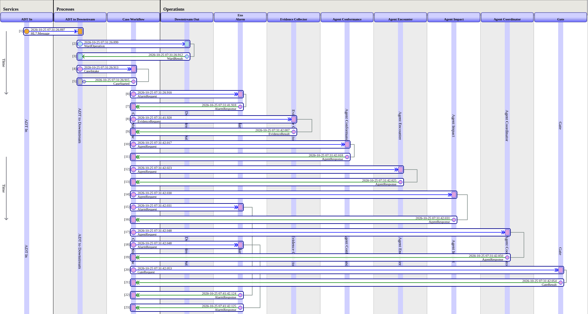

# AI Hub inside Shutter: where the agents sit, and the contest's task

What the README's "Where the agents sit" and "AI Hub inside Shutter" shorten, in full. The agents' code: [src/Shutter/Agent](https://github.com/MxSalata/shutter/tree/main/src/Shutter/Agent).

## Where the agents sit

The three specialists (conformance, encounter and impact) and the coordinator are business operations in the production. The case workflow calls the specialists in parallel, then the coordinator, who writes the plan.

- **A pass** takes 24 to 47 seconds and costs 0.34 to 0.50 USD across the 25 recorded passes: four agents read the evidence through typed tools on a frontier model, `claude-opus-5-5`, a setting of each board item. In **Site policy** mode the catalogue settles the cases it knows with no model call, so a site pays for a board only on the rest.
- **Live or Replay:** with `ANTHROPIC_API_KEY` in `.env` they run live; on an instance never given a key they replay recorded live runs at no cost (a provider once configured stays until `SELECT Shutter.Setup_ClearProvider()`).
- **No write tool:** their tools read the sealed evidence and submit a finding, a plan or an answer; only the gate's checked, released plan is ever written. Shutter resends a message unchanged or not at all: a guessed value is the wrong write it exists to prevent.

## The contest's task, in Shutter

| The contest's task | In Shutter |
| --- | --- |
| An AI Hub agent handles a decision | Each board member is a `%AI.Agent` with typed tools; the coordinator's `SubmitPlan` is the decision ([src/Shutter/Agent](https://github.com/MxSalata/shutter/tree/main/src/Shutter/Agent)) |
| As one step in a production | `Shutter.Process.CaseWorkflow` in `Shutter.Production`; in S19 the failure comes from a hospital's own production |
| At run time | The board is convened when a delivery fails, on that failure's sealed evidence |
| A person in the loop | An `EnsLib.Workflow` task for the role "Shutter Approvers", bound to the plan's digest |
| Seeing what the agent did | Each board member's lane in the Visual Trace, its `AgentResponse` (model, tokens, time, tool calls) the [walk-through](https://github.com/MxSalata/shutter/blob/main/docs/readme/tracing.md) and [what one S8 agent was sent and did](https://github.com/MxSalata/shutter/blob/main/docs/readme/s8-what-the-agents-saw.md); in the trial, **Show the recording** on each member's card |

*A replay: recorded agents answer within milliseconds, in turn. Live, S8's specialists started together and took 12 to 16 seconds each.*

## The code that matters, in this order

A board member, under 30 lines ([Coordinator.cls](https://github.com/MxSalata/shutter/blob/main/src/Shutter/Agent/Coordinator.cls): "Keep every disagreement"; [Base.cls](https://github.com/MxSalata/shutter/blob/main/src/Shutter/Agent/Base.cls), what every member shares); the typed tools ([SubmitPlan.cls](https://github.com/MxSalata/shutter/blob/main/src/Shutter/Tools/SubmitPlan.cls) refuses a bad plan with reasons); the two policies ([Scope.cls](https://github.com/MxSalata/shutter/blob/main/src/Shutter/Bridge/Policy/Scope.cls), [Trace.cls](https://github.com/MxSalata/shutter/blob/main/src/Shutter/Bridge/Policy/Trace.cls)); an agent as a production item ([Bridge/Operation/Agent.cls](https://github.com/MxSalata/shutter/blob/main/src/Shutter/Bridge/Operation/Agent.cls), run by [AIHub.cls](https://github.com/MxSalata/shutter/blob/main/src/Shutter/Bridge/Runner/AIHub.cls) live or [Replay.cls](https://github.com/MxSalata/shutter/blob/main/src/Shutter/Bridge/Runner/Replay.cls) from a recording); the matcher with no model ([Matcher.cls](https://github.com/MxSalata/shutter/blob/main/src/Shutter/Catalogue/Matcher.cls)); the workflow ([CaseWorkflow.cls](https://github.com/MxSalata/shutter/blob/main/src/Shutter/Process/CaseWorkflow.cls)) and the verifier ([Verify.cls](https://github.com/MxSalata/shutter/blob/main/src/Shutter/Operation/Verify.cls)).

## Sign-in, the workflows and the two productions

**Sign-in stays inside IRIS.** Shutter keeps no users or passwords of its own. A person signs in as an IRIS user and IRIS checks the password; what they may do comes from IRIS roles and resources, checked by the API on the server; the approver of record is that signed-in user; and the provider's key sits in the IRIS wallet. A hospital has no second user store to run or secure.

The case and incident workflows are written in ObjectScript rather than BPL, by choice: they wait on a board answering in parallel, timeouts, re-plans and approvals that expire, they are unit-tested and versioned with the gate, and every step is still a production message, so the Visual Trace above shows each case step by step.

**The two productions, item by item.** The demo hospital's own production (namespace `HOSPITAL`) hands its failed deliveries to Shutter's (namespace `SHUTTER`); Shutter's feed, recovery, board and verification are all production items.

## What proves the AI Hub module

- **The AI Hub module:** CI can't download an Early Access build, so it builds the core on the public image. The AI Hub module is proven by:
  - fresh clones installed with `install.sh` on builds 109 and 154, each Doctor clean, the Second Parser running ([receipt on 109](https://github.com/MxSalata/shutter/blob/main/docs/readme/receipt-109.md), [receipt on 154](https://github.com/MxSalata/shutter/blob/main/docs/readme/receipt.md));
  - every scenario on 109, 29 plays across three modes (15 in Board, 12 in Site policy, 2 in Rules only);
  - the board recorded live on build 154 on 25 October and 1 November 2026 (100 agent runs, 10.00 USD at list prices), which CI replays on every push;
  - the board run live on build 109 on 3 November (S2, four runs, 0.42 USD).

## Every AI Hub feature, and where it is

| AI Hub feature | Where |
| --- | --- |
| `%AI.Agent`: three specialists, a coordinator, a single investigator, the production review agent, the Explain agent and the board's question mode | [Agent](https://github.com/MxSalata/shutter/tree/main/src/Shutter/Agent) |
| `%AI.Tool` with typed arguments: the evidence drill-downs and the terminal tools (`SubmitFindings`, `SubmitPlan`, `SubmitReview`, `SubmitAnswer`, `SubmitBoardAnswer`); the answer tools refuse a setting that is not among the case's facts | [Tools](https://github.com/MxSalata/shutter/tree/main/src/Shutter/Tools), [Schema](https://github.com/MxSalata/shutter/tree/main/src/Shutter/Schema) |
| `%AI.Policy.Authorization` holds each run to its own case; `%AI.Policy.Audit` writes each tool call to the trace's log | [Policy](https://github.com/MxSalata/shutter/tree/main/src/Shutter/Bridge/Policy) |
| RAG on `%AI.RAG.VectorStore.IRIS` with FastEmbed: the interface contract, encounter lifecycle, operation effects, member playbooks and review rules | [Library.cls](https://github.com/MxSalata/shutter/blob/main/src/Shutter/Knowledge/Library.cls) |
| The provider key in the IRIS wallet, named in the Config Store as `secret://Shutter.Anthropic#key` (`AI.LLM.Shutter`) | [Setup.cls](https://github.com/MxSalata/shutter/blob/main/src/Shutter/Setup.cls) |
| Who may ask for a live run: only holders of `Shutter_LiveAgents`, each charged to its requester within the day's budget; a failure from the feed runs as `system`, under the day's budget alone | [Dispatch.cls](https://github.com/MxSalata/shutter/blob/main/src/Shutter/API/Dispatch.cls), [Budget.cls](https://github.com/MxSalata/shutter/blob/main/src/Shutter/Util/Budget.cls) |
| Token accounting: sessions with prompt caching; tokens and cost per run | [AIHub.cls](https://github.com/MxSalata/shutter/blob/main/src/Shutter/Bridge/Runner/AIHub.cls) |
| `Model`, `ProviderConfig`, `TokenBudget` and `MaxIterations` as settings of each board item | [Agent.cls](https://github.com/MxSalata/shutter/blob/main/src/Shutter/Bridge/Operation/Agent.cls) |
| The tool catalogue, pinned: before any model call a run checks that `%Discover` names exactly its declared tools, and any other catalogue ends it as `catalogue_mismatch` | [Catalogue.cls](https://github.com/MxSalata/shutter/blob/main/src/Shutter/Bridge/Catalogue.cls) |
| Findings checked on the way back: each must cite evidence the run was given (`evidence_refs`), or the model repairs it in the same run; precedents (what approvers decided before) are shown to the person and never to an agent | [Findings.cls](https://github.com/MxSalata/shutter/blob/main/src/Shutter/Schema/Findings.cls), [CONTRACTS.md](https://github.com/MxSalata/shutter/blob/main/docs/CONTRACTS.md#64-the-site-profile-and-the-policy-path) |
| Shutter's cases, evidence and plans as read-only MCP tools through IRIS's own MCP gateway, identifiers tokenised, each tool call audited under the caller's IRIS user | [CONTRACTS.md](https://github.com/MxSalata/shutter/blob/main/docs/CONTRACTS.md#15-the-publisher-v135) |

What one S8 agent was sent and did: [s8-what-the-agents-saw.md](https://github.com/MxSalata/shutter/blob/main/docs/readme/s8-what-the-agents-saw.md). What was built on it, and what was hard: [building-on-ai-hub.md](https://github.com/MxSalata/shutter/blob/main/docs/readme/building-on-ai-hub.md).
