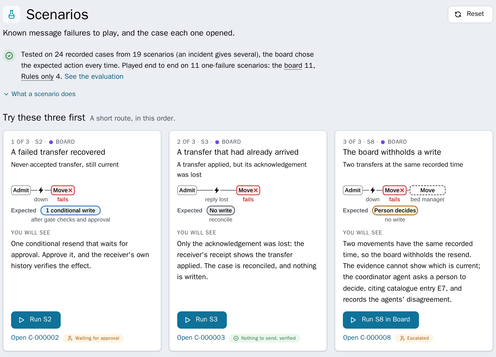
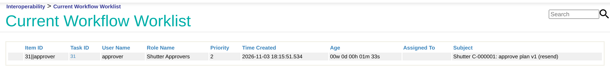
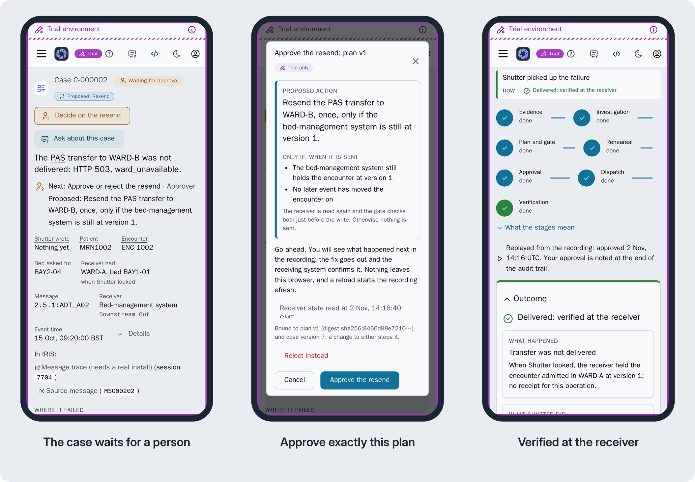
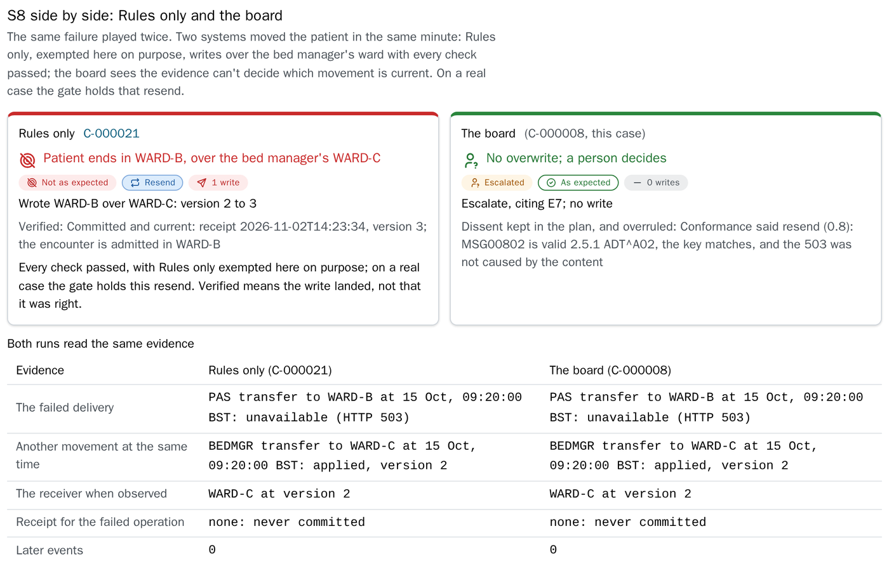
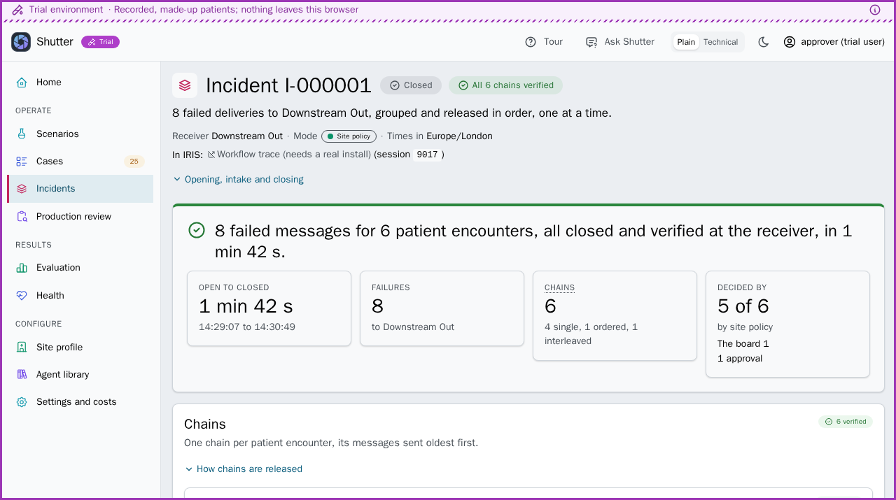

# First steps, step by step

The README's "For judges" and "Try it" in full: what each kind of receiver gets, the four modes, the first three scenarios, three ways to try to break the approval, the online demo's four steps, how a hospital pilots it first, what to look at in S2, S8 and S20, what CI attacks at the approval boundary, and the terms. Sign-ins are under [Try it](https://github.com/MxSalata/shutter#try-it).

## What a receiver gets

What Shutter may do about a failed delivery depends on the receiver, the system the message was going to:

| The receiver | What Shutter does | An example |
| --- | --- | --- |
| Meets the recovery contract: an API with versioned reads, receipts, a readable history, dry runs and conditional writes, described in the site profile | **Case recovery,** for a patient movement: once the gate's checks pass and a person or the site's policy releases it, one conditional write, verified in the receiver's receipt and history | S2 below: the demo's bed manager takes the resend and the case reads "Verified" ([the contract](https://github.com/MxSalata/shutter/blob/main/docs/readme/receiver-contract.md)) |
| An HL7 TCP receiver whose site profile entry has a `watch` block and `engine_resend`, during an outage | **Outage recovery:** after one approval the engine resends the stored messages that never arrived, unchanged and in order. Completed in the engine, as far as the receiver's declared `ack_level` says; not verified at the receiver | A pathology receiver's outage, its ORU^R01 results resent under one approval (on the online demo: P2 on the Scenarios page; [the outage page after recovery](https://github.com/MxSalata/shutter/blob/main/docs/readme/images/pathology-oru-r01-outage-recovery.png); [the install guide, section 11](https://github.com/MxSalata/shutter/blob/main/docs/INSTALL.md#11-a-receivers-outages-v110)) |
| Any other receiver of HL7 messages, a plain MLLP one included | **Investigation and a hand-off:** a case with the evidence and, once a person escalates it, a drafted email to the receiver's team. Never a resend from the case | A NACK at a stock TCP operation: a case, the evidence and the reason nothing was sent ([plain_receiver_check.py](https://github.com/MxSalata/shutter/blob/main/tests/e2e/plain_receiver_check.py)) |

All three rows are about a failed HL7 v2 message. One that isn't HL7 (a FHIR body, for one) opens no case. Nor does one over 2 MB, except a document or report at a receiver with a document exception ([the install guide, section 1](https://github.com/MxSalata/shutter/blob/main/docs/INSTALL.md#what-shutter-does-at-your-site); [section 10](https://github.com/MxSalata/shutter/blob/main/docs/INSTALL.md#10-what-a-watched-namespace-does-not-get) has the other failures that open none).

## The tours

The quick tour ([open it](https://mxsalata.github.io/shutter/?trial=tour)): 9 steps, about 4 minutes. The engineers' tour ([open it](https://mxsalata.github.io/shutter/?trial=engineer)): 6 steps, about 3 minutes, with Detail on Technical.

## The modes

The mode decides who proposes the plan. In every mode the same gate checks the plan, and a person or the site's policy releases any write. **Board** (the default): four AI Hub agents. Three specialists read the sealed evidence at once, each from one angle: the message, the encounter's history, the impact on the receiver. A coordinator weighs their findings and proposes one plan, with reasons. **Site policy**: how a hospital would run it. Failures the catalogue recognises are settled by the site's written policy, with no model; anything it doesn't recognise goes to the board. **Single investigator**: one AI Hub agent with the same evidence and tools proposes the plan alone, to compare with the board. Live only, so not in the trial. In the release 1.4.3 rerun of the twelve held-out cases (36 runs in each mode) the two tied as settled (mean loss 0.167; the unchanged grader gives the single investigator 0.667), the single investigator at 0.127 USD a run against the board's 0.480; what the board adds is three findings from separate views and a plan that records each specialist it overruled, which that test did not show changing a decision ([fair test](https://github.com/MxSalata/shutter/blob/main/docs/readme/fair-test.md#release-143-all-12-cases-rerun)). **Rules only**: no agents, the baseline. Shutter resends the message unchanged unless the gate objects, as a plain Resend would. In a recorded scenario one gate check (`ENTRY_NOT_NAMED_WRITE`) is lifted on purpose, so that S8 can show what that writes; a real case gets the whole gate.

## On your machine or in the trial, first

1. In the trial, choose **Explore on my own** on the welcome; on your machine, if a prompt offers the trial, choose **Not now**, and leave the site profile notice for later: the shipped profile serves every scenario. On **Home**, choose **Start with S2**: it opens **Scenarios** in Board mode, where **Try these three first** has a card for each of the three. Press **Run S2**. About 10 seconds later in the trial (about 20 in replay on IRIS, a minute live) a banner names the run's case, C-000002 in the trial, which is waiting for approval. Open it. There, **Decide on the resend**, then **Approve the resend** in the review that opens: one conditional write, then "Delivered: verified at the receiver".
2. Press **Run S3**: the receiver holds the message and only its answer was lost, so the case (C-000003 in the trial) reads the receipt and writes nothing.
3. Press **Run S8 in Board**: the case (C-000008 in the trial) escalates, writing nothing. On IRIS one gate, on the server, checks all three plans. The trial runs no gate in the browser: it replays the workflow and the gate outcomes recorded on an IRIS instance. In the trial, **In IRIS: Message trace** on C-000008 opens a recorded screenshot.
4. Optional: under **Run mode**, choose **Rules only**, then press **Run S8 in Rules only** on S8's card, where a recorded scenario is exempted on purpose from one gate check (`ENTRY_NOT_NAMED_WRITE`), and approve (in the trial its recorded case, C-000021, is already approved and written): WARD-B overwrites the bed manager's WARD-C. A real case gets that check, and the gate holds the resend. **Compare the two runs** on either case sets the two side by side.

**Try to break it,** with S2's case waiting for approval: run S2 again for each; in the trial, reload. The first also works in the trial (under your name, choose the role); the rest need your machine:

- Sign in as `operator` / `shutter`: the case's action reads **Waiting for an approver**, **Approve the resend** under **Gate and decision** is disabled ("Deciding needs the approver role"), and the API answers 403.
- Open the review (**Decide on the resend**) in two tabs and confirm in each: one write; the second answers 409 ("The case is resolved, not awaiting approval").
- Sign in to the Management Portal as `approver` / `shutter`, the role's member (`_SYSTEM` is not one, so its inbox is empty), and open the Workflow inbox at http://localhost:52773/csp/healthshare/shutter/_DeepSee.UserPortal.Workflow.zen. Select the task, press **Accept**, then **Approve** with `PlanDigest` empty or wrong: the case blocks and nothing is dispatched ("The approval carried no plan digest, so it binds nothing", or "named another plan digest"). **Reinvestigate** recovers it; the digest in the new task's message then approves it: one write, verified.

## On the online demo, first

1. **See the agents decide.** With the judges' account, **Convene the board** on a blocked, escalated or failed case: the board investigates it again, live, on fresh evidence. Or, on **Scenarios**, press **Run S8 in Board** on S8's card: the real agents take the case, one run at a time, under the share of the judges' account, 2 USD an hour that all judges share (Reset stays with the demo's operators). With `demo`, the same button plays S8 from its recordings: no model is called and nothing is spent. The banner also links the hospital's own S8 case, and S8's recorded board in the trial.
2. Press **Break the feed** on the hospital's banner. Its bed manager goes down for a minute and eight movements for four new patients fail; a strip follows Shutter grouping them into one incident and, once the bed manager is back, releasing them in order. Unlike a Resend of each message, each item goes in event order, conditional on the version recorded when the previous one was verified, stopping at the first surprise. In the demo's rehearsal on 3 November 2026 it ended as **one incident waiting for one approval**, with no model call: this outage needed no agent to plan its chains. On **Incidents**, **Approve release** sends them in order.
3. Open a case that **waits for approval**, press **Decide on the resend**, then **Approve the resend**: one conditional write, then "Verified" from the receiver's history.
4. On any case, **In IRIS: Message trace** opens its session in the Visual Trace.

## Pilot it first

For a hospital trying Shutter beside a real production, as [the install guide](https://github.com/MxSalata/shutter/blob/main/docs/INSTALL.md) has it:

1. **Its own namespace, no demo.** Create a `SHUTTER` namespace on backed-up storage and install with `-Ddemo=0`: no demo users, no demo receiver, and the feed, records and scenario items switched off ([sections 3 and 5](https://github.com/MxSalata/shutter/blob/main/docs/INSTALL.md#3-shape-a-shutter-in-its-own-namespace)). Then map your users to `Shutter_Operator` and `Shutter_Approver`, and the approvers to the Workflow role, so someone can sign in to read the cases and decide ([section 5, step 3](https://github.com/MxSalata/shutter/blob/main/docs/INSTALL.md#5-the-steps-for-the-integration-team)).
2. **No live model.** Leave the provider key out: an instance never given one has no provider (one given a key keeps it until `SELECT Shutter.Setup_ClearProvider()` removes it). A watched production's failures run in Site policy by default. The catalogue proposes what it knows and a person approves it (the shipped profile asks at every tier); a case it gives to the board or a person escalates with no plan; a failure it doesn't know takes the rules path, and the gate blocks it (`NEW_PATTERN`). Nothing is written to a draft receiver. The install also starts in shadow mode: until the site profile says `"recovery": {"mode": "enabled"}`, Shutter records what it would propose and sends no rehearsal, recovery write, resend preview, outage resend or escalation email, so an escalation a person sends reads Not sent. That email has one exception: `"notifications": {"shadow_delivery": "enabled"}` in the site profile lets it go while recovery stays off. Enabling recovery later sends no escalation that shadow mode held: a person sends it again.
3. **Onboarding edits the production.** It renames the site's `Ens.Alert`, adds two items and maps Shutter's classes, and the production then needs Shutter's database to start ([section 10](https://github.com/MxSalata/shutter/blob/main/docs/INSTALL.md#10-what-a-watched-namespace-does-not-get)). Do it first on captured traffic in a sandbox, not between a live production's alerts and their consumer.
4. **Intake, with no receiver given an API.** Onboard one watched namespace and send the test failure ([sections 9.2 to 9.4](https://github.com/MxSalata/shutter/blob/main/docs/INSTALL.md#9-onboarding-several-namespaces)). Apply with `SELECT Shutter.Setup_OnboardApply('<NAMESPACE>', '{"alert_on_error": true}')`, or turn `AlertOnError` on for the operations the plan's `todo` names: without it the alert intake hears nothing from them. Each failed delivery the alert intake hears of then becomes a case with its evidence and a drafted email, never a resend from the case, until the site profile describes a receiver's API ([section 10](https://github.com/MxSalata/shutter/blob/main/docs/INSTALL.md#10-what-a-watched-namespace-does-not-get) lists the failures that open no case).
5. **A production review of that watched production** ([section 3.6](https://github.com/MxSalata/shutter/blob/main/docs/INSTALL.md#3-shape-a-shutter-in-its-own-namespace), naming its `namespace` and `production`; a production becomes a target once a case names it, as the test failure's does). It reads its settings, event log errors and failed messages, ties them to Shutter's cases and changes nothing. With no key the review agent has no recording to replay for it, and the deterministic report stands ([CONTRACTS 13](https://github.com/MxSalata/shutter/blob/main/docs/CONTRACTS.md#13-the-production-review-v122)).

## What to look at

- **S2, a transfer that never arrived.** The gate passes the board's resend, the receiver's dry run says it would apply, and the approval waits as a Workflow task. "Acknowledged" is never "Verified". The web app's **Approve the resend** completes that same `EnsLib.Workflow` task as the signed-in approver; from the IRIS Workflow inbox, signed in to the portal as `approver`, press **Accept**, then copy the plan digest from the task's message (it is **Plan digest** on the case page too) into the task's `PlanDigest` field.

**Designed for a PC and a phone.** One web app: the browser tests hold 61 screens and states to a phone's width with no sideways scroll, and walk the main flows there. S2 at phone size, in the trial:

- **S8, two movements the evidence can't order.** In Board mode the plan records the conformance specialist's dissent and why it was overruled. In Rules only one gate check is lifted on purpose, to show what a plain resend writes; on a real case the gate holds that resend. **Compare the two runs** on the case page sets Rules only and the board side by side:

- **S20, a nurse moves the patient by hand** while S2's resend awaits approval. The approval is bound to the receiver's version, so nothing is sent (`APPROVAL_RECEIVER_CHANGED`) and her entry stands: the binding alone stops it, so S20 plays in Rules only mode.
- **Beside the cases:** Ask about this case (agents that cannot write), a read-only review of a production, precedents, each agent's timeline and the evaluation.

All 36 scenarios (S1 to S34, with S23 in three parts; CI played 26 of them end to end at the 1.1.0 release), and the online demo's two optional pathology paths, P1 and P2, step by step, and where each part of the task shows: [docs/readme/scenarios.md](https://github.com/MxSalata/shutter/blob/main/docs/readme/scenarios.md).

## The approval boundary, attacked over HTTP

On every push to `main` that changes code, CI tries an approval naming another plan or a stale version (409), an operator's approval (403), one approval sent twice (one write), a Workflow inbox approval with an empty or another digest (blocked, no write), the receiver changed after approval (S20, no write), and a resend of a delivery the receiver already holds (S3, no write). The script: [boundary_check.py](https://github.com/MxSalata/shutter/blob/main/tests/e2e/boundary_check.py).

## Terms

- **Case:** one failed or withheld delivery and everything decided about it.
- **Receiver:** the system the failed message was going to; in the demo, a bed manager, called the downstream system in the code and the item `Downstream Out`.
- **Catalogue:** the failures Shutter knows and the safe outcome of each.
- **Matcher:** links a failure to its catalogue entry, with no model.
- **Site profile:** the site's written policy, with an entry for each receiver: what Shutter may do there on its own and what waits for a person.
- **Incident and chain:** many failures to one receiver, grouped; a chain is one encounter's messages, in event order.
- **Receipt:** the receiver's own record of a message it holds, read to tell a lost acknowledgement from a lost message.
- **Rehearsal:** the receiver's dry run of the exact write, with nothing kept.
- **Verified:** this operation read in the receiver's receipt and history at the time, never from an acknowledgement; ward and bed aren't compared. Said only of case recovery through the receiver's API: an outage's resend through the engine is completed in the engine, not verified at the receiver.
- **PAS:** the patient administration system, the hospital's source of admissions and transfers.
