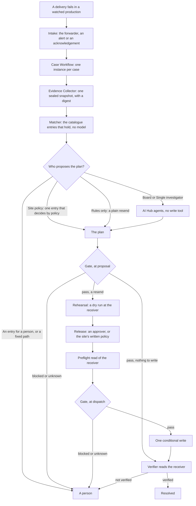
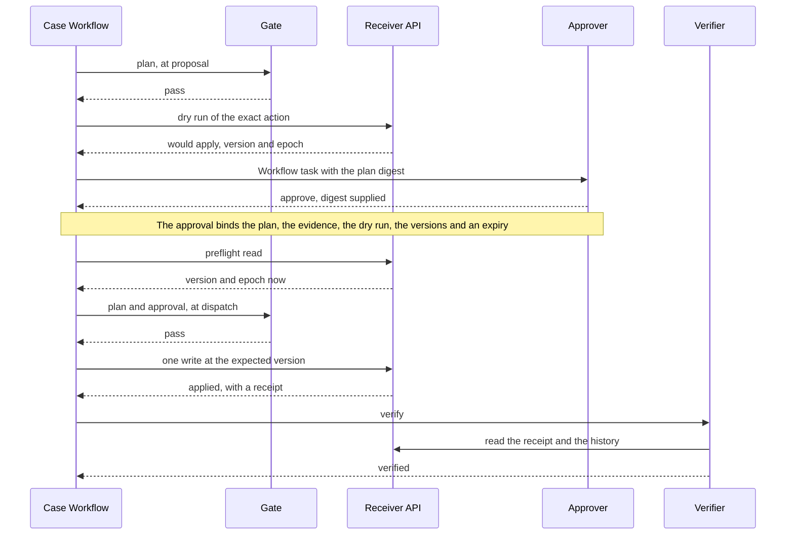
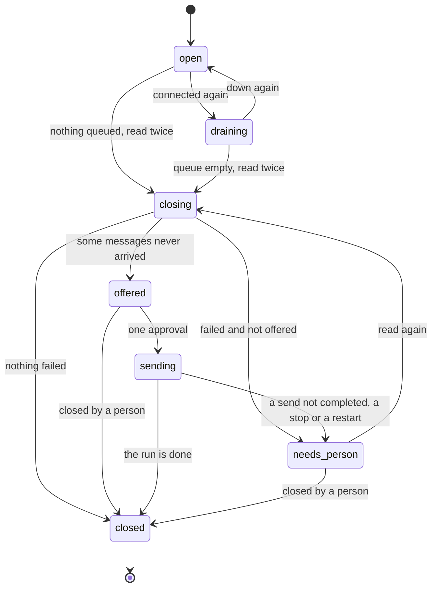

# How Shutter works

This guide is for an integration engineer or a contest judge who has read the [README](../../README.md) and wants the whole mechanism, from a failed HL7 delivery to a verified recovery; it describes Shutter 1.4.5.

It was written from the code at tag `v1.4.4` and checked against `v1.4.5`, and where it quotes the web app (a mode's name, a button, a band on the case page) the words are 1.4.5's. Words in capitals such as `RECEIVER_CHANGED` are the gate's reason codes. The contracts between the parts, field by field, are in [CONTRACTS.md](../CONTRACTS.md); this guide is the map.

**With five minutes,** read three passages: [what holds an agent's run](#4-who-proposes-the-plan-the-run-modes-and-the-agents) (its tools, and the list under them), the first paragraph of [the gate](#7-the-gate), and "A write whose answer was lost" in [section 9](#9-case-recovery-verified-at-the-receiver). Then [what was measured](#15-what-was-measured), with what it did not show. One agent's whole recorded run on S8 is in [s8-what-the-agents-saw.md](../readme/s8-what-the-agents-saw.md).

## Contents

1. [The mechanism in one page](#1-the-mechanism-in-one-page)
2. [From the engine to a case](#2-from-the-engine-to-a-case)
3. [The evidence, the catalogue and the site profile](#3-the-evidence-the-catalogue-and-the-site-profile)
4. [Who proposes the plan: the run modes and the agents](#4-who-proposes-the-plan-the-run-modes-and-the-agents)
5. [What goes to a model, and what never leaves IRIS](#5-what-goes-to-a-model-and-what-never-leaves-iris)
6. [The plan](#6-the-plan)
7. [The gate](#7-the-gate)
8. [Release: the approval and what it binds](#8-release-the-approval-and-what-it-binds)
9. [Case recovery, verified at the receiver](#9-case-recovery-verified-at-the-receiver)
10. [Outage recovery, completed in the engine](#10-outage-recovery-completed-in-the-engine)
11. [Documents and pathology results](#11-documents-and-pathology-results)
12. [The stop switch and shadow mode](#12-the-stop-switch-and-shadow-mode)
13. [The budget and the spending cap](#13-the-budget-and-the-spending-cap)
14. [The audit trail and the decision receipt](#14-the-audit-trail-and-the-decision-receipt)
15. [What was measured](#15-what-was-measured)
16. [Limits, and where to read next](#16-limits-and-where-to-read-next)

## 1. The mechanism in one page

Shutter turns a failed delivery into a **case**. Collecting the evidence, matching the catalogue, the gate's checks and the verification are deterministic code, with no model in them. AI Hub agents may read the evidence and propose a plan; they have no write tool. A gate of fixed checks decides whether the plan may write, a person or the site's written policy releases it, and one conditional write follows, verified at the receiver.

Two paths can put a message right, and they do not give the same guarantee:

| | Case recovery (sections 2 to 9) | Outage recovery (section 10) |
| --- | --- | --- |
| What is sent | One mapped operation through the receiver's API, not the HL7 message | The stored HL7 messages that the engine's own records show never arrived, unchanged and in the approved order, through the engine |
| Settled by | **Verified at the receiver:** read back in its receipt and history | **Completed in the engine:** each new header's delivery outcome and the receiver's declared duplicate answer. Shutter reads nothing at the receiver |

## 2. From the engine to a case

Shutter hears of a failure in one of these ways ([CONTRACTS 11](../CONTRACTS.md#11-the-case-intake-from-another-production-v115)):

| Way in | Class | What it hands over |
| --- | --- | --- |
| The forwarder | `Shutter.Intake.Forwarder`, an item the watched production adds | The HL7 text, the failure as the connector reported it, and where the original lives |
| The production's alerts | `Shutter.Intake.AlertProcess`, as the production's `Ens.Alert` item | Each alert goes on to the site's own consumer first; then the session's HL7 message is forwarded, once |
| An acknowledgement on its own feed | `Shutter.Intake.AckMatch` | An AE, AR, CE or CR, matched by control id to the message sent |
| A held message | The forwarder as a `BadMessageHandler` | A message whose schema is not loaded: a case blocked `SCHEMA_UNKNOWN` until it is imported |
| Shutter's own feed, in the demo | `ADT to Downstream` ([ADTToWard.cls](../../src/Shutter/Process/ADTToWard.cls)) | The operation and the connector's answer. The connector's `FailureTimeout` is 0, so nothing queues behind a failure |

The first four reach `POST /api/shutter/intake` through the forwarder; a body over 2 MB is refused. The item `Case Intake` stores Shutter's own copy of the message, builds the operation and sends it to `Case Workflow`.

**The operation key** names a business operation, not a message: `<source_system>^<patient_id_authority>^<patient_id>^<encounter_id>^<event>^<event_time>`. The same transfer failing again under a new control id joins the case already open.

**The case workflow** ([CaseWorkflow.cls](../../src/Shutter/Process/CaseWorkflow.cls)) runs one instance per case, and every step is a message to another production item. It counts the failure towards an incident (section 9), waits 15 seconds by default so that messages still in flight for the encounter reach the evidence, then collects it. A case ends `resolved`, `blocked`, `escalated` or `failed`.

**Four kinds of case go straight to a person, with no agent:** a document (section 11), a merge or cancel the feed withheld, a failure at a receiver that keeps orders and results (section 11) and, outside Rules only, a message that records a death (catalogue entry E19).

## 3. The evidence, the catalogue and the site profile

**The evidence** is one snapshot taken by the `Evidence Collector` ([Evidence.cls](../../src/Shutter/Operation/Evidence.cls)): the operation, the failure, the message's fields and validation, the receiver's state and history for the encounter, the receipt lookup for the operation key, every operation the feed sent for the encounter with the later ones marked, further messages for the same patient on any visit, and the receiver's capabilities.

The snapshot is sealed: its digest is a SHA-256 over the canonical JSON of every item and the summary, and it is never edited. New evidence is a new snapshot. A second, **material digest** covers only what a decision rests on, without observation times, so the same evidence collected twice has the same one. Observations count as fresh for an hour in the shipped production: the Evidence Collector's `FreshSeconds` is 3600 there, and the class's own default is 300. The gate, the person and, in a reduced copy (section 5), the agents all work from it.

**The catalogue** is the list of failures Shutter knows: 19 entries, E1 to E19, in [knowledge/catalogue](../../knowledge/catalogue). Each has a pattern, a preferred outcome with alternatives, and a line that says who decides. A deterministic matcher ([Matcher.cls](../../src/Shutter/Catalogue/Matcher.cls)) evaluates every entry against the snapshot with no model, in every mode, before any agent runs, and its result becomes part of the snapshot.

| `decides` | Entries | Means |
| --- | --- | --- |
| `policy` | E1, E2, E3, E4, E6, E10, E16, E18 | The site's written policy may settle it with no model |
| `board` | E5, E7, E9 | It needs the agents' judgement, then a person's approval for any write |
| `person` | E8, E11, E12, E13, E14, E15, E17, E19 | Only a person may act |

**The site profile** is the site's written policy, a versioned JSON document ([CONTRACTS 6.4](../CONTRACTS.md#64-the-site-profile-and-the-policy-path)). It has an entry per receiver (its category, tier, API paths and declared capabilities) and a policy table by tier and chain kind: `automatic`, `approval`, `per_chain` or `board`. The shipped policy asks a person at every tier, and a non-demo install starts with any `automatic` in its policy turned to `approval`: a tier is `automatic` there only once the site saves it so in its own profile. The demo keeps its own labelled table.

## 4. Who proposes the plan: the run modes and the agents

The mode decides who proposes. The gate, the release and the verification are the same in all four ([CONTRACTS 6.3](../CONTRACTS.md#63-matching-and-the-investigation-modes)).

| Mode | Who proposes the plan |
| --- | --- |
| **Site policy** | One matching entry that decides by policy: the workflow builds the plan from its outcome, with no model. One that decides by a person: escalated at once. Anything else: the board. The default for a watched production |
| **Board** | Three specialists in parallel, then a coordinator. The installed default for the scenarios |
| **Single investigator** | One agent with the same evidence tools. It has no recording, so it runs live only |
| **Rules only** | No agent and no catalogue path: a plain resend of the case's own operation, for the gate to judge. The baseline |

**The agents** are `%AI.Agent` classes ([src/Shutter/Agent](../../src/Shutter/Agent)), each run by a business operation ([Agent.cls](../../src/Shutter/Bridge/Operation/Agent.cls)) with its own lane in the Visual Trace. The specialists each take one view: the message, the encounter's history, and the effect on the receiver. The coordinator reads their findings and submits one plan, keeping every disagreement.

An agent has eight read-only evidence tools, a knowledge search over IRIS vector tables and one terminal tool, `SubmitFindings` or `SubmitPlan`. None reaches a receiver or the message store. Each run is held by:

- **a scope policy** (`%AI.Policy.Authorization`, [Scope.cls](../../src/Shutter/Bridge/Policy/Scope.cls)): a call that names another case is denied;
- **an audit policy** (`%AI.Policy.Audit`, [Trace.cls](../../src/Shutter/Bridge/Policy/Trace.cls)): one row and one trace line per tool call, a denied call included;
- **a pinned tool catalogue** ([Catalogue.cls](../../src/Shutter/Bridge/Catalogue.cls)): tools other than the declared ones end the run before any model call;
- **a citation check:** a finding or a plan may cite only evidence the run was given, or the submit tool refuses it;
- **bounds:** 8 turns and 120,000 tokens a run, 120 seconds a model call, 600 seconds for the specialists and then for the coordinator. A failed run is not retried, and no other model is tried ([model-fails.md](../readme/model-fails.md)).

**Live or replay.** By default an agent item runs live when a provider is configured and the AI Hub runner is installed. Otherwise it replays a recorded live run's answer, marked replay, with no model call, and the gate checks that plan as it would a live one.

**When nobody can answer** (no recording, or the budget spent), a case the catalogue gives to the board or to a person is escalated with no plan, and any other case takes the rules path. Either way a person decides: only a plan the policy path built from a catalogue entry can be released by policy, and the gate checks that origin at dispatch (`APPROVAL_PLAN_ORIGIN`).

## 5. What goes to a model, and what never leaves IRIS

The stored snapshot is complete and stays in IRIS. A model receives a reduced copy, made by [ModelView.cls](../../src/Shutter/Util/ModelView.cls) at the two places anything of a case leaves: the agent request's context and every answer of the evidence tools ([CONTRACTS 9](../CONTRACTS.md#9-what-leaves-iris-for-a-model-v111)).

| In the snapshot | In the model's view |
| --- | --- |
| The identifiers Shutter knows for the case: MRN, NHS number, other PID-3 identifiers, encounter, visit number, name parts, date of birth | Per-case tokens such as `MRN-T1` and `ENC-T1`, replaced inside every string, operation keys and error echoes included. The map stays in IRIS |
| Demographics: name, sex, address, phone, next of kin and the like | Dropped wherever they occur |
| The text of OBX and NTE notes | A flag per note. The text goes only if the site profile sets `model_content.free_text`, tokenised and cut at 500 characters |
| Strings from outside, such as an error's text | Cut at 1,000 characters and flagged when they read like an instruction |
| Precedents, and the findings on an order or result | Not sent |

The view **fails closed**: if the token map cannot be built, nothing is sent and the case goes to a person. On the way back the identifiers are restored, and invisible characters stripped, before anything is stored.

Two limits, plainly. The tokenised copy is pseudonymised, not anonymised. And an identifier that appears only in a receiver's or engine's free text, which Shutter has not learnt, can reach the model ([SAFETY.md](../SAFETY.md#data-flow)). With no provider configured, nothing goes to any model.

Two other things leave in a case's own work, neither through an agent (every other flow, a person's question to an agent, the production review and the MCP publisher among them, is in [SAFETY.md](../SAFETY.md#data-flow)):

- **The write to a receiver** carries the operation's fixed fields: its key, identifiers, event, ward, bed, event time, digest and expected version. No name and no note.
- **The escalation email** ([CONTRACTS 10](../CONTRACTS.md#10-escalation-by-email-v111)) is drafted from the stored case with no model: the hospital and NHS number, the date of birth, the event, what failed, why Shutter stopped and what the receiver holds. It takes no name, address or note text from the message, but the failure text goes as the receiver or the engine wrote it, and that can echo one. A person reads it and sends it, and the send is bound to the digest of the text that person read.

## 6. The plan

A plan ([Plan.cls](../../src/Shutter/Store/Plan.cls)) is small and typed:

- a **disposition:** `resend`, `reconcile`, `superseded`, `more_evidence` or `escalate`;
- an **action** and, for a resend, the operation key, the receiver version the write is conditional on and the payload digest;
- the catalogue entry it follows and which of the entry's outcomes it chose;
- preconditions, the evidence keys it rests on, a summary and a reason;
- the specialists the coordinator overruled and why, and any member who did not answer.

The only write a plan can ask for is the case's own operation, unchanged. There is no field for an edited message: Shutter sends the operation as the message gave it, or not at all.

That operation is a patient movement mapped from an ADT message: an admission, a transfer, a discharge or an update, and a cancel or a merge only where the site profile allows it. It carries the fixed fields of section 5 and no demographics. So a resent A08 is an update with no ward or bed: the receiver record's version moves, and none of the message's demographic changes go with it.

A plan is never edited. A new version is a new row, and its **digest** is a SHA-256 over the plan, its version, the snapshot's digest, the catalogue version and the case id. The plan also records who made it: an agent run, `policy:<entry>`, `rules`, or the case whose board it followed.

## 7. The gate

The gate ([Gate.cls](../../src/Shutter/Operation/Gate.cls)) is a business operation with no model in it. It runs twice for a write: at the **proposal**, and again at the **dispatch**, after the release and a fresh read of the receiver. Each check answers pass, block or unknown with a reason code, and the outcome is the worst of them: **an unknown blocks a write as a block does.** Every decision is stored with all its checks and the gate's policy version (`2026-11-07.1` in this release).

| Check | What it asks | What it refuses |
| --- | --- | --- |
| `identity` | Does the receiver's encounter belong to the case's patient? | `PATIENT_MISMATCH`, `UNKNOWN_ENCOUNTER`; unknown: `RECEIVER_UNREADABLE` |
| `conformance` | Did the message parse and map to an operation? | `PARSE_FAILED`, `UNMAPPABLE`, `SCHEMA_UNKNOWN` |
| `intent` | Is a write exactly the case's operation, unchanged, to a receiver the profile describes? | `DIFFERENT_OPERATION`, `PAYLOAD_CHANGED`, `RECEIVER_NOT_IN_PROFILE`, `RECEIVER_NOT_MODELLED`, `MERGE_WITHHELD`, `CANCEL_UNSUPPORTED`, `UNKNOWN_DISPOSITION` |
| `ordering` | Has anything later happened to the encounter or the patient, and does the engine still hold the message? | `SUPERSEDED_BY_LATER_EVENT`, `SUPERSESSION_UNSUPPORTED`, `EVENT_TIME_IMPLAUSIBLE`, `NEWER_MESSAGE_PENDING`, `FURTHER_MOVEMENT`, `FURTHER_NOT_READ`, `PATIENT_UNREADABLE`, `UPDATE_LOCATION_DIFFERS`, `BED_OCCUPIED`, `WAITING_FOR_OCCUPANT_CASE`, `OCCUPANT_CASE_FAILED`, `ENGINE_STILL_TRYING`, `ENGINE_DELIVERED`, `RECEIVER_MAY_HOLD_IT`; unknown: `FURTHER_MOVEMENT_NEW`, `ENGINE_UNREADABLE` |
| `state_transition` | Is the event allowed from the receiver's current state? | `INVALID_TRANSITION`, `PATIENT_LEVEL_WRITE`; unknown: `RECEIVER_UNREADABLE` |
| `effect` | What does the receipt say? | A write the receiver already holds (`ALREADY_COMMITTED`); a reconcile with nothing to reconcile (`NO_RECEIPT`, `RECEIPT_NOT_AVAILABLE`), with other content under the key (`RECEIPT_PAYLOAD_DIFFERS`) or with a cancel since (`RECEIPT_THEN_CANCELLED`); unknown: `RECEIPT_UNREADABLE` |
| `authorization` | At dispatch: is there a valid approval of exactly this plan? | `NO_APPROVAL`, the `APPROVAL_...` codes of section 8, `POLICY_REQUIRES_APPROVAL` |
| `rehearsal` | At dispatch: did the receiver dry-run this exact plan at this version, epoch and payload? | `DRY_RUN_MISSING`, `DRY_RUN_FAILED`, `DRY_RUN_STALE` |
| `concurrency` | Does the write name a receiver version, and is it the one seen now? | `NO_EXPECTED_VERSION`, `RECEIVER_CHANGED`, `PATIENT_LEVEL_WRITE`; unknown: `RECEIVER_UNREADABLE` |
| `evidence` | Are the snapshot's observations still fresh? | Unknown: `STALE_EVIDENCE` |
| `capability` | Does the receiver guarantee conditional writes, receipts, a readable history and dry runs? | `CONNECTOR_INCAPABLE`, `HISTORY_UNSUPPORTED`, `DRY_RUN_UNSUPPORTED`; unknown: `CAPABILITIES_UNREADABLE`, `HISTORY_UNREADABLE` |
| `catalogue` | Do the plan's entry and outcome agree with what the matcher found? | `NEW_PATTERN`, `ENTRY_UNKNOWN`, `PATTERN_NOT_MATCHED`, `OUTCOME_NOT_ALLOWED`, `OUTCOME_MISMATCH`, `ENTRY_NOT_NAMED_WRITE`; unknown: `MATCHER_ERROR` |

[block-reasons.json](../../knowledge/block-reasons.json) gives each code its words, what is missing, who owns it and what triggers a new look.

**After the proposal gate.** A plan that asks for a person is escalated whatever the gate found. A pass on a plan that writes nothing goes to the verifier, which reads the receiver before the case closes; a pass on a resend goes to the rehearsal. Unknowns that a fresh read can answer collect the evidence again, at most 3 times. Anything else stops the case for a person, or holds it until what it waits for settles.

**The one deliberate exemption.** `ENTRY_NOT_NAMED_WRITE` blocks a write that names no catalogue entry where a matched entry calls for no resend. It is lifted in one situation only: a `rules` plan, on a case in Rules only mode, that the scenario runner played from a recorded scenario. That is how S8 in **Rules only** shows what a plain resend writes over. Every other check still runs there, and a real case in that mode gets the whole gate.

## 8. Release: the approval and what it binds

Once the proposal gate passes a resend, the receiver dry-runs the exact action, and the plan waits to be released.

**By a person.** The workflow raises an `EnsLib.Workflow` task for the role `Shutter Approvers`. Its text carries the exact action, the plan's digest, the rehearsal's result, and what approvers decided before on the same conditions at this receiver. Those precedents inform; they never release.

**Who may approve.** Shutter keeps no users of its own. An approver is an IRIS user who holds the resource `Shutter_Approve` and is a member of the Workflow role. The approver of record is the signed-in user; a name in the request is ignored. An operator, who holds `Shutter_Operate` but not `Shutter_Approve`, is refused with 403.

**What the decision must carry:** the plan's digest and, through the API, the case's version as the caller read it. A stale digest or version is refused with 409, and of two decisions on one task one stands. In the Workflow inbox the `PlanDigest` field starts empty: an approval with no digest, or another plan's, binds nothing, and the case blocks with nothing dispatched. A task nobody answers in 24 hours is cancelled and the case escalates.

**What the approval binds** ([Approval.cls](../../src/Shutter/Store/Approval.cls)). If any of these has changed when the dispatch gate asks, the approval no longer authorises the write:

| Bound | If it changed |
| --- | --- |
| The plan's digest | `APPROVAL_PLAN_CHANGED` |
| The evidence: the snapshot's digest, or its material digest after a refresh | `APPROVAL_SNAPSHOT_CHANGED` |
| The gate's policy version | `APPROVAL_POLICY_CHANGED` |
| The catalogue's version | `APPROVAL_CATALOGUE_CHANGED` |
| The site profile's version | `APPROVAL_SITE_PROFILE_CHANGED` |
| The receiver's version | `APPROVAL_RECEIVER_CHANGED` |
| The receiver's epoch, which moves at every reset | `APPROVAL_RECEIVER_RESET` |
| Time: one hour by default | `APPROVAL_EXPIRED` |
| The dry run of this plan | The rehearsal check's codes |

**By policy.** Outside the demo no tier says `automatic` as shipped (section 3). Where a site's profile says it for the receiver's tier and chain kind, a plan from the policy path is released with no task. The record is an approval whose approver is `policy`, with the same bindings, and the write is still rehearsed, gated twice and verified.

## 9. Case recovery, verified at the receiver

A case resends only to a receiver that offers versioned reads, conditional writes, receipts, a readable history and dry runs that change nothing ([receiver-contract.md](../readme/receiver-contract.md)). After the proposal gate:

1. **Rehearsal.** The exact action goes as a dry run. Anything but "would apply" blocks the case. A receiver that applies a dry run has taken a write nobody released: Shutter raises an alert and escalates, and it never reads as a success.
2. **Release,** as in section 8.
3. **Preflight read.** The connector reads the receiver's version and epoch now.
4. **The dispatch gate.** All the checks again, with the approval, the rehearsal and the fresh version. If the receiver changed, the approval is revoked and the case is planned again, once, on fresh evidence.
5. **The write.** The connector ([Ward.cls](../../src/Shutter/Operation/Ward.cls)) reads once more for a newer message of the encounter still pending and for further messages for the patient, passes the recovery control (section 12), then sends one request conditional on the expected version. It never retries on its own.
6. **Verification.** The verifier ([Verify.cls](../../src/Shutter/Operation/Verify.cls)) reads the encounter and the receipt. For a resend, **Verified** means the receiver returns a receipt for the operation key, the operation is in its committed history, and both hold the case's own content. A site can turn that content check off for a receiver (`strict_answers` false in its entry): **Verified** then says only that a receipt and a history entry exist under the key, not that their content matches. It is never taken from an acknowledgement.

**A write whose answer was lost** is not assumed either way. The verifier reads again, at about 10, 30 and 70 seconds. A receipt and a history entry found on one of those reads verify it. It says "not committed" only when the version has moved past the one the write was conditional on, by something else. Failing both, the verdict is unknown and a person checks at the receiver. In those two cases the approval is revoked: it authorised one write.

**Incidents.** Many failures to one receiver (5 within 10 minutes in the shipped profile) open an incident ([CONTRACTS 7](../CONTRACTS.md#7-incidents-many-failures-to-one-receiver-v16-as-built-in-v17)). Its cases form chains per encounter, oldest event first. Where the policy asks for an approval, one approval binds the incident plan's digest, every item included. The items are released one at a time, each through its own gate and verification, and each after the first goes at exactly the version the previous item's verified receipt reports. A chain stops at the first surprise.

**A receiver with no such API,** a plain MLLP system for example, still gets a case, the evidence and a drafted email. It never gets a resend from the case.

## 10. Outage recovery, completed in the engine

This path is for a receiver whose profile entry has a `watch` block ([CONTRACTS 17](../CONTRACTS.md#17-receiver-outages-v147), [INSTALL 11](../INSTALL.md#11-a-receivers-outages-v110)). The item `Receiver Watch` polls what the engine shows about the receiver's production item: its status, adapter state, queue and settings. It opens no connection to the receiver, writes nothing in the watched namespace, and opens one outage per receiver.

Not drawn: an outage that does not settle within 10 minutes goes to a person, and a person can pause one.

**The set.** When an outage closes, Shutter works out which messages of its window never reached the receiver, from the engine's own records: it asks the receiver nothing. A message is offered only if its header ended in error, every attempt the engine kept shows a connection that never opened, no production start crosses its life, and the patient check passes. The rest are listed with the reason.

**The approval.** At a receiver whose entry says `engine_resend`, an approver approves the offered set by its digest, with a note. Where the receiver is not declared to refuse a duplicate, the approver must also say they checked the receiver for these messages.

**The send.** The item `Engine Resend` ([EngineResend.cls](../../src/Shutter/Operation/EngineResend.cls)) takes one message at a time, in the approved order. Before each it reads the set's rules again and, last, the recovery control. It writes the ledger row before the call, has the engine resend the stored body unchanged and reads the new header until it settles:

| The new header | What happens |
| --- | --- |
| Completed | The row is completed and the message's case resolved |
| Refused with the receiver's declared duplicate answer | Closed as already delivered |
| Any other end | Failed. The run stops, the outage waits for a person, and that message is never offered again |
| Not settled within the wait | Unknown. The run stops; the header is read again for up to 7 days, and nothing is sent again |

**What this proves.** A completed header proves what the site declared a completed delivery means at that receiver: its `ack_level`, `connection`, `commit` or `application`. `engine_resend` is accepted for an orders and results receiver, and for the other two categories only with `ack_level` `application`. Shutter reads nothing at the receiver on this path, so I do not call it verified.

## 11. Documents and pathology results

**Documents** ([CONTRACTS 11.2](../CONTRACTS.md#112-document-exceptions)). Where document handling is switched on at both ends, the receiver's profile entry and the forwarder's `DocumentReceivers` setting, a failed MDM^T01 to T11, or an ORU^R01 with an OBX whose value type is ED or RP, becomes a **document exception**:

- The forwarder posts metadata only: the MSH fields, every PID-3 identifier, the visit number, and the document's number, parent and statuses. No note, name or title is read; on a report, only each OBX's value type is. Shutter keeps no copy of the message.
- No catalogue entry matches it, no agent runs, and it does not pass the gate, since there is nothing for the gate to let through. Nothing is resent from the case: `recovery: none` is the only value this release accepts.
- The case shows a person the document's identity, status and chain, with reasons from a fixed table, such as cancelled, replaced or a changed patient.

A report sent as Base64 under a text value type reads as text and takes the ordinary path. Without a document profile a failed MDM is an ordinary case, and one over 2 MB opens no case. An outage's resend (section 10) is a separate path: it takes whatever message type failed at the watched operation, a document included, on its own rules and patient check, and reads no document's status or chain.

**Pathology: orders and results.** A receiver of category `orders_results` has its own handling.

- **One failed message** becomes a case with findings for a person ([CaseFindings.cls](../../src/Shutter/Util/CaseFindings.cls)): what the engine did with the message, the receiver's own words by field, and which OBX those words name. No agent runs, and the gate blocks any write from the case (`RECEIVER_NOT_MODELLED`). The escalation draft takes no result value, units or comment.
- **An outage** takes the path of section 10. For a message with an order number the patient check is narrowed: a result on another order no longer holds the set. A newer message on the same or a linked order still does, as does a newer message for the patient that cannot be shown to be about other orders, a merge or identity change, an unresolved case on the same order, and anything Shutter cannot read.

Which release brought each part is in the [CHANGELOG](../../CHANGELOG.md).

## 12. The stop switch and shadow mode

These are two different controls ([CONTRACTS 18](../CONTRACTS.md#18-shadow-mode-and-the-recovery-stop-v150), [RecoveryControl.cls](../../src/Shutter/Util/RecoveryControl.cls)).

**Shadow mode** is a setting, the site profile's `recovery.mode`. Only an explicit `enabled` enables recovery. A new install with no demo, and an upgrade whose profile does not say, start in shadow. There Shutter investigates and records what it would have proposed. It sends no rehearsal, recovery write, blind-resend preview or outage resend, and no escalation email unless the profile allows that one.

**The stop** is a latch a person sets: **Stop Shutter recovery**, on the Settings page, for any operator or approver. It is kept in the data database, so a restart or a reinstall leaves it set. Clearing it needs both `Shutter_Configure` and `Shutter_Approve`, and a reason.

| Call | While in shadow mode or stopped |
| --- | --- |
| Rehearsal | Not sent; the case is escalated |
| Recovery write | Refused at the connector; the case blocks |
| Blind-resend preview | Refused |
| Outage resend | The approval is refused and nothing is recorded; a run under way halts before its next message |

Three points an engineer should know:

- **The promise is exact.** No recovery call is admitted after a stop commits. A call admitted before it may still complete, and is listed as outstanding. One cut off by a restart reads uncertain, never "not sent", and sets the stop itself.
- **Clearing releases nothing.** Plans made before a stop, a clear or a mode change are refused afterwards (`plan_predates_control`), so each case needs fresh evidence and a new plan.
- **It is not a switch for the hospital's feed.** It refuses Shutter's own recovery calls, not the ordinary feed. To hold everything a connector sends, disable the connector item in IRIS.

## 13. The budget and the spending cap

Every live agent run is stored with its tokens and, where Shutter holds a list price for its model, its cost. The prices it ships with are Anthropic's: a run on another provider's model is stored with no cost, so it adds nothing to the day's spend and the cap does not hold it. Three settings bound the spend ([Budget.cls](../../src/Shutter/Util/Budget.cls)):

| Setting | What it bounds |
| --- | --- |
| `SHUTTER_DAILY_BUDGET_USD` | What live runs may spend between one 00:00 UTC and the next. Unset or 0 means no cap |
| `SHUTTER_JUDGE_BUDGET_USD` | One user's share of that day. Every agent request carries who asked; the feed's own runs are `system` and have no share |
| The resource `Shutter_LiveAgents` | Who may ask for a live run at all. Without it a person's runs answer from recordings only |

Before a run that would call a model, the agent item asks the budget. Once the day's spend has reached the cap, the run is not sent and ends `budget_exhausted`. A run in flight has no cost yet, so each live run reserves an estimate when it starts and settles it when it ends. A replay costs nothing and is never refused.

When the budget is spent no new live run starts, and the case follows "when nobody can answer" in section 4: a resend the rules path proposes still needs the gate and a person's approval. A storm is bounded too: at most 6 boards convene a minute, and cases with the same failure signature within 600 seconds follow one board's decision, each through its own gate and approval. Runs in flight can finish past the cap, so keep a hard limit at the provider. Across the 25 board passes recorded live on build 154 on 25 October and 1 November 2026, on `claude-opus-5-5`, a pass cost 0.34 to 0.50 USD ([evaluation.md](../readme/evaluation.md)). The online demo runs under its own caps, which the README gives.

## 14. The audit trail and the decision receipt

**The trace.** Every step of a case is a production message, so the case's session in the Visual Trace is its audit trail, with a lane per item. An agent's response carries its model, mode, tokens and tool calls. On the case page, **In IRIS: Message trace** opens it ([tracing.md](../readme/tracing.md)).

**The records** are tables you can query in SQL:

| Record | Holds |
| --- | --- |
| `CaseEvent` | The case's append-only timeline: each state change, note, approval, execution and escalation, with who |
| `Snapshot`, `Plan`, `GateDecision` | Each sealed snapshot, each plan version and each gate decision with every check |
| `AgentRun`, `Finding`, `ToolCall` | Each run's status, model, tokens and cost; each finding; each tool call, the denied ones included |
| `Rehearsal`, `Approval`, `ExecutionAttempt`, `Verification` | The dry run, the release, the write and what the receiver then held |
| `DispatchPermit`, `RecoveryControlEvent` | Every admitted recovery call; every stop, clear and mode change, with who and why |
| `Outage`, `OutageEvent`, `ResendRecord` | Each outage, what happened to it, and the ledger row for every message |

**The decision receipt** is the band of that name on the case page. It puts five facts side by side: the **Proposal**, the **Gate**'s outcome, **Released by**, **Writes** and **Verification**. One click further are the versions, the times, and the plan and snapshot digests. **Copy receipt as JSON** copies it whole. Every line is assembled from the stored records, not written by a model.

**The case bundle** is one JSON file of a case for audit or a support handoff: the case, every snapshot, the plans, gate decisions, approvals, attempts and verifications. It is redacted through the model's view of section 5, or unredacted for an approver who types a reason. Each download leaves a note on the case with the file's SHA-256.

## 15. What was measured

Loss runs from 0 for a right outcome to 20 for a wrong write executed, by a scoring rule that was hashed with the cases and their expected outcomes on 6 November 2026, before any run, and published with them. The seal rests on my word; it was not sealed independently. The cases are synthetic, at one fictional hospital, against the demo receiver.

| Evidence | Cohort and release | Result |
| --- | --- | --- |
| The full comparison | 12 held-out cases, 3 runs each, 36 runs a mode; release 1.0.0; agents live on `claude-opus-5-5` | Board 0.167 mean loss. Single investigator 0.167 as settled, 0.500 by the unchanged grader. Site policy with no model key 3.500 and Rules only 5.000, each with 3 wrong writes executed. Always escalating, computed, 1.250 |
| The rerun | The same 12 cases, 3 runs each; release 1.4.3; a regression rerun, not a new held-out test | Board 0.167 and Single investigator 0.167 as settled (0.667 by the unchanged grader), 36 runs each, with the same 12 writes as on 1.0.0, all verified. Site policy with a live board 0.900 on the 10 cases played. Rules only 4.000. No mode executed a wrong write: the gate stopped the ones proposed |
| F03 and F07 | 2 of the 12 cases, 3 runs each; release 1.3.2 | Both closed right in every Board and Single investigator run |
| The catalogue demonstration | S1 to S10 and S13; the board recorded live on build 154 on 25 October 2026, and replayed | All 11 expected outcomes, live and in replay, with the catalogue's preferred outcome supplied to the agents |
| The approval boundary | CI at release 1.1.1 | 34 of 34 checks, among them a stale plan or version, an operator, and one approval sent twice |
| Unit suites | Release 1.4.3 | 1,083 passed on AI Hub build 154 and 1,074 on IRIS 2026.2, none failed |

How I read it:

- **Both agent modes beat always escalating and wrote nothing wrong,** on 1.0.0 and again on the 1.4.3 rerun. On F04 and F09 the catalogue's match pointed the wrong way; on 1.0.0 the agents read the entry against the evidence and escalated.
- **The board is not shown to beat the single investigator.** The two tied as settled. On the 1.4.3 rerun the board cost 0.480 USD a run against 0.127, about 3.8 times as much; on 1.0.0 it was 0.480 against 0.129, 3.7 times. What the board adds is three findings from separate views and a record of who was overruled and why. These tests did not show that changing a decision.
- **The catalogue demonstration shows agents applying written policy to evidence,** not reaching the answer unaided: across the 25 recorded board plans (19 scenarios, recorded on 25 October and 1 November 2026) the coordinator took the catalogue's preferred outcome in 24.
- **No row above was run on 1.4.4 or 1.4.5.** 1.4.4 changed who may run the demo's scenarios and how those runs replay, and 1.4.5 changed the web app and, on the server, only the `open` filter of `GET /cases` and the message link of an agent run; `Gate.cls` is the same file at `v1.4.3`, `v1.4.4` and `v1.4.5`.

Every run, the scoring rule and the one disagreement with the grader are in [fair-test.md](../readme/fair-test.md); the rerun is its section "Release 1.4.3: all 12 cases rerun".

## 16. Limits, and where to read next

- **Not measured at a hospital.** The scenarios are mine, and every recovery proof so far is against the demo receiver or a stub.
- **The receiver is part of the safety boundary.** One that ignores the condition on a write, returns part of its history, or writes during a dry run can defeat checks that rely on its answers.
- **An approval does not stand in for validating a feed.** A site confirms its identifiers, event meanings, location fields and times before it enables recovery.
- **Escalated does not mean someone was told.** Outage mail and reminders are opt-in.
- **FHIR R4 is in development, not supported.** No case uses it yet.

Next: installing at a hospital in [INSTALL.md](../INSTALL.md), how to test a receiver in [receiver-conformance.md](../receiver-conformance.md), every limit in [limits.md](../readme/limits.md), what one agent was sent and did in [s8-what-the-agents-saw.md](../readme/s8-what-the-agents-saw.md), and every route in [openapi.json](../api/openapi.json).
