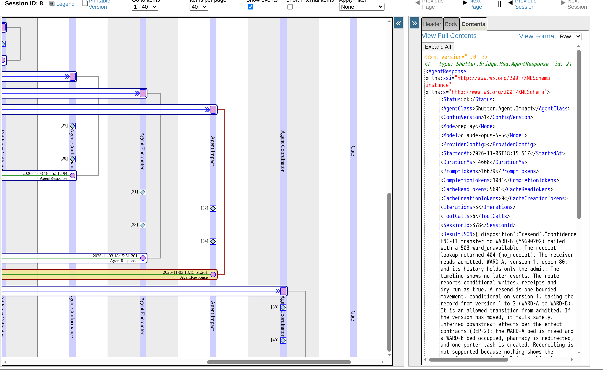
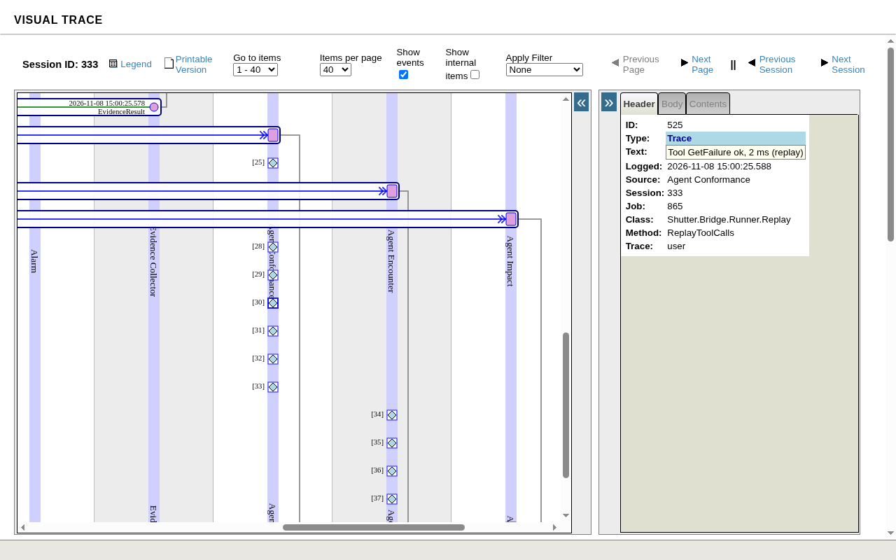

# Tracing AI agents with Interoperability (DPI-I-689)

The walk-through the README's "Tracing AI agents with Interoperability" paragraph summarises, in full. The idea: [DPI-I-689](https://ideas.intersystems.com/ideas/DPI-I-689).

The idea asks whether Interoperability could do the job of a tracing tool such as Langfuse. In Shutter every agent run is a message, so for a workflow in IRIS the production's own trace does that job, with no other service to run; Langfuse does more on evaluations, prompt management and dashboards.

**Follow one decision, step by step,** on your own instance (the replay edition is enough: no key, no cost) or in the online demo's Visual Trace:

1. Open http://localhost:52773/shutter/index.html as `approver` / `shutter`, who may read the traces (`operator` may not). In **Scenarios**, run **S8** in **Board** mode.
2. On S8's case page, **In IRIS: Message trace (session N)** opens the case's session in the Management Portal's Visual Trace (sign in there as `approver` / `shutter` too). Each production item has its own lane: `Case Workflow`, `Evidence Collector`, then `Agent Conformance`, `Agent Encounter` and `Agent Impact` in parallel, then `Agent Coordinator` and the `Gate`.
3. Click an `AgentResponse` arrow. Its contents are the generation: `Model`, `Mode` (live or replay), `PromptTokens`, `CompletionTokens`, `CacheReadTokens`, `Iterations`, `ToolCalls`, `DurationMs` split into `LlmMs` and `ToolMs`, and `ConfigVersion`, a version label set by hand (`"1"` on every board member and on the review and explain agents), not taken from the prompt: recordings carry no digest of the prompt. An `AgentRequest` arrow holds its `Goal` and `Context`, the evidence as sent; a `GateResult` arrow, the gate's `ChecksJSON`.

   

   The diamonds above each response, in the member's lane, are events: one per tool call, in the order the run made them, each a step of its own. A board pass is about 60 items, so set **Items per page** to 75 or more to see the members' responses on the page the trace opens on.
   - **Live:** `Tool GetRoute(...) ok, 120 ms, 845 chars`: the tool, the first 120 characters of its arguments as the model sent them, ok or `failed:` with the error, the milliseconds and the size of the answer. A call the authorisation policy refused reads `Tool GetMessage(...) denied:` with the reason.
   - **Replay:** `Tool GetRoute ok, 120 ms (replay)`: the tool, ok, denied or failed, the recorded milliseconds and the word replay, and nothing of the arguments, the answer or the error, so a replayed run shows the same steps as the live run it was recorded from.

   A replay makes no model call and runs no tool: it writes back the recorded answer, tokens, timings and tool calls, marked replay ([Bridge/Runner/Replay.cls](https://github.com/MxSalata/shutter/blob/main/src/Shutter/Bridge/Runner/Replay.cls)). It shows the gate and the workflow, not the model's quality, which is measured live. To run AI Hub's own agent loop, the evidence tools, the knowledge search and the policies with no model and no cost, [tests/mock](https://github.com/MxSalata/shutter/tree/main/tests/mock) has an API mimic that answers the live runner's model calls; it is in neither IPM module and not in the image, so load it by hand on a test instance.

   

4. In the Management Portal's SQL page (namespace `SHUTTER`), signed in as `_SYSTEM` / `SYS`, run the query below with that session number: every tool call of the pass, in order, with its duration, whether it succeeded, whether the authorisation policy refused it, and the board member that made it.
5. On the case page, **When each agent worked** draws the same rows as a timeline, and the **Settings and costs** page sums them by case.

| Langfuse records | In Shutter |
| --- | --- |
| A trace (one end-to-end run) | The case's session in the Visual Trace, one lane per step and agent |
| A generation (one model call) | One `AgentRequest` and `AgentResponse` pair per run, with the model, the duration and the tokens summed over the run's model turns (`Iterations`), and its cost on the `AgentRun`; Langfuse shows each call separately |
| Tool calls and retrieval | Each tool call, knowledge searches and refused calls included, as a `ToolCall` row and as a step of its own in the trace's log, live through `%AI.Policy.Audit` and in replay from the recording |
| Cost | The **Settings and costs** page and `GET /costs`, by case, review and question |
| The prompt's version | A configuration version set by hand ([Store/BoardMember.cls](https://github.com/MxSalata/shutter/blob/main/src/Shutter/Store/BoardMember.cls), `CONFIGVERSION` on the review and explain agents), in the request and each recording's key; no digest of the prompt, so a changed prompt under the same label replays the old recordings |
| Replay | Recordings keyed by encounter, event, member and configuration version, replayed by CI on every push |

```sql
-- One session's tool calls in order, with the board member that made each (? is the session number)
SELECT t.Seq, %EXACT(t.Name) AS Tool, t.DurationMs, t.Ok, t.Denied, %EXACT(h.TargetConfigName) AS Member
FROM Shutter_Bridge.ToolCall t JOIN Ens.MessageHeader h ON h.ID = t.RunKey
WHERE h.SessionId = ?
ORDER BY h.ID, t.Seq
```

Tokens and cost by board member, model and mode, in SQL: [docs/readme/running.md](https://github.com/MxSalata/shutter/blob/main/docs/readme/running.md#agent-runs-by-board-member-in-sql).
