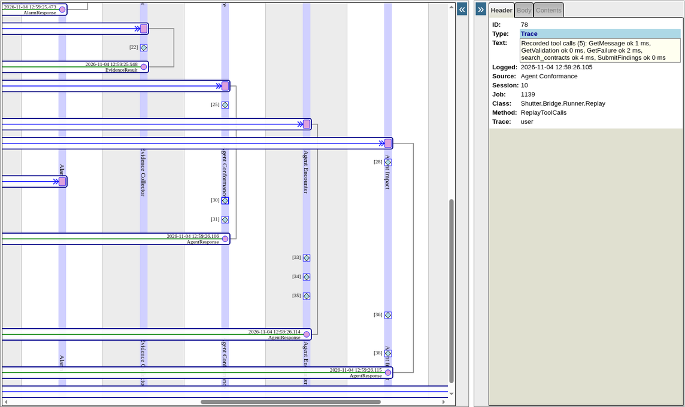

# Tracing AI agents with Interoperability (DPI-I-689)

The walk-through the README's "Tracing AI agents with Interoperability" paragraph summarises, in full. The idea: [DPI-I-689](https://ideas.intersystems.com/ideas/DPI-I-689).

The idea asks whether Interoperability could do the job of a tracing tool. In Shutter every agent run is a message, so for a workflow in IRIS the production's own trace does that job, with no other service to run; a dedicated tracing tool does more on evaluations, prompt management and dashboards.

**Follow one decision, step by step,** on your own instance (the replay edition is enough: no key, no cost) or in the online demo's Visual Trace:

1. Open http://localhost:52773/shutter/index.html as `approver` / `shutter`, who may read the traces (`operator` may not). In **Scenarios**, run **S8** in **Board** mode.
2. On S8's case page, **In IRIS: Message trace (session N)** opens the case's session in the Management Portal's Visual Trace (sign in there as `approver` / `shutter` too). Each production item has its own lane: `Case Workflow`, `Evidence Collector`, then `Agent Conformance`, `Agent Encounter` and `Agent Impact` in parallel, then `Agent Coordinator` and the `Gate`.
3. Click an `AgentResponse` arrow. Its contents are the generation: `Model`, `Mode` (live or replay), `PromptTokens`, `CompletionTokens`, `CacheReadTokens`, `Iterations`, `ToolCalls`, `DurationMs` split into `LlmMs` and `ToolMs`, and `ConfigVersion`, the prompt's version. An `AgentRequest` arrow holds its `Goal` and `Context`, the evidence as sent; a `GateResult` arrow, the gate's `ChecksJSON`.

   

   The diamond above each response, in the member's lane, is an event: in replay it lists the run's tool calls with their durations.

   

4. In the Management Portal's SQL page (namespace `SHUTTER`), signed in as `_SYSTEM` / `SYS`, run the query below with that session number: every tool call of the pass, in order, with its duration, whether it succeeded, whether the authorisation policy refused it, and the board member that made it.
5. On the case page, **When each agent worked** draws the same rows as a timeline, and the **Settings and costs** page sums them by case.

| A tracing tool records | In Shutter |
| --- | --- |
| A trace (one end-to-end run) | The case's session in the Visual Trace, one lane per step and agent |
| A generation (one model call) | One `AgentRequest` and `AgentResponse` pair per run, with the model, the duration and the tokens summed over the run's model turns (`Iterations`), and its cost on the `AgentRun`; a tracing tool shows each call separately |
| Tool calls and retrieval | Each tool call, knowledge searches and refused calls included, as a `ToolCall` row and in the trace's log (`%AI.Policy.Audit`; in replay, one line per run) |
| Cost | The **Settings and costs** page and `GET /costs`, by case, review and question |
| The prompt's version | The agent class's configuration version, in the request and each recording's key |
| Replay | Recordings keyed by encounter, event, member and configuration version, replayed by CI on every push |

```sql
-- One session's tool calls in order, with the board member that made each (? is the session number)
SELECT t.Seq, %EXACT(t.Name) AS Tool, t.DurationMs, t.Ok, t.Denied, %EXACT(h.TargetConfigName) AS Member
FROM Shutter_Bridge.ToolCall t JOIN Ens.MessageHeader h ON h.ID = t.RunKey
WHERE h.SessionId = ?
ORDER BY h.ID, t.Seq
```

Tokens and cost by board member, model and mode, in SQL: [docs/readme/running.md](https://github.com/MxSalata/shutter/blob/main/docs/readme/running.md#agent-runs-by-board-member-in-sql).
